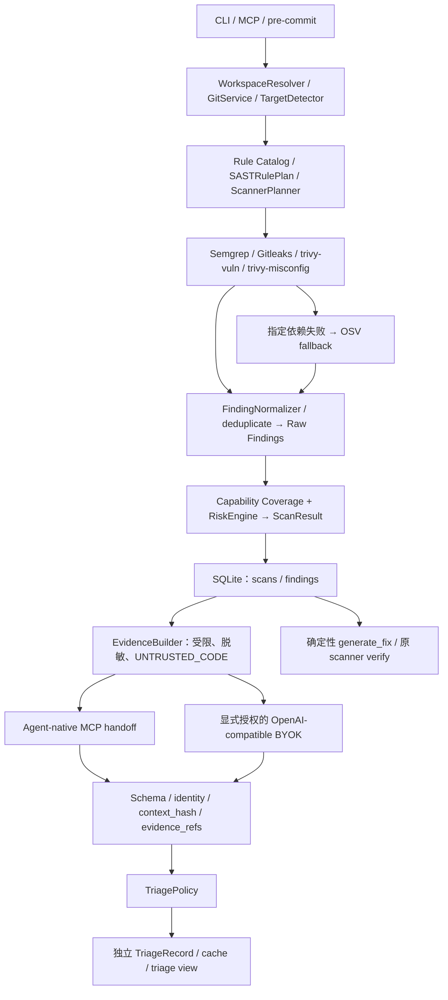

# AI Security Runtime — Architecture

更新：2026-10-02（Asia/Shanghai）。核对分支：`feature/runtime-mvp`；本轮规划基线 HEAD：`7e197443eb4f712d10bc9a61be82c4929b1569da`；代码及既有验收快照：`3d773aaaa1b95b8c7596bf32c77c4bd5eabfd399`。Triage v0.1 最终实现提交：`557052049c74c6d1ca4321c2d9559483a36f55d2`。Runtime 包版本仍为 `0.3.1`，Triage milestone 与包版本不同；本轮没有源码改动。

本文以当前源码为事实依据。项目恢复先读 [PROJECT_STATE](PROJECT_STATE.md)，架构理由见 [DECISIONS](DECISIONS.md)，后续规划见 [NEXT_STAGE](NEXT_STAGE.md)。历史 acceptance 描述各阶段时点，不能把其中“五工具”“尚未实现 AI”直接当作当前状态。

## Implemented：系统与执行链

本地 Python 模块化单体。CLI、MCP stdio 和 pre-commit 共用 `SecurityRuntime`；普通 scan 执行确定性 scanner，不自动调用模型。已有 Finding 可以单独进入 AI Finding Triage & Risk Validation v0.1。没有 SaaS 扫描后端。

主编排在 [runtime.py](../src/security_runtime/runtime.py)，能力选择在 [capabilities.py](../src/security_runtime/capabilities.py) 和 [planner.py](../src/security_runtime/planner.py)。`ScannerRegistry` 注册 adapter，`ScannerPlanner` 选择能力对应且适用的 primary provider。Capability 枚举预留项不代表已经支持。

## Implemented：Scanners、Providers 与 Coverage Contract

| Capability | 默认 adapter / engine | 真实职责 |
| --- | --- | --- |
| CODE_SAST | SemgrepAdapter / Semgrep 1.178.0 | 本地规则与选定文件上的 search/taint 检查 |
| SECRET_SCAN | GitleaksAdapter / Gitleaks 8.30.0 | 独立 Secret 检查，使用 `--redact=100` |
| DEPENDENCY_VULN | trivy-vuln / Trivy 0.74.0 | 只启用 `--scanners vuln`；按策略切换 OSV |
| IAC_MISCONFIG | trivy-misconfig / Trivy 0.74.0 | 只启用 `--scanners misconfig`，不准备漏洞数据库 |
| DEPENDENCY_VULN fallback | OSVDependencyAdapter / OSV-Scanner 2.6.0 | ON_DEMAND / FALLBACK，独立记录库存和覆盖契约 |

四个默认 primary adapters 共用三个主引擎；OSV 位于独立 `fallback_adapters`。Trivy 两项执行独立并发，共享引擎准备事务串行。默认 Trivy 不提供 Secret、Container、SBOM 或 License 扫描能力。安装的 Python scanner plugins 是受信任代码，不受操作系统沙箱隔离。

`ScannerRun` 记录 provider、capabilities、provider_role、coverage_contract、coverage_notes、诊断、rule_coverage 和 dependency_inventory。`ScanResult.capability_results` 表示最终能力状态，`capability_details` 保留 active provider、coverage 和 primary 失败原因。ProviderRole 支持 PRIMARY / FALLBACK / SUPPLEMENTAL / USER_PROVIDED；不等于每种角色均有默认实例。

依赖聚合以能力契约为准：至少一个 SUCCESS + FULL provider 才建立 EXECUTED；SUCCESS + PARTIAL 只能建立 PARTIAL。回退满足 FULL 时，历史 primary 失败不单独拖低该能力；两者诊断仍保留。Secret 与 IaC 不受 Trivy vuln 失败牵连。

`should_fallback()` 仅接受明确白名单，如 MAVEN_RATE_LIMITED、指定网络/解析错误、引擎或漏洞库不可用。校验失败、边界违规、配置错误、TLS 错误、未知错误不能通过回退掩盖。健康 primary 零 OSV 准备/调用；fallback 不递归回退。

OSV 使用已验证依赖快照、Runtime 空配置、限定 lockfile 插件、`--no-call-analysis=all`。FULL 要求全部计划输入有可信库存确认且无未支持输入、未知版本或解析警告；POM / requirements / go.mod 不证明完整图，保守 PARTIAL。离线使用本地引擎/数据与 `--offline --no-resolve`，不下载或在线查询。

源码：[scanners.py](../src/security_runtime/scanners.py)、[dependency_fallback.py](../src/security_runtime/dependency_fallback.py)、[osv.py](../src/security_runtime/osv.py)、[models.py](../src/security_runtime/models.py)。验收：[OSV_DEPENDENCY_FALLBACK](OSV_DEPENDENCY_FALLBACK.md)、[TRIVY_CAPABILITY_DECOUPLING](TRIVY_CAPABILITY_DECOUPLING.md)。

## Implemented：Rule Coverage

`RulePackManager → Rule Catalog → SASTRulePlan` 在引擎准备前确定适用规则、语言和文件。Catalog 与 YAML 交叉校验身份、metadata、provenance、许可及 fixture。默认 `ai-security-core 1.1.0` 有 24 条 BETA 规则：Java 22（21 Java AST + 1 MyBatis mapper XML）、Python 2。Java 有 12 个 catalog 类别，7 search / 15 taint；没有 compiler-grade 跨文件可达性能力。

执行覆盖依据本次 Semgrep `time.rules`、`paths.scanned`、errors 与 skipped_rules，不用 exit 0 或 findings 数替代。零适用规则：NOT_COVERED，零 ensure / 零 invocation。NOT_APPLICABLE 表示不适用；UNAVAILABLE 表示引擎不可用。

Jeepay 最新保存结果：650 项目文件，Java 22/22/22 available/selected/executed，548 Java/XML SAST 文件 EXECUTED；JavaScript 10 文件、0 规则 NOT_COVERED，CODE_SAST=PARTIAL。FULL 仅表示计划内契约满足，不能推导仓库没有漏洞；代码检查不适用而其它适用检查完成时可为 SCOPED。无变更为 NO_CHANGES / NONE / NOT_ASSESSED。

源码：[rule_catalog.py](../src/security_runtime/rule_catalog.py)、[rule_coverage.py](../src/security_runtime/rule_coverage.py)、[rulepacks.py](../src/security_runtime/rulepacks.py)、[sast.py](../src/security_runtime/sast.py)。细节与历史验收：[RULE_COVERAGE](RULE_COVERAGE.md)、[JAVA_RULES_ACCEPTANCE](JAVA_RULES_ACCEPTANCE.md)。

## Implemented：Raw Finding 与独立 TriageRecord

Raw Finding 是 normalizer/dedupe 后的 scanner 候选，保留 severity、scanner confidence、位置、来源和 technical_details；不等于原始 scanner stdout，也不等于已确认漏洞。`RiskEngine` 仍独立产生 SAFE / REVIEW / BLOCKED：HIGH/CRITICAL 且 HIGH confidence，并有 evidence 或多来源时 BLOCKED；有候选或覆盖不完整时 REVIEW；完整且无候选时 SAFE。Triage 不重写原 severity、scan coverage 或 release_status。

[triage_models.py](../src/security_runtime/triage_models.py) 定义独立 `TriageRecord`：scan/finding identity、fingerprint、verdict、confidence、exploitability、reason、attack_path、evidence_refs、已满足/未知前提、建议、provider 身份、prompt_version、context_hash、priority、status、policy_notes、时间。Verdict 五种：CONFIRMED / LIKELY / NEEDS_REVIEW / UNLIKELY / FALSE_POSITIVE；exploitability 独立使用 CONFIRMED / LIKELY / CONDITIONAL / UNLIKELY / UNKNOWN。

[triage.py](../src/security_runtime/triage.py) 的 `TriageService` 提供 prepare / submit / view / run。提交校验完整批次的 schema、scan membership、重复 ID、当前 context_hash，以及引用是否落在实际交付的文件/行范围；CONFIRMED / LIKELY 必须有引用。范围合法不等于 claim 的语义已经被确定性证明。模型输出不会作为命令执行。

`TriagePolicy` 最终决定显示优先级：

| 条件 | Runtime 结果 |
| --- | --- |
| CONFIRMED，或 HIGH confidence 的 LIKELY；原 severity 为 MEDIUM/HIGH/CRITICAL；exploitability 为 CONFIRMED/LIKELY | ACTIONABLE |
| UNLIKELY | LOWER_PRIORITY，Raw 仍保留 |
| FALSE_POSITIVE + HIGH confidence + 引用覆盖明确反证 + 无未知前提 | SUPPRESSED，Raw 仍保留 |
| 其余有效记录 | REVIEW |

v0.1 自动可核验反证仅支持严格完整赋值中的固定 placeholder 字面量。文档/test/example 位置、项目公开、没有搜到 API 或模型的自然语言理由均不足以压制；FALSE_POSITIVE 证据不足时降为 NEEDS_REVIEW。依赖记录的 CONFIRMED/LIKELY exploitability 强制降为 CONDITIONAL，bounded manifest/context 不证明 reachability。

IaC 不进入 v0.1 AI Triage，另按明确 rule ID 分类：DS-0002 / DS-0029 为 HARDENING，DS-0022 / DS-0025 / DS-0026 为 BEST_PRACTICE，其它保守为 SECURITY_MISCONFIGURATION。Jeepay 14 条为 5 HARDENING + 9 BEST_PRACTICE，均 UNTRIAGED。依赖按 ecosystem / package / version / manifest 分组，全部 advisory 可展开；当前 88 条形成 28 组。

## Implemented：EvidenceBuilder、安全边界与 Cache

正式证据构建在 [triage_evidence.py](../src/security_runtime/triage_evidence.py)。只从该 ScanResult 的 target_profile.files 读取，拒绝绝对/越界路径及 symlink/junction；单文件读取上限 1,000,000 bytes，拒绝 binary。提供 Finding 周边、imports/class/method、同文件 use、有限词法引用及分类 enrichment；词法检索不证明调用链。

默认预算：每文件 120 行、最多 5 个关联文件、每 Finding 完整序列化 packet 32 KiB、最多检索 200 候选文件/256 KiB、每批 20 Findings、并发 1、provider timeout 30 秒、response 64 KiB；BYOK 总请求另限 256 KiB。超过预算或证据不可用时返回 evidence error，不把失败判成安全。

已识别 Secret 的匹配行整行替换为 `[REDACTED_SECRET]`；相邻字面量、长 token 和返回文本保守脱敏。Packet、模型返回、日志和 SQLite 的出口均有保护与测试；provider error 不保存原 body/request。API key 仅用于配置 endpoint 的 Authorization，不进入 evidence 或 TriageRecord。此机制不能证明任意未识别 Secret 都绝不泄漏。

源码、注释、README、config、Skill 和 scanner 文本是 UNTRUSTED_CODE。固定 instructions 不接受其中指令；schema 拒绝 shell/network/hide/block 等字段；Runtime 不向 Triage 模型提供任意工具、shell 或环境读取权限。宿主 Coding Agent 的其它工具权限由宿主控制。

Cache key 含 finding fingerprint、packet context_hash、provider_type/name/model 和 `triage-v0.1.0` prompt version。Packet 的 opaque keyed revision 使脱敏前相关源码/Secret 变化也改变 hash；随机 HMAC key 保存在 state 的 `triage-evidence.key`，不进入 packet。源码/context 或 prompt 改变、workspace 消失使旧记录 STALE；provider/model 身份改变不能命中同一 cache key。读取 triage view 可持久化 STALE 状态，prepare 可写 cache 复用记录，不能将这些操作描述为纯只读。无关仓库内容不会简单触发整仓 hash 失效。

## Implemented：Agent-native、BYOK 与八个 MCP 工具

[triage_providers.py](../src/security_runtime/triage_providers.py) 的正式接口为 `AIProvider.triage`。AgentNativeProvider 仅描述宿主交接，Runtime 无法主动调用 Host 模型；`prepare_triage → 宿主分析 → submit_triage` 是实际路径。`is_external=False` 表示 Runtime 没有直接发起外部 AI HTTP，不代表宿主模型必然本地运行或没有自己的数据策略。

BYOK `OpenAICompatibleProvider` 使用标准库请求 `/chat/completions`，要求 JSON schema structured output，再由 Runtime 校验。`ai configure` 只保存 base_url/model/provider/API key 环境变量名；值从用户环境读取。`triage --provider configured` 必须显式带 `--allow-external-code-context`，配置本身不授予上传权限，CI/非交互同样 fail closed。HTTPS 必需，loopback HTTP 仅作为例外；URL 不含 userinfo/query/fragment，不跟随 redirect。`SECURITY_RUNTIME_OFFLINE=1` 拒绝非 loopback provider。当前 BYOK 真实协议验收是 loopback 假服务器，未测公网模型质量。

同一依赖组在 BYOK 中共享 context 并 batch 返回；每条仍校验独立 ID/hash/引用。普通 scan 不走上述两条模型路径。

[mcp_server.py](../src/security_runtime/mcp_server.py) 当前正式注册 **8 个工具**：

| Tool | 职责 |
| --- | --- |
| scan_diff | quick/feature Git 变更扫描 |
| scan_project | release 项目扫描 |
| get_findings | 完整原候选列表的 agent projection，附加 triage 状态；不因 suppression 删除项 |
| generate_fix | 生成确定性修复任务，不调用 LLM、不改源码 |
| verify | 受影响文件上的原 scanner 复查 |
| prepare_triage | 返回受限脱敏 packet/schema/instructions 与 handoff session，不调用模型 |
| submit_triage | 验证交接、结构/引用与 policy，保存独立记录 |
| get_triage | coverage、逐项记录及分组视图；可标记并保存 STALE |

当前 stdio server 在内存保存 handoff 的 scan ID、finding IDs/hash；15 分钟过期，最多 64 个 session。成功提交消费对应项，拒绝重放。配置 WorkspaceBinding 时，scan/finding/handoff 被约束到连接的 workspace；未绑定连接不提供这一隔离，不能称多租户服务。

`verify` 仅枚举 primary adapters，OSV-only origin 通常返回 UNKNOWN；文件删除有直接 RESOLVED 路径，位置 fingerprint 消失不是业务漏洞修复证明。MCP 返回 compact scan/coverage/provider 数据，不使用 CLI progress renderer，stdout 保持 SDK JSON-RPC。

## Implemented：当前展示与用户流程的边界

[human.py](../src/security_runtime/human.py) 的 render_triage 展示 coverage、priority、逐项 verdict/reason/exploitability、证据位置、依赖分组及 IaC 分类。当前将有效 AI 分析记录写为“已验证”；其技术含义是记录通过 Runtime 校验，不是人工验证、漏洞复现或线上可利用证明。该用词尚未在代码中修正。

当前没有开发者任务单、当前 workspace 最新扫描的 MCP 汇总入口或内置的继续核查流程。宿主 Agent 可在另获/已有授权范围内阅读源码，但其额外分析不是 Runtime 的确定性检查，也不自动进入受 hash/session/引用约束的 TriageRecord。已有 EvidenceBuilder 的有限词法关联不提供 compiler-grade 调用链。用户提供的 Jeepay 宿主调用链报告按 PROJECT_STATE 的来源说明保留，不能提升 scan/triage coverage。

## Implemented：Progress、Diagnostics、Storage 与 Packaging

ProgressEvent / ContextVar reporter / heartbeat / checkpoint 与外部进程取消已实现，包含 scan、engine、fallback、triage 生命周期。CLI 进度仅 stderr，JSON 结果仅 stdout；`--no-progress` 关闭 renderer，致命错误仍可写 stderr。事件不默认持久化或上传，不制造百分比。Diagnostics 保存限长脱敏的标准错误、来源 host、retry-after 和 proxy configured 状态。来源：[progress.py](../src/security_runtime/progress.py)、[cli_progress.py](../src/security_runtime/cli_progress.py)、[diagnostics.py](../src/security_runtime/diagnostics.py)、[processes.py](../src/security_runtime/processes.py)。

[storage.py](../src/security_runtime/storage.py) 保留 `scans(id,data)`、`findings(id,scan_id,data)`，通过 CREATE TABLE IF NOT EXISTS 加法增加 `triage_records` 和 cache index，不迁移/搬移旧数据库。Triage 路径不改写或删除 scans/findings；但它们仍用 INSERT OR REPLACE，并非数据库级 immutable audit log。全局 finding ID lookup 可被后续 scan 替换，scan JSON 保留当次候选；TriageRecord 按 scan/finding/cache key 保存。整批先校验，再逐记录事务写入，不是整批数据库事务。没有 retention/TTL 清理或多租户实现。

| 本地资源 | 配置 / 默认位置 |
| --- | --- |
| scans.db、ai.json、triage-evidence.key | SECURITY_RUNTIME_STATE_DIR；否则 Windows LOCALAPPDATA/AI Security Runtime；其它平台 XDG_STATE_HOME 或 ~/.local/state 下的 ai-security-runtime |
| managed engines、漏洞数据、plugins | SECURITY_RUNTIME_DATA_DIR；否则 Windows LOCALAPPDATA/AI-Security-Runtime；macOS ~/Library/Application Support/AI-Security-Runtime；Linux XDG_DATA_HOME 或 ~/.local/share 下的 ai-security-runtime |

这两套目录不是同一路径，Git clone 不携带用户 DB、HMAC key、API key、engine cache 或项目源码。Finding fingerprint 包含 workspace 根路径，跨设备不保证 ID/cache 通用。权限保护不能抵御已控制同一用户账户的攻击者。

[workspace.py](../src/security_runtime/workspace.py)、[target.py](../src/security_runtime/target.py)、scoped snapshots 和参数数组约束目标输入；`run_process` 有 timeout/output cap，是进程管理器而非 OS sandbox。默认扫描与 triage 不自动执行被扫项目 Maven/Gradle/npm/pip/go 构建或安装。普通 scan 无模型上传，但工具下载、数据准备或在线依赖解析仍可能联网。

wheel/sdist 与 PyInstaller onedir 已实现；Windows x64、Linux x64、macOS x64/arm64 工作流有原生归档验收。Scanner engines 单独按需安装，不捆绑在 Runtime 包。规则、法律声明、四个 triage 模块及 source commit/artifact 完整性有分发门禁。最近实现提交的 382 passed / 6 skipped / 6 subtests、74 项 Triage 定向测试、四组 CI 及 native BYOK/MCP 证据记录于 [AI_TRIAGE_ACCEPTANCE](AI_TRIAGE_ACCEPTANCE.md) 和 [triage-delivery-evidence.json](triage-delivery-evidence.json)，属于既有验收，本轮未重跑构建或模型。

## Planned：AI Triage Quality Validation & Developer Guidance

用户已确认下一阶段路线，详细范围与验收见 [NEXT_STAGE](NEXT_STAGE.md)；本轮只更新文档。新增能力均未实现，当前八个工具、Raw/Triage 分离、覆盖契约、TriagePolicy 和授权边界仍以以上 Implemented 部分为准。

| 迭代 | Planned 内容 | 本轮边界 |
| --- | --- | --- |
| 1：开发者任务入口 v0.1 | 当前 workspace 的扫描定位、纯只读汇总、保守任务投影、普通/详细视图、准确状态与来源、明确下一步；建议 MCP 名称 get_security_summary | 无新工具、数据模型或展示代码；不自动核查、修改 priority 或执行修复 |
| 2：继续核查 | 宿主沿任务推进已有 MCP handoff、选取待分析项、补充受限证据，先核对源码可回答的事实，再问必要业务问题 | cache/batch 推进调整和来源导入契约未开发；不是自动 compiler-grade 调用链 |
| 3：修复与验证 | 可审阅补丁、兼容性说明、授权后的编辑与验证、执行状态与剩余条件 | 现有 generate_fix / verify 不等于完整修复流程 |

首轮建议以现有记录建立展示投影，不另建持久化任务数据库；合并任务保留每条 Finding/Advisory 的独立身份及状态。Runtime priority 与建议跟进动作分别表达，REVIEW 可以对应“核查影响”，不升级为 ACTIONABLE。模型叙述或引用合法不等于事实语义已经证实；扫描器候选、Runtime 接受的 AI 审阅与宿主补充核查需区分，额外源码分析不能伪装为已接受 evidence_refs。当前没有通用宿主补充报告的持久化/导入接口。

只读汇总还需设计不写入的 freshness/投影路径；现有 TriageService.view 可持久化 STALE，直接包装不能满足纯只读目标。自动定位扫描须按明确 workspace 约束，不用全局最新记录，不静默启动扫描；旧 MCP 工具仍无 latest 别名。

独立质量工作协同开展：固定 Jeepay benchmark 身份、独立人工标注、版本化 ground truth schema、五类 verdict 一致标准、Agent-native/BYOK 模型比较、suppression risk、precision/agreement 和 prompt/model regression。已提交的 26 项脚本回放与用户提供的另一组实际宿主报告分别保留 provenance；均不能当独立人工真值。三位未参与开发的开发者试用仅评价易用性，不能换算安全准确率。任务入口完成不代表质量阶段完成。

Joern Java PoC 必须在质量门槛通过后单独评估。Joern、compiler-grade dataflow、完整 Maven reachability、主动 AI 全仓审计、自动构建、自动修复、retention 与云服务均未实现。`privacy.py` 的旧 ContextProvider/LocalContextProvider/AIProvider.generate_fix 没有接入当前 Runtime；正式 Triage 使用 EvidenceBuilder 与新的 provider 接口。
