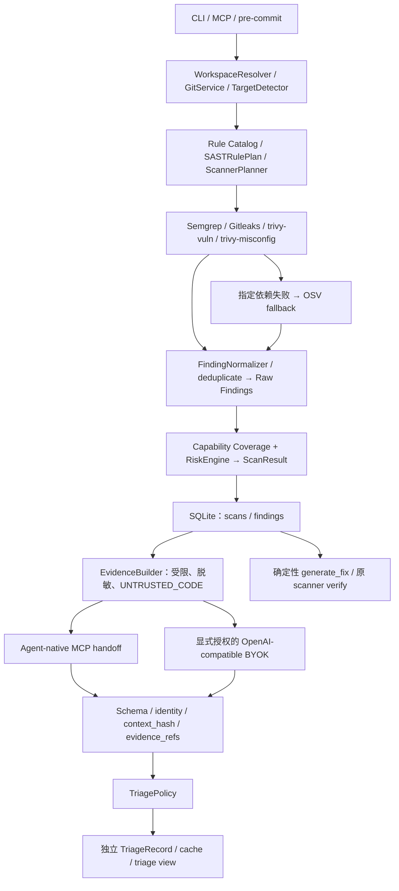

# AI Security Runtime — Architecture

## Current milestone — R0, 2026-10-07

R0 Rule Program v1 + Java High-Confidence Pack = IMPLEMENTED / LOCAL VERIFIED
in the uncommitted `feature/runtime-mvp` working tree. This current block
supersedes older roadmap/status entries below; historical evidence is retained.
See [Rule Program](RULE_PROGRAM.md), [coverage matrix](RULE_COVERAGE_MATRIX.md)
and [complete acceptance](rule-program-acceptance.md).

Cursor Host Adapter v1 detection, first-scan attribution, Finding/Policy and
Advisory Remediation = COMPLETE / DESKTOP VERIFIED from the user's observed
Desktop evidence. Native user-visible feedback is
HOST_CAPABILITY_UNAVAILABLE_ON_OBSERVED_PATH (Cursor 3.22.12 afterFileEdit path,
postToolUse NOT OBSERVED); automatic continuation is PENDING_HOST_CAPABILITY.
Do not describe the entire detection Runtime as PARTIAL. Production setup has
sessionStart/afterFileEdit/afterShellExecution/stop only. Signed old probe/fifth
entries migrate safely; custom user entries remain. No new pending feedback
delivery is created by this path; generic presentation storage is dormant.

10 product capabilities: 2 CORE (TLS + Gitleaks Secret), 8 VALIDATED (SQLi,
command injection, SSRF, path traversal, arbitrary read/write, XXE,
deserialization). Java Core Pack v1 and Validated Java Pack v1 are explicitly
separate tiers. VALIDATED detection/guidance is default-on and labelled;
8 retained unrelated legacy Java EXPERIMENTAL rules are default-off. The two
legacy Python rules remain default-on for compatibility. 19 owned Java/XML
Semgrep variants (18 for Java-only files); 29 installed rules including legacy.
No provider-owned Gitleaks rule-count or new automatic fixer is inferred.

Final actual managed corpus: 71 synthetic cases, 46 TP /28 TN /0 FP /0 FN.
These author-declared labels are not independent human or production-grade
ground truth. Findings retain source/sink/basis/location/underlying identity
and explicit limitations. MyBatis interpolation is structural with unknown
parameter trust. Read/write is primary at an overlapping traversal sink.
Capability variants share canonical Family identity; real absence proof must
execute all applicable variants. TLS original bytes/identity, Secret detector
identity, Episode/budget/opaque refs/receipts and Core-vs-Deep boundaries remain.
Historical non-TLS raw-rule identities are not silently migrated or retargeted.

Focused: 306 passed, 6 subtests passed in 460.88s (0:07:40). Full offline: 1783 passed, 9 skipped, 6 subtests passed in 2326.45s (0:38:46); skipped reasons are individually
listed in [regression](rule-program-regression.json). Actual local MCP TLS
inline/envelope/proof/CLOSED and recurrence PASS. Isolated offline wheel
installation and simulated Cursor native command+real Scanner PASS.
Wheel/sdist integrity/compliance PASS; 93 runtime Python modules and formal
rule data byte-equal; manifest/corpus/new tests included and probe code absent.
Fresh R0 Desktop NOT_RUN; historical actual Desktop results remain separate.

No commit/push, active Runtime replacement, actual user `.codex`/Cursor change,
model invocation, target build, dependency download or new scanner. Starting
and current HEAD: `ee1bfd9c12493683cc313cb3628753a51ae124ac`. Prior dirty work preserved by snapshot/diff audit.
Next recommendation is wider labelled OSS/internal FP/FN corpus and independent
review before CORE or automatic-fix graduation; no next implementation stage
has started. Cursor UI/continuation workarounds and new Hosts remain deferred.
Deep/Plus/Maven environment/human trials retain their prior Pending/Planned
state. Capability does not imply execution on the default Hook.

## P0-10.1 Cursor Visible Security Feedback

P0-10.1 adds a signed bounded presentation-only outbox and separate postToolUse Write delivery path. afterFileEdit retains Core; postToolUse never dispatches/scans. Cross-process waiting has no held lock; no security authority is created.

See [acceptance](cursor-visible-feedback-acceptance.md) for binding, bounds, privacy, native race evidence and manual UI trial.

## P0-9.6 — Policy and execution capability separation

RemediationConfig 是用户偏好存储，通过 read()/managed_paths()/revision() 提供 policy 输入和原确认绑定；RemediationTransportConfig 独立表达 supports_advisory_remediation/supports_agent_continuation/supports_write=false。默认 live transport 保留 Codex 原 grant/inline Ticket/Envelope/proof 闭环；advisory-only 路径不创建自动修复 authority 或新 Episode。

共享 normalized dispatcher 将已有 VerifiedHostContext 传入 remediation。Advisory 必须逐一验证 canonical root/host/session，缺失或不匹配 fail closed，不借 config.path/cwd 推导 workspace。原 scan/task/Finding resolution 再核对 scope。复用 TaskFixService resolver + task_fix.PLANS 做有界 informational advisory，原 opaque task_ref 保留，任意 Scanner prose/source/Host IDs/Secret 不复制。

新六项 diagnostics 仅 closed enum/bool 经既有 bounded SQLite recent 跨进程读取。Cursor post-edit output schema 保持 {}，不新增虚构 context/followup；Runtime structured OFFERED 与 Host 展示/自动 continuation 区分。Policy decide、attribution、Family/Episode/receipt/proof 不变。

## P0-9.5 — Shared first-scan presence attribution

仅在可信 COMPARISON_BASELINE 且 filesystem digest delta 后、当前 targeted scan 有 family 时进入归因。filesystem baseline 没有安全 Finding，不能直接当“原本无风险”。旧字节从既有 Git index/HEAD 恢复，workspace key/file identity/HMAC 必须等于 pre-edit snapshot；不存在 byte archive，也不更新 SessionStart。

first_scan_attribution 复用原 SemgrepAdapter / FindingNormalizer / RulePlan 与 covered()。同一 bundled rule pack、选中规则、版本与 normalization；启动前已有 ToolManager probe identity 经临时 ContextVar 收集（线程 copy_context 继承），在 current/pre scan 前后校验引擎 content identity，源字节前后稳定才提交原 HookSnapshot。safe first edit 不增加额外扫描或 probe/hash。

临时树只含当前风险的 changed files，relative identity 不变，真实 source 不写入；16 targets、1 MB/file、4 MB combined、bounded line matching、既有 process timeout。旧 occurrence 的未变 source span 映射到新行号后做 one-to-one matching，模糊/改写旧 span 保守 inconclusive。首次成功归因后完全走原 family_delta / Policy；同 family 新实例仍为 additional_occurrences，而非新造 family。

失败不推进 comparison snapshot/pending completion；当前真实 scan candidates 仍可审阅，但没有 NEW 或修复授权。所有新增 diagnostics 是 enum/bool/count/monotonic duration，由既有 bounded SQLite recent 保存；不保存源码、snapshot bytes、Git blob、scanner identity 原值、Secret。Cursor command 独立 policy config.path 问题保持冻结并单独记录。

## P0-9.4 — Cursor Event Lifecycle + Baseline Ordering

Cursor ingress 仅移除 SessionStart scanner-seed 前置并选择内部 lifecycle=True；normalized kind 真正 dispatch 到同一 HookCoordinator 的 SESSION_BASELINE / WORKSPACE_RECONCILIATION / SESSION_FINALIZATION。现有 capture_snapshot、validate_state、Family multiset/delta/covered AST 不变，既有 Codex/MCP/Stop continuation 兼容。SessionStart 两次稳定 bounded HMAC capture + fsync/replace；重复开始保留旧 point。comparison point 不是 clean security proof。

跨进程复用 OS workspace lock、10秒有界等待，SQLite pending-activity.db 最多64 pending session，只有hash+opaque arrival nonce，条件清除防止擦除新 arrival。超时持久 pending、明确 retry；没有后台调度保证，无 Stop scanner。failed/incomplete/moving-source 不推进 completed snapshot。只有当前 digest delta + required family paths 入 scope，不把未变化 dirty inventory 扫一遍。

本轮只修 Cursor normalized lifecycle / baseline publication / 跨进程 ordering；用户最新真实 Desktop 已确认 P0-9.3 claims、anchor、generation、relative roots、file containment 通过，这些代码冻结。Cursor 新 lifecycle 真实 Desktop PENDING_USER_RETEST，不执行新 Desktop E2E。focused 343 passed / 331.23s；完整 offline regression PASS：1687 passed, 9 skipped, 6 subtests passed in 2141.83s (0:35:41)；skipped 单列，不计为通过。 installed native command + managed offline Scanner PASS / 37.76s，临时 venv 借用已有依赖；Codex local MCP + managed offline Scanner 两轮 recurrence PASS / 37.39s（模拟 Host、实际 MCP/Scanner，非 Desktop）。wheel/sdist/integrity/compliance PASS，88 module bytes 对照；最终 docs 后再构建核验。不 commit/push、不改真实 .cursor/.codex、不替换活动 Runtime；前序未提交工作和文档历史保留。详见 [P0-9.4 验收](cursor-event-lifecycle-acceptance.md)。

## P0-9.3 — Cursor workspace anchor compatibility

用户新增真实 Desktop evidence 已定位：workspace_roots shape VALID，但 POSIX 形态在 Windows 非 absolute、无 drive，旧实现先把 event root 当主路由调用严格 resolver，于 PATH_SHAPE/RAW_PATH_NOT_ABSOLUTE 拒绝；部分 sessionStart 合法空列表也曾提前拒绝。这取代 P0-9.2 对历史 raw shape 无法确定的结论。2026-10-07 重新核对 [Cursor 官方 Hooks](https://cursor.com/docs/hooks)：CURSOR_PROJECT_DIR Always Present/workspace root，afterFileEdit file_path absolute。

本轮仅 Cursor ingress：CURSOR_PROJECT_DIR 是 required strict canonical anchor；workspace_roots 仍 required typed/bounded string[]，empty 是 EMPTY_HOST_LIST，single native-relative 是 UNVERIFIED_RELATIVE，仅 metadata，不做 cwd/拼接/猜测/文件探测；single absolute 独立 canonicalize 并必须 MATCHED；multi-root 仍 CURSOR_MULTI_ROOT_UNSUPPORTED。anchor 缺失/invalid、来源冲突、file outside/nested/link、session cross-workspace 全部 fail closed。generation contract / CursorBindings / Core / Codex / scanner / remediation / Ticket / Exact Envelope / installer / shared resolver 不变。

新增闭合 enum/bool diagnostics：cursor_workspace_anchor、cursor_project_dir_valid、workspace_roots_state、workspace_root_relative、workspace_root_corroboration、file_path_absolute、workspace_binding_reason，复用原 prefix absolute/canonicalized/hash 与现有跨进程 bounded recent SQLite；无 raw path/env/root/ID/source/command/input/output/transcript/Secret 持久化。绝对来源冲突的诊断现在分区到已验证 anchor，不向旧 event-root 路由。

新增 25 cases；targeted 124 passed / 80.24 s，focused 254 passed / 261.39 s；full 1672 passed, 9 skipped, 6 subtests passed in 2110.34s (0:35:10)；离线 wheel/sdist/package integrity/compliance PASS。真实 Desktop PENDING_USER_RETEST，本轮不进行新 Desktop E2E；Cursor live continuation 仍 Pending。后续阶段仍 Planned。详情与最终证据见 [P0-9.3 验收](cursor-workspace-anchor-acceptance.md)。不 commit/push，不修改真实 .cursor/.codex，不替换活动 Runtime；前序未提交工作和文档历史保留。

## P0-9.2 — Cursor real SessionStart / workspace resolution

用户新增真实 Desktop 证据明确 sessionStart generation_id 是空字符串、后续 generation 有效；旧 common nonempty 校验因此拒绝 SessionStart。本轮按事件修正：sessionStart 以合法 session_id=conversation_id+workspace 建立 baseline，absent/exact-empty generation 标 NOT_YET_AVAILABLE；wrong type/oversized/control/Unicode/whitespace-only 仍拒绝，post/stop 仍要求有效非空 generation。signed CursorBindings 增加 bounded generation hashes：OBSERVED/UNCHANGED/UPDATED；合法新消息不视为 replay，cross-workspace session 仍拒绝；generation 不是 invocation/authorization。兼容旧三-key state，新 state 的旧 reader 会 fail closed，不与旧活动 Runtime 共享 candidate state。

真实 workspace 旧记录在 WORKSPACE_ROOTS 前 canonical identity 为 null；旧 generic code 对应 raw path admission/directory handling，不能归因于 generation 或 env source comparison。历史 raw path shape 没有留存，精确 predicate 仍 UNDETERMINED_FROM_RETAINED_DIAGNOSTICS。Project F 给定标准 Windows root 的 native/slash/case/trailing/subdir 只读 probe 全部 OK、同 canonical identity、没有 ownership 错误；不等于重构历史 claim。新增 Cursor-only preflight 分 path/filesystem/boundary/Git/shared resolver；先无 safe.directory override 只读 probe，dubious ownership 精确拒绝、不得 fallback，不修改 Git trust；共享 resolver/Git/Core/Codex 不变。event root primary+env independent corroboration，no cwd fallback；FILE_URI 明确 reject，nested/outside/link/session mismatch 保持 fail closed。

新增 safe path-shape/Git/status/step/reason 与 generation observation diagnostics，沿现有跨进程 bounded recent SQLite，不保存 raw path/ID/command/tool_input/source/output/transcript/Git stderr/Secret。新增 37 cases；targeted 124 passed，首轮仅两项新测试 state 属性断言错误已修正；最终 focused 265 passed；full offline PASS：1647 passed / 9 skipped / 6 subtests passed（skipped 单列）；native installed command/Scanner PASS 46.99s、Codex MCP regression PASS 40.18s，结果见 [P0-9.2 验收](cursor-session-workspace-acceptance.md)。package integrity/compliance PASS；真实 Desktop PENDING_USER_RETEST，continuation 原 Pending。无 commit/push/真实 .cursor/.codex 修改/活动 Runtime 替换/新 Desktop E2E；前序未提交与文档历史完整保留，本轮后停止。

## P0-9.1 — Cursor schema / workspace compatibility

Hook delivery 四事件已按用户真实 Desktop 证据 VERIFIED；本轮不重新调查 launcher，不运行新 Desktop E2E。旧代码没有 UUID/hex 校验，也未用 process cwd 做 root：它使用 event workspace_roots 并互证 CURSOR_PROJECT_DIR。原 identity 校验的 `${` 模板限制不适合 native opaque 字符串，已移除；保留非空/原始长度 500/类型/控制字符/Unicode 边界。null workspace_roots 在旧 shape guard 漏判现已 fail closed；0/multi-root 不猜 root。canonical resolver、conversation binding、filesystem digest、Core/Scanner/Policy/Ticket/Envelope/Codex 均不变。

新增安全诊断区分 generation 类型/存在/裁剪长度/原因，root count/shape，workspace source、env corroboration、canonical hashes、resolution stage、file containment。source mismatch / nested file-root mismatch 使用 Cursor 专属 fixed reason；先解析到 root 的拒绝可在该 root diagnostic 分区查询，无注册/扫描/授权。无 raw ID/path/command/edits/source/transcript/secret 持久化。Project F root/src/Java 子目录只读解析同 identity；历史失败行缺少具体 generation/source 元数据，精确真实原因仍 UNDETERMINED_FROM_RETAINED_DIAGNOSTICS，不伪称 UUID/cwd 根因。空 generation 仍拒绝，不绕过 claims。

新增 28 cases；首轮 targeted 112 passed / 74.97s。最终 focused 243 passed；full offline PASS：1610 passed / 9 skipped / 6 subtests passed，skipped 单列，结果见 [验收](cursor-schema-compatibility-acceptance.md)。真实 Desktop compatibility PENDING_NEXT_USER_RETEST，Cursor continuation 保持 Pending；不 commit/push/修改真实 .cursor 或 .codex/替换活动 Runtime。前序成果保留，不扩展后续阶段。

## P0-9 — Cursor Host Adapter v1

P0-7/P0-8 已按用户新增的真实 Codex Desktop TLS 验收封版（USER_REPORTED_DESKTOP_VERIFIED），与本轮 local fixture 分开。P0-9 当前 IMPLEMENTED / LOCAL VERIFIED，真实 Cursor Desktop PENDING。仅四个官方事件：sessionStart / afterFileEdit / afterShellExecution / stop → CursorHostEventAdapter → P0-8 NormalizedHostEvent → 原公共 dispatch / HookCoordinator；不复制 Scanner/Policy/Family/remediation。严格 canonical root/file containment、conversation/root 跨进程绑定、事件专属 claims 保留 fail closed；单本地 root，远程/multi-root 不猜。官方所选事件没有可靠 invocation ID，capability=false，序列仅本地记账；真实 digest / cooldown / single-flight 收敛，不宣称精确 Host replay authentication。SessionStart 复用 bounded real-scanner baseline capture，Host 参数默认 codex 向后兼容，重复启动保留原比较点。

Cursor native command Hook 不具备 Codex MCP 同连接 Ticket continuation；post-edit 无官方 Agent context 输出，Stop followup 本轮不自动启用。复用原 RemediationService report_only 作为 transport 能力上限，不写用户 policy、不授予源码写入；明确 PENDING_CURSOR_CONTINUATION_CAPABILITY，当前不宣称自动 AUTO_FIX/receipt/CLOSED 同等闭环。Codex 本地 MCP TLS 两轮 recurrence 原 Ticket/Envelope/receipt 流程继续 PASS。common capabilities 为有限 bool，Cursor transport 能力为有限 dataclass，capability != timing/authorization。Deep/其他 Host/Scanner/Ticket/新规则未扩展。

Global setup cursor --scope global 生成用户 hooks.json 的 installed absolute Python/venv/frozen command，不植入 repo/src/PYTHONPATH；签名 ownership exact merge，保留用户 command/prompt Hook、未知设置及 MCP bytes，healthy setup/repair 不重写，remove 只删自有内容。Recent 使用既有跨进程 SQLite journal，32/workspace、1024 total，新增闭集 Cursor schema/normalized 字段；不存 raw command/source/output/edits/transcript/secret/token/identity。候选 wheel 临时 venv 的真实 Windows command（带空格路径）+ managed offline Scanner local trial PASS / 40.06s；独立 CLI 查询、普通 delta/same bytes/TLS finding/模拟 Host 手工最小修复复扫/Stop/lifecycle 均通过，非实际 Desktop或自动 continuation。Codex local MCP trial PASS / 36.70s。新增 34 cases；最终 focused 215 passed / 208.65s。完整 offline 回归 PASS：1582 passed / 9 skipped / 6 subtests passed；skipped 单列于 regression artifact。wheel/sdist integrity + compliance PASS，87 module byte 对照；最终文档后已复核包；详见 package artifact。

[官方契约与映射设计](cursor-host-adapter-design.md)，[验收与下一次 Desktop 步骤](cursor-host-adapter-acceptance.md)，[Cursor installed local trial](cursor-host-adapter-local-trial.json)，[Codex regression trial](cursor-host-adapter-codex-trial.json)。前序 453 incoming 文件全部保留，无删除；Core/Codex Hook definition AST 不变；不 commit/push/替换活动 Runtime/修改真实 .cursor 或 .codex，三位试用及独立 Ground Truth 保留 Pending/未执行。后续阶段继续 Planned，本轮完成后停止。

## Core P0-8 — Host Event Normalization v1

P0-7 Global Codex Desktop E2E 根据用户提供的真实验收已 VERIFIED、封版；此结论与历史本地证据及本轮模拟 Host 分开记录。当前交付为增量控制流抽象：Codex Raw → CodexEventAdapter → NormalizedHostEvent / VerifiedHostContext → 公共 dispatch → 原 HookCoordinator / remediation / continuation。事件使用 SESSION_START / WORKSPACE_ACTIVITY / SESSION_STOP；operation 使用 READ_ONLY / DIRECT_FILE_MUTATION / POSSIBLE_WORKSPACE_MUTATION / UNKNOWN。strict claims、workspace/session/replay、原始 opaque refs 和签名命名空间不变；binding consistency 不等于 Host authentication。Core 用 normalized semantics 和真实 filesystem digest 判断扫描，mutation hint 不是证明。baseline/snapshot 发布顺序、Family/Episode、Ticket/Envelope、真实 scanner receipt 不变。Capabilities 是有限 bool 声明，不是执行时机或权限。默认 Core 不进入 build/test/Deep。Codex MCP schema/输出、Global Hook definition、setup/status/repair/uninstall 兼容；recent journal 增加闭集 normalized 字段，原 Codex ABI 保留。Session 原值仅在内部 context 私有字段中短暂保留以兼容旧命名空间，禁止序列化或持久化整份 context，诊断只用安全投影。Focused：182 passed in 170.80s (0:02:50)；full offline：1548 passed, 9 skipped, 6 subtests passed in 1804.88s (0:30:04)，零失败，skipped 单列不计 PASS。wheel/sdist integrity/compliance PASS。本地 stdio MCP + 真实离线 Scanner 的 TLS recurrence 两轮 PASS（模拟 Host，非 Desktop）。 [设计与验收](host-event-normalization-acceptance.md)，[最终回归及跳过原因](host-event-normalization-regression.json)。下一 Host 可复用安全 Core，但仍需自己的真实 claims/schema、输出/continuation 及 transport/install wiring；当前 GlobalWorkspaces 仍是 Codex transport router，不声称已有通用 installer。Cursor/Claude/Gemini/Copilot normalized adapters 仍 Planned，未实现、未验收。前序未提交成果完整保留；未 commit/push，未修改真实 .codex，未替换活动 Runtime，未执行新 Desktop E2E。本轮完成后停止。

## Core P0-7.3.3 — Real PostToolUse reconciliation

Project C 只读证据：SessionStart 比较点已经是 2400（摘要与当前及 2400 variant 匹配，与 2300 variant 不匹配）；目标 mtime 09:21:52 UTC，基线发布 10:27:13 UTC，10:30 PostToolUse 比较的是相同内容。旧 changed_file_count 是 Git dirty inventory，并非本次 delta，不能将该历史 NO_CHANGE 断言成 digest 漏检。修正 adapter 无条件 mutation=true；新增 bounded tracked/dirty raw-byte HMAC 比较和准确 delta count，保持 Git dirty 列表；重复 SessionStart/reconnect 保留当前 session 比较点。缺 pre-edit snapshot 的 lazy bootstrap 明确无法归因，不伪造 NO_CHANGE。新诊断跨进程 recent 可读，无源码/命令/原身份/Secret。Scanner/claims/workspace binding/remediation/Ticket/Envelope/rules/Deep 不改，Git 配置不改。旧 snapshot 保持可读，无历史 bytes 重建。最终 focused：281 passed in 293.87s (0:04:53)；full offline：1523 passed, 9 skipped, 6 subtests passed in 1838.52s (0:30:38)，零失败，skipped 单列不计 PASS。wheel/sdist integrity/compliance PASS / 4.58s。 [验收与生命周期](mutation-reconciliation-acceptance.md)，[最终回归及跳过原因](mutation-reconciliation-regression.json)。前序未提交工作完整保留；未 commit/push/替换活动 Runtime/修改真实 .codex 或 Project C 源码，Desktop 新候选试用 Pending，P0-8 未开始。

## Core P0-7.3.2 — Enrollment verification and workspace identities

Global workspace resolution succeeds before configuration/admission checks, so a later configuration error must not imply path mismatch. Existing COMMITTED HMAC enrollment permits read-only expected-launcher/Hook fingerprint verification; it cannot create enrollment or bypass new-install DEV opt-in. Workspace/cwd, canonical nearest root, admitted root and session root remain distinct, with hash/relation/stage diagnostics only. The existing strict resolver and all admission/binding/bootstrap method bodies are unchanged. Core, opaque refs, scanner proof and Deep remain unchanged. [Contract](workspace-binding-acceptance.md).

## Core P0-7.3.1 — Non-authoritative persistent observations

`recent_hooks` wraps Codex MCP ingress before the original validator. One ContextVar journal follows Global→project dispatch, with additive transport/coordinator boundary observers. Only closed enums/names/counts/booleans and hashes enter a dedicated SQLite diagnostic table in the existing Runtime state namespace. The observer neither reads proof nor feeds security decisions. Per-workspace 32/global 1024 retention, no late resurrection, short SQLite lock timeout and fail-soft writing. The CLI uses existing read-only SQLite access and no runtime-engine creation. No scan, baseline or remediation implementation is replaced. [Contract](recent-hook-acceptance.md).

## Core P0-7.2 — Tool coverage and lazy bootstrap

Codex Global PostToolUse covers Bash plus apply_patch/Edit/Write. `tool_input` is an untrusted bounded claim used only for in-memory READ_ONLY/POSSIBLE_WORKSPACE_MUTATION/UNKNOWN classification. Only READ_ONLY skips scanning; all other paths rely on the existing workspace snapshot and HookCoordinator proof. If SessionStart readiness was missed, a mutation Hook may retry bounded workspace bootstrap; an unfinished bootstrap returns advisory/inconclusive and never invents a baseline or AUTO_FIX authority.

## Core P0-7.1 — Codex host-owned Hook state compatibility

仅修复配置兼容性，feature/runtime-mvp / ee1bfd9c12493683cc313cb3628753a51ae124ac 不变。不 commit/push、不替换活动 Runtime、不读写真实用户 CODEX_HOME；前序 dirty 保留，PROJECT_CONTEXT 未读写，P0-8 未开始。

已确认根因：_config 将 TOML hooks.state dict 当 event list；base/global 后续重复 Hook 检查也直接遍历所有 hooks 值。按当前官方 HooksToml / HookStateToml schema，仅对 TOML 的 state 建立明确 metadata 分支；每条 state 是 object，enabled 为 bool、trusted_hash 为 string。官方未封闭 state object 的扩展字段，保留其值；未知其它 hooks dict 不获得豁免。独立 hooks.json 保持 event-only 校验。真正 event groups/handlers、command/server/tool/input/timeout/statusMessage 校验与签名 ownership 冲突检查仍 fail closed。Runtime 不使用这些 host trust values 决定自有 ownership 或修改 trust。

只建立 event-only view，不改变原 parsed document；现有 signed managed block/CAS 合并保留 TOML 原字节，uninstall 恢复原 user bytes。state 与 node_repl、用户 inline/JSON Hook、未知 top-level 设置共存；setup/repair 两次稳定且无无意义重写。两种实际定义来源仍按既有 duplicate 检查处理；state 不算 event source。[详细验收及官方来源](codex-hook-state-acceptance.md)。

新增 25 cases；focused 160 passed / 121.85s；最终 full offline：1414 passed, 9 skipped, 6 subtests passed in 1853.57s (0:30:53)（runner 1854.15s），9 skipped 单列不计 PASS。[回归](codex-hook-state-regression.json)。wheel/sdist integrity + licenses/notices compliance PASS，[package](codex-hook-state-package.json)。temporary venv 强制安装本轮 wheel，确认 module origin 在其 site-packages，借用已有依赖、无网络下载；实际 CLI setup→setup→repair→repair→status→doctor→uninstall 全 PASS，实际 Codex CLI 0.159.2 正常解析脱敏 state 且同时发现 node_repl/ai_security_runtime。[安装验收](codex-hook-state-installed-trial.json)。修复前隔离结构 fixture 为 CONFIG_INVALID，修复后 MCP/Hook CONFIGURED；不是实际 Desktop Hook trial。

现有两份产品模块仅 narrow compatibility hunks；新增 test/fixture + MANIFEST fixture include。router/remediation/Ticket/Scanner/Deep/CET 与 incoming 字节相同；[前序工作区保留审计](codex-hook-state-workspace-audit.json)。真实 Desktop 验收仍 Pending，三位试用待验收、独立 Ground Truth 未执行，未扩大本轮范围。

## Global Integration: 用户配置、cwd router、独立 workspace 子服务

仅 Core P0-7 Global Runtime Integration / Install Once。继续 feature/runtime-mvp / ee1bfd9c12493683cc313cb3628753a51ae124ac；414 incoming 文件已快照，前序 P0-1…P0-6.1 dirty 完整保留，PROJECT_CONTEXT 未读写。不 commit/push、不替换活动 Runtime、不修改真实用户 CODEX_HOME、不运行 Desktop trial。

用户新增真实验收将 P0-6/P0-6.1 更新为 USER_REPORTED_ACTUAL_DESKTOP_PASS：prepare=0、read=1、search=0、exact envelope MATCHED / outside=false，真实 Scanner proof 后 resolved/CLOSED/RETURN_TO_HOST；cycle≈65.9s、Host/Agent窗口≈51.6s。本轮不重跑或优化该 latency。

官方支持 user-level hooks/config/MCP；匹配 user/project Hooks 累加执行，项目 trust 与用户 Hook trust 分开，trust 由 Codex 对精确定义 hash 管理。Runtime 没有可靠官方 trust-state 查询，不读取/修改内部 DB。实际 Codex CLI 0.159.2 已在 temporary CODEX_HOME 中确认全局 MCP list/get。Hook discovery/trust reuse/真实 cwd event delivery 的 Desktop gate 保留 PENDING_ACTUAL_DESKTOP，不能由 fixture hash 稳定推断 PASS。[完整验收与官方来源](global-integration-acceptance.md)。

GlobalCodexIntegration 复用既有 HMAC ownership、exact fingerprints、bounded parser、preservation/CAS/rollback，只改变配置目的地与 launch scope。默认用户级 CODEX_HOME/config.toml + hooks.json；三份 released product_hooks 定义不改、所有 workspace 使用 ${cwd}。默认不生成项目 .codex。installed Python -I module 或 frozen launcher；无永久 repo/src/PYTHONPATH 配置。DEV 显式 opt-in，且 CLI + 实际 MCP 的 global_runtime_integration=v0.1 / integration_scope=GLOBAL / 路由 schema 握手必须通过；同版本旧 Runtime 不可假装全局支持。没有 updater。

GlobalWorkspaces 仅 transport router，复用现有 workspace-bound MCP/HookCoordinator/RemediationService。每 canonical root 独立 DB、Hook state/key、baseline、Family/Episode、receipts、live tickets/triage；opaque refs 原样转交。不按 refs 反推 root、不使用 last workspace/单个已登记 root 作为默认。全局 workspace 请求必须明确 workspace_path（或原 scan path alias），即使只有 A 已登记也不能猜 Host 未切换到 B；缺少 claim 拒绝。global-only ref tools 增补 workspace_path；项目工具原 schema 保持。一个 session 不可换 root；16 roots / 64 sessions budget 不驱逐已有 live authority。静态 Scanner cache 保持既有安全进程生命周期，不缓存/共用 proof。显式 manual MCP scan 保留原完整 ScannerRegistry；Core Hook 与初次比较基线只用 SAST/Secret registry。

Git cwd→最近 repo root（含 subdir/nested），非 Git→bounded name-only project layout/source recognition。拒绝 home/drive/system/state/CODEX_HOME、UNC、traversal/template、symlink/junction ancestors。非 Git source inventory 有界，支持 advisory Hook checks，不升级 Git-dependent AUTO_FIX proof。当前非 Git inventory 并非 Git dirty diff，此限制如实保留。

SessionStart → NEW_WORKSPACE / INITIALIZING → READY 或 DEGRADED/ERROR。两线程 in-process bounded quick baseline，非 daemon/Scanner worker；复用既有 bounded tracked/untracked source inventory 与 coverage/byte recheck，在同一 workspace lock 内发布当前 session 比较点，防止 clean tracked 旧风险被普通编辑误归为 NEW。超预算/失败/partial/moving source 不发布基线。普通 Edit 仍增量，不调用 Full Scan API、不 build/Functional。初始化仅 hashes + safe Hook projection，初次 Finding/source packet 不存 DB。READY 是比较基线/连接观察，不是安全证明。尚未 ready 或 startup Hook 未交付，first edit fail-soft/inconclusive，不假造 NEW/AUTO_FIX；需要可用基线后后续事件收敛。重连新建 live contexts，不恢复 Ticket authority。

只检查当前 root→cwd active project .codex layers。证明 Runtime ownership 才迁移/移除旧 entries，mixed user handler 与 unrelated config 保留；未知 related entries、改名 Runtime launcher/MCP/Hook alias conflict，不能按名字删除。新遇到旧项目可 LEGACY_PROJECT_CONFIGURATION_REQUIRES_REPAIR，需要显式 repair --path，不遍历整盘。已 admit child 也继续检查新出现的子目录 duplicate。Global uninstall 只删自有全局配置，不删 workspace history。旧安全历史留在原 namespace，不搬运历史 receipt/grant、不重解 opaque refs；旧引用 stale 时需取得当前 workspace 新结果。

默认 CLI setup/status/doctor/repair/uninstall。旧 setup codex --path、setup --scope project、integration ... codex 保留；doctor --project 保留原 Scanner/project doctor（原测试明确加 --project），--path 的既有 project doctor 行为兼容。setup --scope global --path 指定迁移来源。仅 readiness 未观察不制造 repair 要求。

Core 仍 incremental scan → policy → AUTO_FIX → real targeted security recheck → return。Hook 名称/claims/Ticket/envelope/receipt/Episode/risk policy/cache/timing 不重定义，Deep API 兼容保留但不自动调用。无新 Scanner、第二规则、Persistent Scanner、Functional扩展、Sandbox/CET、商业权限或云服务。

最终 explicit-routing focused PASS：253 passed / 290.34s；新增 64 cases。[最终完整回归](global-integration-regression.json) PASS：1389 passed / 9 skipped / 6 subtests passed / 1821.36s（30:21）。Skipped 单列：3个需显式开启的 managed performance tests，6个旧 real E2E 的 binaries 前提未满足；不冒充 PASS。focused 有1条既有依赖 lifespan forward-reference warning，无失败。产品/测试/验收脚本137文件的final freeze在完整运行后仍一致。[SDK](global-integration-sdk-final.json) PASS / 119.99s：真实 offline Scanner 的 A1/B1/A2 recurrence 都 resolved/CLOSED/RETURN_TO_HOST、prepare=0、Stop ALLOW_STOP；A refs在B拒绝、多root缺claim拒绝，单A已登记缺claim也拒绝；每次initial Hook Semgrep/Gitleaks各1调用。初始baseline DB不存scan/Finding packet、fixture连接及临时目录清理通过。单 root implicit fallback 收紧前 full 1388 passed / 9 skipped / 6 subtests / 1958.99s，这是修正前结果，不能替代最终回归。baseline专项 94 passed / 88.07s。最终 package/wheel/sdist integrity + licenses/notices compliance PASS，78 Python源 bytes 对照，6.30s。[package](global-integration-package.json)。temporary clean venv 使用已有 deps --no-index --no-deps --system-site-packages；Runtime wheel 强制放入临时 venv 并校验真实 module origin，不能误验基础环境同版本旧包。不是第三方依赖完全空白安装，也不是 Desktop/model trial。没有 network/model/target build/raw-ref report persistence。

历史初轮：26-case 用例的结果解析 helper 把 SDK text list 当 dict，修正测试 helper；握手 mock 漏 get_findings 和 SDK report 读取不存在 scanner_runs，均仅修 fixture。三个审查期间的 full run 主动中止，不记 PASS；最终结果从 frozen delivery source 获取。最新 SDK 增加初次 DB 空表检查后未关闭 fixture SQLite 导致 Windows cleanup 失败，已显式关闭并重验，不放宽验收。日志保留，不以文档覆盖失败。

用户 Desktop 下一步：自行加载交付包后 setup一次 → review user Hook → reconnect → clean Project A bootstrap/编辑 → Project B不setup、确认同定义不重复review与独立状态 → disposable TLS inline fix真实安全闭环 → old owned project repair/重复setup/uninstall验证preservation。本轮绝不代用户执行这些动作。[步骤和限制](global-integration-acceptance.md)。

三位独立试用仍 Pending；Ground Truth UNREVIEWED/null；Maven PENDING_ENVIRONMENT_PREREQUISITES；其它未授权阶段 Planned。本轮 gate 完成后停止。

## Core P0-6.1: signed bounded exact edit envelope

仅 Core P0-6.1 Post-edit Exact Target Verification correctness bugfix。继续 feature/runtime-mvp / ee1bfd9c12493683cc313cb3628753a51ae124ac，168 incoming 文件已保存快照，P0-1…P0-6 前序 dirty 完整保留；不 commit/push/install/替换活动 Runtime，不运行新 Desktop E2E。

根因：原 FastFix.removal 从 raw UTF-8 bytes 计算整行 range/segment/preimage/canonical postimage SHA，但 Agent Ticket 只保留整文件 preimage 和唯一 postimage SHA。post_failure 只接受“删除风险整行、保留后续空行”的唯一结果；真实 Desktop patch 删除风险整行及其后一个空行，所以 Scanner 已观察风险消失仍无法授权 canonical proof。只读读取已有试验记录：新增/删除均 8-space statement + 1 empty line，记录无其它 changed lines；当前文件 UTF-8 BOM / MIXED EOL。完整旧 Ticket/raw preimage 未捕获，[forensic](inline-exactness-forensic.json) 中 preimage/expected SHA 与 offset **明确为重建假设**，不冒充原凭据。未发消息、未使用旧 opaque refs、未编辑或持久化真实目标源码。这是历史取证，不是新 Desktop E2E。

没有证据表明原 raw-byte helper 存在 decode→newline normalize→encode、BOM 删除、字符/byte offset、pre/postimage 混用或错误 snapshot 来源。具体 mismatch 是 following-empty-line cleanup；设计过窄而不是取消 whole-file hash 本身。构造现在复核 original file/segment/canonical result SHA 来保证同一 preimage。

新 signed edit_envelope = 原 risk physical line + 至多一个已存在的、真正空的紧邻 LF/CRLF line。不含业务代码/注释/indented blank/第二空行。预枚举 ≤3 exact byte variants：REMOVE_LINE（旧结果）、REMOVE_STATEMENT（只移除 statement，原缩进/尾部/EOL/后空行精确保留）、REMOVE_LINE_AND_EMPTY_LINE（只在原已有该空行时）。签入 range、statement range、原 segment/statement SHA、原字节总长、prefix/suffix SHA、EOL/BOM、variant segment length/SHA/whole-result SHA。所有结果从原 bytes 得到；无 post-edit normalize/fuzzy/diff/formatter tolerance/语义等价推断。新缩进/空格、whole-file EOL/BOM 改动均拒绝。

Post-edit 比较原长度定位的 prefix 与右锚定 suffix SHA，验证 envelope 内长度/segment SHA 为预枚举结果，再验证该 variant whole-file SHA；外部 byte-for-byte preservation 保持。原 HMAC、workspace/task/remediation/Episode/grant/scan/snapshot、policy/TTL/attempt、source/preservation/scope guards 原样执行。成功后仍走原当前 snapshot + TaskFix/Verification **真实原规则 Scanner recheck**，签名 receipt 才能 CLOSED；Ticket MATCHED + scanner FAILED/UNAVAILABLE 仍 INCONCLUSIVE。原 Fast Fix 单结果 contract 不变、legacy 无 envelope Ticket 保留旧严格 SHA 分支。已有旧客户端 prepare/Context hint/fallback 不变；正常 inline prepare RPC 仍 0。

非敏感 exact_target_verification diagnostics：MATCHED/REJECTED、subreason、expected preimage/current/canonical SHA、expected envelope length/actual result length/deleted bytes、prefix/suffix/outside changed、expected/actual EOL/BOM/encoding、accepted variant、preservation guard bool。无源码、Secret、byte diff、模型内容。顶层兼容 TICKET_TARGET_NOT_EXACT，子原因 TARGET_PREIMAGE_NOT_REMOVED / TARGET_RESULT_MISMATCH / OUTSIDE_EDIT_ENVELOPE_CHANGED / LINE_ENDING_IDENTITY_MISMATCH / ENCODING_IDENTITY_MISMATCH / TARGET_RANGE_DRIFT / RESULT_HASH_MISMATCH；原 ticket-binding/scope/clock/expiry reason 不改。

产品 hunk 仅 agent_fix_ticket.py + 新 agent_fix_envelope.py；新增 tests/test_agent_fix_envelope.py（48 cases）、scripts/inline_exactness_acceptance.py，MANIFEST 加一行及文档/安全报告。Security Context、Fast Fix、Hook schema/MCP names/4 claims、remediation/receipt/Family/Episode、timing、scanner/cache、Deep/Functional/BOM/CET 文件与 incoming **字节相同**。不增加 prepare RPC、新规则、daemon/bridge/build/Deep。普通 Agent 编辑仍是 post-validation，未观测 edit-and-restore ABA 不可证明，没有原子编辑承诺。

## Core P0-6: Inline Prepared Agent Fix Ticket

仅 Core P0-6 Inline Prepared Agent Fix Ticket / Reliable Handoff。继续 `feature/runtime-mvp` / `ee1bfd9c12493683cc313cb3628753a51ae124ac`，165 个 incoming 文件已快照；前序 P0-1…P0-5 dirty 保留。P0-5 wheel SHA `fa1a1e90ab5df6b9d2a46a2ef8b66cceb53922a07d2c1286d36a7cbc4658ef3e` 校验后仅提取源码作 A/B，不安装。用户提供 Episode 8 的 cycle 90854.049ms、continuation wait 61355.587ms、prepare 1133.092ms、约 12 次编辑前 Agent calls / 1 read / 0 search / 1693 context bytes，标 `USER_REPORTED_ACTUAL_DESKTOP`；本轮未自行复现 Desktop。

先完成 [prepare A/B 安全职责分析](inline-ticket-safety.md)：所有 POLICY_AUTO TLS **preparation** 必需项可在原 workspace 锁内完成，包括 workspace/Episode/grant/授权/预算/成员/origin scan/snapshot/source/scope、TaskFix bounded evidence、prepared attestation 与提交依赖。B 是 USER_CONFIRMED 的用户选择及实际编辑/后续 scanner receipt，不从 initial Hook 推断。原 `_prepare` 完整执行，不删检查。P0-5 历史将 prepare 保守保留为独立 RPC；本轮在此窄 eligibility 内复用同一函数到 Hook 事务，不改变 generic/confirmed prepare 或安全 proof。

只在 connected MCP Hook（可信 embedding 可显式 opt in）、POLICY_AUTO / SAFE_DETERMINISTIC_FIX / AGENT_FIX / Fast Host capability unavailable / 唯一 `ai-security.java.trust-all-hostname`、attempt 1、当前 scan/Episode/grant/snapshot/target 且唯一整行可精确删除时签发 Ticket。命令 adapter 默认保留原 prepare。正常窄路径为 Hook → 原 prepare 检查在 Hook 内完成 → structured Ticket + Context → Host read/edit → post-edit incremental scanner + 原规则 targeted real recheck → 签名 receipt / CLOSED / RETURN_TO_HOST；无额外 prepare MCP。没有 Runtime source writer、模型调用、原子编辑桥、Scanner worker、新规则、Deep/Functional/build/test/Sandbox/CET/Plus/Pro。

`agent-fix-ticket-v1` 正式字段位于 `structuredContent.remediation.agent_fix_ticket`：version/mode/fix_path、workspace_id、episode_id、grant_id、原 task_ref/remediation_ref、finding_id/origin_scan_id、security_context_ref、snapshot_digest/scope_hash、allowed_target_paths/rule_id、authorization_kind、attempt_count/max_attempts、prepared_attestation、connection-scoped 900s expiry、精确 removal operation、原文件/预期结果 SHA、ordinary Agent post-validation edit contract、real-scanner success/CLOSED/RETURN_TO_HOST 及 production UNKNOWN / no Deep。上限 4096 canonical bytes；Context 仍独立解释 What/Where/Why/建议/范围/成功条件，不成为 credential。inline Context 的 `prepare_required=false` 仅描述已签发 Ticket；原 refs 不解析重建、不改字，informational context ref 对当前小对象重新计算，不是 bearer grant。

原 authorization、2-attempt budget、membership、source/preservation、receipt binding、真实 scanner proof 保留。inline 额外要求 whole-file expected result bytes，连接内 ≤32 Ticket + 单调 TTL + policy revision binding。磁盘仅存签名 attestation HMAC/状态/固定原因，绝不恢复 live authorization；重启丢 Ticket/prepared，不伪造延续。unexpected target、额外文件、expiry、wrong binding、lost attestation 不能 CLOSED；观察到 stale 后持久拒绝，不被后续 manual-recovery Hook 漂白。未编辑且原 freshness 仍有效时，可用**原两个 refs**走 legacy prepare 重新检查并替换未消费/过期 preparation；可不传 hint，旧 Host 也可传当前 inline Context ref，Runtime 在完整原检查内从当前事实重建这个 informational 对象（只差 prepared flag），不是从 hint 接受授权。已 drift/escalated 要刷新当前任务，不盲目重试旧授权。已签发 CLOSED security proof 不被 Ticket expiry/重连或 Deep unavailable 降级。

没有 Host 原子编辑锁，未观测的 edit-and-restore ABA 无法证明，旧 prepare 同样无法检测；不声称阻止每次外部写入或证明模型读了哪份 Ticket。可观测的异常编辑被当前字节/snapshot/其它文件 preservation 和编辑后 scanner 阶段拒绝。完整 machine Ticket 不依赖 prose：测试删除或截断文本后仍从原 structuredContent 完成闭环。官方 [Codex Hooks](https://learn.chatgpt.com/docs/hooks) 于 2026-10-05 实际读取，说明 MCP 与 command Hook 输出契约一致、大输出可 spill/truncate；没有 arbitrary structuredContent 独立向模型展示的官方保证。保留正式 SDK 字段，同时 documented additionalContext 只投影完整同一 Ticket/Context 与短固定说明，去掉重复 refs/报告/scanner diagnostics。**SDK 完整性 PASS 不等于 Desktop 模型一定见到完整对象**，其 gate 仍 Pending；不改 config/schema/四个输入 claims，不猜官方字段。

observability：agent_fix_ticket_version/mode、prepare_task_fix_required、Runtime 工具函数入口计数（当前 grant/当前连接）、handoff_recovery_required、structured_handoff_complete、inline_prepare_reason、ticket_stale_reason/ticket_status；Host retry/read/search/model CPU 未观测仍 null。P0-3 timing 保留：inline_prepare_started/finished 在 initial runtime 内；独立 inline_host_edit_window 为 response-ready→post-edit Hook，混合 Host/Agent/transport，不叫模型 CPU。正常 inline 不制造 prepare MCP/Host received 端点；旧 prepare windows 为 null，不重复相加。recurrence 独立新 Episode/grant/scan/Ticket；相同字节的 snapshot digest 可以相等，隔离靠新身份，绝不伪造 hash。

新增 agent_fix_ticket.py、tests/test_agent_fix_ticket.py（当前37 cases）、scripts/inline_ticket_acceptance.py、inline-ticket-safety.md。修改 remediation.py（原 prepare 复用、签名 requirement、post gate、fallback lock）、mcp_server.py（标准 MCP 窄路径启用）、codex_mcp_hook.py（正式 Ticket / bounded text projection）、host_guidance.py（优先 Ticket 分支）、hook_timing.py（不重叠 inline 窗口）、MANIFEST.in（一行 script）和既有五份文档。旧测试原文未改；fast_fix.py/fix_context.py/TaskFix/Verification/scanner/cache/Functional/BOM 字节不变。11个 ref/receipt/Episode/guard/grant/security recheck 函数 AST、官方 Hook config/output filter AST 不变。_verify 只增 Ticket post gate；原安全校验仍执行。incoming 审计和 source freeze 见 .security-runtime/p06-scope-audit.json；PROJECT_CONTEXT 未读写。

初轮新增 fixture 把 Windows CRLF 改成 LF，精确字节保护拒绝（1passed/1failed）；修测试不放宽校验。其次错误使用不存在的 mode advisory（20passed/1failed）、期待旧 verify wrapper 输出内部 superseded 原因（22passed/1failed），均只修新测试；旧 API generic INCONCLUSIVE 保持。首次 SDK driver 错误要求所有 legacy MCP 工具均 structuredContent，尚未完成 A/B；修 driver，Hook Ticket 仍严格用原 structuredContent，旧 prepare text JSON envelope 按既有协议读取。一次带空格 pytest -k 的 Windows quote 失败/no tests，不计门禁。32case initial complete PASS/152.62s 后增加2 scanner failed/unavailable case；计时修正前兼容focused108passed/404.13s。MCP明细发现post policy误扣上一Hook preparation detail，仅扣当前inline span修正，另加1 accounting case；对应focused40passed/191.06s。其后发现P0-5 Host继续prepare+inline hint兼容问题，修为从当前事实重建informational hint，不放宽授权；定向5passed/18.65s。修正前全量347.05s主动停止return130，不计PASS。新增总37case；最终以final-focused/full为准。初轮MCP/package/fallback另存 before-timing-correction，计时后/兼容修正前报告另存 before-hint-correction，不覆盖错误/历史证据。

最后的 full-before-guidance-correction 实际完成为 1275 passed / 1 failed / 9 skipped / 6 subtests passed（1678.99s），唯一失败是旧 Host 指引契约要求的 `Immediately follow prepare → edit → verify` 大小写。保留原断言，仅修产品 conditional guidance 的句首；原测试单独重跑 1 passed / 0.34s。试图停止该已结束专用 wrapper 被 absent/ambiguous 安全保护拒绝，没有停止其它进程。最后审阅另发现 native Fast 分支不应带 Agent PREPARE_REQUIRED 诊断，仅将新的 offer 限定 AGENT_FIX、保留 Fast 原实现；新增兼容 case 使用 Host fixture edit + 原核查路径（单元测试 provider），1 passed / 6.73s。中止 release-full 专用子进程、保留日志，冻结最终源码后重跑 certified-focused/full；不把此前失败或中断记录改成 PASS。

## Core P0-5: Agent Fix Context Compression

Security Fix Context v1只在POLICY_AUTO + SAFE_DETERMINISTIC_FIX + AGENT_FIX的单条TLS信号启用。共用原RULE/source_proof/_reference/TaskFixService及canonical proof；不新增修复语义。what为rule/CWE-295/当前severity/confidence/class；binding为workspace/Episode/grant/origin scan/finding/snapshot；target为唯一relative file与scanner起止行，可靠symbol未知null；why为固定API与三项既有scanner/本地JDK corroboration依据，不转发scanner message/dataflow/source。recommendation为受限删除override模式（not_a_patch），scope只该installation/1file/32KB且保留其它代码文件；success要求当前snapshot与原规则真实复扫、匹配receipt/CLOSED/RETURN_TO_HOST；context不是credential，生产可达性仍UNKNOWN。

初次Hook携带短context与informational security_fix_context_ref；prepare/verify/Stop handoff仍原两个task/remediation opaque values逐字保留，不改参数字典或重记continuation。仅保留context的Host可在prepare_task_fix调用额外传可选security_context_ref，其值为原context ref；不能让所有旧调用/verify/Deep继承未知参数。接口向后兼容：无hint（包括Stop fallback）返回INLINE compact context；匹配hint时在原ref/snapshot/source/preservation/budget门禁内重建并核对，REUSE_HOOK_CONTEXT仅回指事实，不重复整段信息；不匹配REFRESH_REQUIRED且无prepared attestation。hint单独不能授权，没有remediation grant时固定拒绝；context/ref不持久化，不成为新grant或缓存proof。所有generic selected-task以及USER_CONFIRMED preparation保留旧完整接口；legacy host_protocol.instructions保留短Core结束语，不重复guidance。POLICY_AUTO packet的旧报告/代码excerpts不再输出，bounded_evidence只保留UNTRUSTED_CODE locator兼容标记，不是source packet。

diagnostics包含fix_path/version、canonical UTF-8 security_context_size_bytes/chars、递归JSON object key field_count（不是token）、target/scope/evidence counts、agent_prepare_required与duplicated_guidance_removed。Host read/search、model token和MCP transport次数Runtime无法可靠知道，返回null/UNKNOWN。独立SDK fixture能观测自己的3个Runtime MCP及1个Host编辑、1次target read/0search，但不代表LLM工具行为。保留P0-3 timing/cycle与UNKNOWN边界。

fix_context.py只读取可信原状态/原scan、复用source_proof，不写源码或调用模型/新Scanner。Hook先完成原grant持久提交，再在AGENT_FIX追加informational context；Fast offer仍原唯一实现。prepare仍原grant/snapshot/preservation前后检查+TaskFixService prepare，再压缩该policy-auto响应；未绕过EvidenceBuilder原检查（它产生的source packet只在内存，压缩返回不含源码）。提示不是新授权；错误context不能建立prepared。固定CWE/API/建议来自当前窄TLS政策，scanner/AI自由文本从不成为指令；symbol/dataflow没有可靠依据时null。CONFIRM_REQUIRED/USER_CONFIRMED/manual不走这次压缩。

## Core P0-4: Deterministic Fast Fix Path

2026-10-05实际读取[OpenAI官方Hooks](https://learn.chatgpt.com/docs/hooks)：MCP Hook调用已连接server并遵循Hook输出协议，PostToolUse的additionalContext/continue:false提供模型可见反馈；PreToolUse updatedInput只能重写已排队工具。未发现PostToolUse响应能直接启动原生edit、检查当前Episode并原子CAS的官方契约。现有Codex Runtime integration也只输出反馈、四个metadata claims与Agent handoff，apply_patch无whole-file digest CAS参数。因此默认Codex严格保持AGENT_FIX/FAST_FIX_HOST_CAPABILITY_UNAVAILABLE；未实现、未宣称Codex machine-executable或无LLM apply。

Fast Fix仅支持POLICY_AUTO + SAFE_DETERMINISTIC_FIX + ai-security.java.trust-all-hostname + 一个<=32KB UTF-8 Java文件内、scanner坐标 corroborated 的唯一整行inline true lambda。复用原source_proof/preservation_proof和原grant，不扩规则、不新增scanner/policy。更窄REMOVE-only排除多安装、注释混行、多行lambda、非JDK receiver、类型遮蔽/重赋值/global TLS。Runtime只读取/规划/授权/核查，不写目标源码。Host执行编辑。

FastFixPlans是连接内<=32、monotonic TTL900s的read-only plan registry。trusted constructor/embedding（create_server remediation_factory与hook_coordinator injection）不是远程Host claims、配置或entitlement。标准serve不传bridge，仍原Codex流程。offer在原Episode/grant持久后，仅有效POLICY_AUTO；原SAFE决定/scan成员/canonical workspace/单文件/原snapshot/source/preservation再次检查，构造整个原文件与segment/result SHA、精确UTF8 bytes range、原opaque refs、origin scan/finding/rule及plan_ref。只返回metadata/hash/REMOVE intent，不返回源码。plan/grant bearer/current deadline不持久化；原状态只保留原MAC envelope。

桥接Host必须先对目标持有真实编辑排他性（包括rename），在该排他区调用validate_and_claim，Runtime验证original plan的严格canonical JSON、current grant/Episode/membership/policy revision、deadline、source bytes、snapshot与preservation；通过后原prepared attestation connection-local，无新增grant/attempt。Host还必须独立CAS segment/file/result bytes。校验函数不提供任何writer，不是MCP工具，不能让默认Agent声称capability而跳过准备。未注册或匹配失败不授予Fast edit，返回Agent/refesh提示。

正常Hook检查post-edit snapshot；Fast仅exact expected result+原scope guards才进入原TaskFixService/VerificationService，proof成立后原_close及security receipt。explicit verify同样不能绕开exact edit。不存在凭plan或Host applied关闭的路径。当前Hook安全projection没有canonical verifier的实时原始rule-plan/per-provider execution ledger全部字段，故本轮不将family absence当remediation proof；仍两扫描窗口。将来若合并，需要live single-use observation进入同一canonical verifier，不是读取上次Scan或放宽coverage。

P0-3 cycle增加fast_fix_plan_ready/fast_fix_apply_authorized/host_fast_edit_observed与host_fast_apply_window。Fast分区为initial_runtime→Host/bridge/transport混合窗→post-edit→原风险recheck→finalize；Agent prepare与旧Host窗null，不伪0、不加总scanner detail。无需prepare不代表无Host时间，模型/传输CPU细分UNKNOWN。原Agent分区兼容，显式fallback成功prepare切回AGENT_FIX，不重启同Episode计时。原resolved facts不依赖timing，restart/reconnect保持UNKNOWN。

## Core P0-3: AUTO_FIX Continuation Latency Observability

延伸原RemediationCycles，不另造状态机/refs/receipt。start来自成功持久的AUTO grant和当前风险Hook入口；observations为请求局部字典，不共享无界pending映射。所有点绑定canonical workspace+已验证Episode；Stop仅已验证record的root/hash观察，prepare只在READY后归属packet中的当前Episode。移除按唯一active或prepared猜对象的跨workspace/session兜底；mark检查当前process identity、有效有限monotonic值、未完成状态。标记/结果异常由观测wrapper隔离，不改变原必要Scanner/授权/关闭。

timepoints为相对风险入口的ms。main breakdown为initial_runtime→Runtime响应ready至首次Stop/有效prepare观察→continuation_to_prepare→prepare_fix→Host/transport window至fix Hook入口→post_edit_hook→真实原规则security_rescan→close/finalization→unaccounted；互不重叠，rounding tolerance0.01ms。scanner/policy/auth及post-edit scanner为detail，不加到分区；重叠/倒序则breakdown UNKNOWN，不能clamp伪装完整。第一prepare/recheck端点冻结；多retry不把后续Host工作标成Runtime finalization，未分配进入residual。首次成功完成cycle不随显式重复verify延长。原cycle wall/timing_ms六字段兼容。

ready不是网络sent；Host模型CPU、收到消息、精确源码edit start/end、MCP传输/队列子项均无可信端点，因此UNKNOWN/null。host_edit_observed仅表示相关post-edit snapshot已由Runtime检查，不代表源码写入的瞬时。初始及post-edit Hook span包含Scanner/Runtime，独立recheck仍实际执行并按原rule/file证明。relative metadata无源码/Secret/rawref/绝对clock持久化，<=32连接内；restart/reconnect缺起点返回UNKNOWN。CLOSED安全事实与观测分开，官方Hook schema与MCP输入不变，Deep仍显式兼容且不进默认Core。门禁见BD；FastFix仅可行性分析。

initial_hook_response_ready具体为adapter advisory数据已就绪、尚未将新增additionalContext编码或发送；后续编码、MCP传输、队列和Host工作只能落在混合窗口，不据此单独归因。RETURN_TO_HOST端点表示Runtime返回决策，不能声称Host已经收到。 最终门禁与实际样本见BD；无默认Deep自动调用或计时驱动状态迁移。

## Core P0-2.1: Cache Lifetime & Scanner Invocation Reduction

scanner_cache是单Python进程的静态准备信息owner，不是Scanner进程/daemon。random runtime_instance_id（非授权token，不输出PID/主机/path）绑定进程模块生命周期；cache_generation每个新进程初始1；同一已加载owner检测到PID变化时新identity/generation+1/空buckets，generation不是跨进程全局序号。PROCESS_LOCAL_CONTENT_VALIDATED表示缓存作用域。MCP工厂、ToolManager、adapter和registry重建不创建新的owner；command transport每次新进程仍正常冷启动。

最多64个namespace buckets：version按engine/manager data root，成功entries<=16；pack entries<=8；SAST provider bucket内plan/config各<=16，单config<=1MB，保留BB资源限制。所有实际取值/写入使用方法本地bucket及其共享锁，避免同ToolManager的Semgrep/Gitleaks并行切换调试属性导致写错bucket。不同engine不共用全局扫描锁。每次内容指纹与原managed安装/checksum/license检查仍执行；workspace包含在version identity、pack/plan/config keys中；target字节变化重新plan，静态metadata允许HIT。失败/未完成/unknown Python布局不cache正向proof。全部RAM，不cache结果/confirmed/error集合。

Gitleaks quick/feature先验证并去重完整selected文件：单文件直接dir，多个文件用原_snapshot helper构建项目外temporary mirror，相对结构保留，唯一dir扫描该mirror，报告路径映射回原坐标。目标准备计时只包复制，不包含扫描。原--redact=100/timeout/outputbudget/报告要求与normalize保持；正常和失败都清理，无源副本进DB/artifacts。新增scope及invocations(type,target_count)，invocation_count只算实际扫描调用，VERSION_PROBE另列；列表64条上限，有truncated标记，总数不因截断丢失。

RemediationCycles连接内记录(workspace,episode)单调start/end，<=32，首次AUTO grant持久成功后记录本次风险Hook入口的真实起点；重试不重置。on_hook或显式verify在原scanner proof/原CLOSED提交之后结束，结束值冻结，重复verify不延长旧cycle。measurement状态NOT_APPLICABLE/IN_PROGRESS/OBSERVED/UNKNOWN；无旧起点/不连续clock/进程identity变化不能报数值。端点是Runtime返回决策，不能声称测到了Host最终收到消息或模型CPU。不同窗口的旧timing_ms六字段不变；无receipt/schema迁移，无新增工具或Host输入。

最终focused485passed、full1154passed/9skipped/6subtests、显式managed新2项与既有1项、本地MCP两Episode、package/compliance均PASS，真实证据及跳过见BC。默认仍安全复扫后返回，无Deep/build/test/sandbox；cycle12730.601/12721.181ms仅本地driver观测，重连未知不影响安全事实。实现冻结、门禁完成后停止；未替换活动Runtime。

## Core P0-2: Scanner Hot Path Performance

scanner_observation为每次调用的ContextVar metadata，隔离workspace/线程，只投影timing/count/cache；内部workspace不输出。Runtime诊断分workspace_discovery、target_preparation、rule_planning、scanner_orchestration、result_normalization_policy、state_persistence、total。BaseScanner分capability_preparation/cache_validation、version_probe_invocation、rule_config_preparation、process_invocation/creation、parsing_normalization、scanner_total；actual_scanner_execution=null。process_creation仅Popen调用壁钟，不包括Python初始化；engine_reported_config/core/total/rules_parse分列、不宣称CPU或可加总。新字段additive，既有timing_ms语义与HookSnapshot闭合持久格式不变。

ToolManager version cache只存successful匹配版本的正向probe，<=16，key包括expected版本、canonical executable、内容identity、env及workspace；每次_check原managed安装/checksum/license验证保留。Python布局必须已知且包含Semgrep package/helpers/dist metadata/runtime executable/core bytes，否则不缓存；内容identity最多2000文件/512MB，超限正常probe。两次探测前后identity不一致不缓存；失败/版本错配不缓存。同engine锁single-flight，不串行化不同engine。restart无cache，原engine ensure/install流程不变。

RulePackManager每次读取YAML/catalog/LICENSE/NOTICE内容fingerprint，只有相同内容才复用validated record；<=8 packs、<=1000records/4MB YAML才缓存。Semgrep plan<=16，以workspace/pack checksum/文件集合及目标源bytes digest绑定，目标<=1000files/20MB才缓存；每次创建全新confirmed/scanned/error集合，来源内容变动/其他workspace/profile MISS。配置缓存<=16、每项<=1MB，绑定pack path/checksum/selected IDs；每次仍创建独立临时config并启动新process。_scan再次核对当前规则包拒绝stale plan。所有缓存仅内存，无源内容/secret/model prompt或旧scan proof持久化。

HookCoordinator连接内lazy managed registry与RemediationService共享，重用ToolManager/adapter准备事实，ScanStore仍区分baseline projection-only与事件Finding DB；不缓存扫描结果。传入hook_scope后Runtime避免先执行重复Git.changed_files；保留TargetDetector所有路径/大小/links校验和dirty/retained family scope，workspace discovery/snapshot仍真实执行。初次扫描保持全部适用规则；VerificationService在单次verify_many内按(file,origin provider)选原rule union，未知规则不能授权absence。checksum/原rule版本、time.rules、paths.scanned/errors、process_observed、scope/snapshot及episode/receipt仍必须通过。复扫不使用Hook旧结果、grep或旧confirmed集合。Hook/Git snapshot状态采集仍保留；诊断repository_discovery=false仅指显式Scanner目标/profile不递归扩大。final focused406/full1137+7skip+6subtests、package/compliance及真实managed/MCP门禁已通过；停止本轮。详见 BB。

## Core P0-1: Hot Path Policy & Integration Hardening（2026-10-04）

HookCoordinator 仍是唯一 baseline/snapshot/cooldown/single-flight/family multiset/coverage 实现；Codex MCP transport 包装 quick observation 与 RemediationService 原 policy/prepare/TaskFix verifier。安全复扫真实运行，原 scope/授权/预算/receipt validation 保留；resolved 后 guidance 返回开发任务，不自动发现或执行项目 verifier。默认 MCP verify_task_fix 只返回安全结果；同连接明确 prepare_functional_verification 后，至多16个原 task/remediation pair 的有界 intent 才允许 existing functional.finalize 合并。重连不继承 intent，需要显式 Deep prepare；工具名称/参数不变。Core readiness 不要求 Deep 工具/feature；Core 必需动作失败仍 INCONCLUSIVE/ESCALATE。

hook_timing 提供 timing_ms：hook_total、scanner、finding_policy、remediation_preparation、auto_remediation、security_rescan。scanner 包括 runtime.quick.scan 的规划/检测；policy 时间扣除其内部真实 recheck；security_rescan 累计原 TaskFix verifier 时间。transport 的 total/duration_ms 包含 policy/recheck，Coordinator total 只属于自己的调用。prepare/recheck 使用 perf_counter；Host window 仅连接内最多32 grant，重启或无准备观测为 null。缓存不复用旧耗时，持久 HookSnapshot 闭合字段不变，无源内容/Secret/Host claimed duration 进入 timing。

execution_context 区分 trigger 与 profile=CORE；runtime-info.execution_timing 声明六种来源及 capability_is_not_execution_timing=true，不赋予执行权限、不新增调度或商业 gate。默认 PostToolUse/SessionStart/Stop 的 matcher/tool/input/timeout/statusMessage 及官方 Hook schema 不变，command transport 保留。

CodexIntegrationAdapter 在 TOML parse 前验证 signed ownership：只接受精确 v0.1/v0.2 marker、CRLF 归一化 block hash 与 server fingerprint 同时匹配的至多16自有块。重复自有 table 用只读合并投影检查，transaction 仍对原字节应用 lock/journal/fingerprint/concurrent-edit/atomic rollback。Hook migration 只接受签名安装锚点下精确旧 POC handler，或旧 Git 管理标记下精确 command generator。混合自定义 handler/event 保留；健康单块不改 bytes/mtime；未证明自有的同名或近似对象拒绝迁移。见 [BA](AI_TRIAGE_ACCEPTANCE.md#ba-core-p0-1-hot-path-policy--integration-hardening)。

## Deep Verification protocol correctness fix（2026-10-04）

RemediationService 在既有 workspace lock/HMAC envelope 的 CLOSED 原子提交中写 resolution.binding：版本、workspace identity、episode_id、task_ref hash、grant_id、origin_scan_id、精确目标成员/检测器 metadata 的 keyed scope hash、resolved scan keyed hash 和 verification_id。实际 Hook SCANNED scan 必须属本 workspace、覆盖目标、CODE_SAST EXECUTED、该 family 已消失，且不能是 origin risk scan。DEBOUNCED/reused Hook 的旧 scan ID 不充当 resolved scan；成功的独立 TaskFix scanner recheck 用 snapshot/scope/verification identity 保存正向证明，hook_scan_id=null，不伪造 SQLite scan。重复同 snapshot/scope 的显式安全核查保留有效旧 proof identity。

functional reader 先验证原 opaque task/remediation refs 与 workspace 最新 episode，再验证 signed resolution 的各项绑定、完整 snapshot、source/preservation guards 和原 policy/确认期限/connection 权限。精确原成员从 origin scan 核对，动态 AI review 的 VALID/STALE 状态不参与 scanner proof 身份判定。prepare 和状态提交共用 workspace lock；状态忙时明确 retry，不生成计划。Host functional plan/cache/结果接收绑定 security proof identity；proof 变化拒绝既有计划并清理临时目录。失败输出固定 receipt_validation/receipt_reason_code，security 的历史 resolved 事实与当前执行授权分开。

此为 Deep Verification 协议修复；没有新的 Hook→functional planner/executor 调用。Core 默认产品方向为安全增量检查/必要修复/安全复扫后返回；已有 Functional Verification 兼容保留供未来重验证入口使用，本轮不重写历史 Hook guidance。BOM source handling、COMPILE_ONLY、Host 执行职责、CET 和已有执行安全模块均保持。旧三字段 resolution 只保留安全事实；功能授权需要原引用真实安全复核，不能只读迁移生成新授权。见 [AZ](AI_TRIAGE_ACCEPTANCE.md#az-deep-verification-protocol-correctness-fix)。

## javac UTF-8 BOM compatibility（2026-10-04）

仅扩展现有 Host javac plan：从签名 receipt 已选择的 ≤8 个 Java 成员读取有界字节，严格 UTF-8 校验；无 BOM 使用原文件/原 cwd，有开头 EF BB BF 时在本 plan 的项目外 asr-host-functional-* 目录下 sources/ 按原相对路径复制全部选中成员，只对有 BOM 的副本删除开头三字节。package/换行/其余字节不变，不复制未选中源码。javac cwd 指向 sources/，输入仍是原相对成员列表，-d/classpath/sourcepath 仍指向同一外部目录，原 -proc:none/-implicit:none/-encoding UTF-8 保留。Runtime 只准备文件与固定计划，Host 执行；无新 runner/sandbox。

plan/step 新增 source_handling、source_modified=false、normalized_target_files；plan 还绑定 source_policy=javac-leading-utf8-bom-v1。functional 结果/step、缓存及 verify_task_fix 保留处理方式，COMPILE_ONLY 不变。临时源输入复用 projection 的 keyed hash 校验，原 workspace snapshot/receipt/tool/config 仍校验；副本被改拒绝报告并清理，source/Secret 不进持久状态。临时源码和 .class 同一目录安全清理，cleanup 不成功不能 PASS；既有过期和退出清理不变。原文件严格字节不变；未知 UTF-8、重复开头 BOM 或 NUL 不归一化，INCONCLUSIVE。javac 缓存增加政策版本，避免复用旧 BOM 失败，其他 provider key 不变。见[AY](AI_TRIAGE_ACCEPTANCE.md#ay-javac-utf-8-bom-compatibility)。

## 功能验证器发现与宿主执行编排 v0.1（2026-10-04）

FunctionalVerifierRegistry保留原detect(root)内部兼容入口；生产Host prepare用签名remediation receipt的target_files调用detect(root,target_files)。Java根pom优先Maven，否则Gradle，否则Java目标+已有javac；build metadata存在但工具缺失不会悄悄javac绕过。Python识别已有tests/pytest入口并优先相关测试；Go有go.mod及既有tests时只选择目标package；Node只选择既有typecheck/test/lint/build脚本。不新增policy、scanner或全语言平台。

FunctionalVerificationService默认executor=None，MCP仅规划/接收Host报告；显式注入executor路径保留内部既有回归，生产MCP无此开关。不修改functional_execution.py，不引入执行环境。prepare校验current episode的signed scanner-resolved receipt、workspace/link/完整有界snapshot、config/tool identity，签发connection-local functional-v1引用。plan_digest绑定公开固定argv计划，connection row绑定原task/remediation refs、snapshot/config/grant，TTL900s/MAX16；Host不能提交argv/shell或修改命令。run接受闭合FunctionalExecutionReport，严格比对plan_digest、command_id顺序/范围、状态/预算，并再次核对receipt/snapshot/tool/config。Host报告为UNTRUSTED_HOST_EXECUTION_REPORT，不能签发security事实或证明生产正确性。

javac固定-proc:none/-implicit:none/-encoding UTF-8，空classpath/sourcepath，只编译remediation成员；-d使用项目外专用目录，取消JDK/Java/classpath环境注入。其它既有构建/测试复用snapshot的≤200files/2MB瞬时副本，Host在副本执行；requires_project_code_review、network_allowed=false，Host无法执行限制时回报NOT_AVAILABLE。原项目须不变，副本已有输入必须不变；有界检查产物/links后仅清理本plan目录。预算：每步60s/总180s、输出65536bytes、报告每路摘要8192字符、产物800entries/50MB。正常提交/过期重规划/正常service退出清理；硬杀或无法安全清理时不盲删，清理失败不能PASS。

复用原HMAC functional-cache；Host结果独立namespace绑定snapshot/config/grant，只持久化状态和keyed输出hash，不保存源码/Secret/log/prompt/ref bearer；瞬时副本不进入状态/DB。成功/失败/部分结果可复用，未知/不可用允许显式重新prepare但不自动重跑。verify_task_fix保留原scanner status/verification_status，附functional_status与双维度overall；CLOSED仍为security episode关闭，功能状态独立。详见[AX](AI_TRIAGE_ACCEPTANCE.md#ax-functional-verifier-discovery--host-execution-v01)。

## Finding Family / Remediation Episode lifecycle（2026-10-04）

SAST eq-v1 identity 保持 category + sorted scanner sources + rule_id + normalized relative path 的 digest，不含行号/源码/Secret；workspace 规范化路径 hash 在外层隔离。RemediationService 复用 workspace OS lock、snapshot.key 与 `records/mac` HMAC envelope，family_key 仍索引 flat current episode，以兼容原 prepare/verify/Stop guard；增加 episode_id、episode_number、episode_history、resolution。历史只存 id/number/attempt_count/CLOSED/resolution/task_ref_hash，最多16 episodes，不保存 bearer token/源码/model prompt。

current episode 承载原 phase、attempt_count、task_ref/origin_scan、token hash 与 guards。resolution 只由原 TaskFix verifier 的 SCANNER_VERIFIED_RESOLVED 写入，含安全 snapshot digest 和可用的 Hook scan_id。recurrence 要求 CLOSED + positive receipt + 与消失时不同 snapshot + 新 SCANNED/last_check_status SCANNED + COMPLETE_RULE_FILE_SCOPE presence + scan_id 不等于 origin/resolution scan；然后走原 saved scan/workspace、单成员、rule/pack/checksum/engine、source/preservation proof 和当前 policy。exhausted 后人工修复还需新 Hook 完整 absence 加原 verifier 成功及稳定 snapshot/guards才可关闭，不发新授权。显式 verify 的独立正向证明也可使用，不依赖下一次 delta 必须叫 NEW。当前 policy 只允许 ADVISE/NONE 时仍建立新 episode，phase=OBSERVED/attempt=0，无 token 或确认权限；旧权限同时失效。缺少 narrow guards 的 OBSERVED episode 不可声称 scanner resolution；有 guards 且人工修复经完整复查后可关闭。

workspace 内有界读取64个 session envelopes，选择最高 episode_number，阻止换 session/host 重置预算。recurrence 在当前 session envelope 写新 record；旧 namespace 不再有最新 authority。所有 remediation/confirmation lookup 校验最新 episode；legacy no-grant task gate 使用历史 task_ref_hash 拒绝旧任务。Stop guard 核心及 prompt 不改。task-v1 仍绑定 workspace/固定 scan/精确成员，非直接 episode 编码；新 episode 必须使用不同的新 scan task_ref。rem-v1 格式不变，随机 token/hash 绑定 current record；旧 prepared/authorized/Stop handoff 清除，旧 functional receipt 沿 reference lookup 失效，functional 状态机不改。

无 DB migration。旧 rows 先验证 MAC，再只读映射 #1/原预算。旧签名 CLOSED + last_verification=SCANNER_VERIFIED_RESOLVED + 有效64位snapshot/source_guard/preservation_guard 可保留其已有正向 scanner proof 为 resolution（hook_scan_id未知为None）；不要求已证明消失的旧 family 重新制造/修复一次。CLOSED alone/缺成功marker/缺guards不推断absent，resolution=None，须新完整核查补证。新 mutation 签名写 episode metadata，新增无授权 OBSERVED phase。损坏/不完整 metadata、同 workspace 旧 session 重复 family 同编号歧义 fail closed，不自动删状态/换 key。16 families/262144 bytes/envelope、64 envelopes/workspace 保持，新增16 episodes/family上限。

## AUTO_FIX PostToolUse Code Mode Contract Fix v0.1（2026-10-04）

干净起点 `feature/runtime-mvp` / `50f002deff33d0946ee99c338d700b08a739e394`。最新用户真实 Desktop：缺失首安全 Hook 后危险首有效 Hook 为 SETUP_SEED / baseline_available=true / SCANNED / NEW1 / AUTO_FIX，First-run Baseline Seed、归因、AUTO检测策略 **USER_REPORTED PASS**。之后 Script failed、未prepare/未secure edit、resolved0；Host重试危险编辑导致SESSION/NEW0/ESCALATE。**PostToolUse continuation USER_REPORTED FAIL（Code Mode decision:block contract）**；Stop未进入，Desktop **NOT TESTED**，不能写Stop FAIL。readiness/lifecycle已有真实PASS，不再调查。新transport的fresh Desktop自然继续/Stop闭环 **PENDING_ACTUAL_DESKTOP**。

[当前官方 Hooks 文档](https://learn.chatgpt.com/docs/hooks#tool-calls-from-code-mode)核对于2026-10-04：PostToolUse decision:block 在已执行工具后拒绝nested Code Mode promise；continue:false把反馈作为model-visible result而不拒绝promise。只改codex_mcp_hook.py的AUTO_FIX反馈为continue:false/stopReason，systemMessage原样；固定提示前一编辑已执行、不要retry/repeat、授权的是remediation、立即prepare_task_fix，然后附原bounded guidance。无新字段、无原AUTO decision/reason。CONFIRM_REQUIRED原continue:false/stopReason主动询问并WAIT；NONE无停止；Stop仍decision:block/reason生成continuation prompt，不能机械替换。

实现 `1033abfd5c467661a2a7110442bcc410851e9bb1` 已提交推送。focused **156 passed in 383.80s (0:06:23)**；targeted **534 passed in 1007.83s (0:16:47)**；final full offline **987 passed, 6 skipped, 6 subtests passed in 1142.05s (0:19:02)**。六项skipped单列于AV，不计PASS。wheel/sdist/package/compliance、101打包文件bytes integrity、其余全部Runtime源码不变、严格离线clean安装、actual source SDK、独立新目录Windows native均PASS。新四类CI **PENDING_RERUN_AFTER_ACCOUNT_RECOVERY**，实际jobs/annotations见AV；未运行的平台不写PASS。最终docs HEAD按本文件git log核对，其docs-only CI在最终交付回复单列。

AUTO_FIX action/interaction、原task_ref/remediation_ref/grant_id与prepare/verify handoff、policy/guards/verification/state machine保持。HookCoordinator/baseline/snapshot/cooldown/single-flight/family multiset/coverage gating、Raw/脱敏/UNTRUSTED_CODE/session/hash/evidence_refs/预算保持；command hook保留。SessionStart/PostToolUse/Stop的matcher/tool/input/timeout/statusMessage exact Hook定义与起点一致；canonical SHA256 cb407a5d3e175add5d51d90c86e5fd43cb74708b770dc585eab9eca92e82eb8b仅Runtime测试摘要，不猜Host私有hash、不写信任数据库。

SDK/clean/native真实Runtime/Scanner均SETUP_SEED/NEW1/AUTO_FIX，新feedback→driver消费原Stop handoff→prepare→模拟secure edit→resolved1/SCANNER_VERIFIED_RESOLVED/CLOSED，匹配receipt无需重复explicit verify；functional prepare NOT_AVAILABLE、无run。**SYNTHETIC_SDK_NOT_DESKTOP**，不证明自然模型继续。新原生包dist/standalone-code-mode由已提交实现HEAD构建；保留旧活动包/进程。fresh步骤见[Codex使用说明](CODEX_INTEGRATION.md)：全新disposable Git fixture→setup/Local Baseline READY→正常Review & Allow→退出/重开/新Chat→safe edit→danger edit→路径A自然PostToolUse或路径B原Stop兜底→同grant prepare/secure edit/resolved1，不得Script failed或重复危险编辑；不用旧ESCALATED baseline-seed-desktop-trial。

真实Maven A/B/Linux hardened execution PENDING_ENVIRONMENT_PREREQUISITES；不安装/下载/搭环境。三位试用PENDING，独立Ground Truth UNREVIEWED/null、质量NOT_MEASURED。未改Jeepay/用户实际fixture/冻结benchmark/人工标签；Runtime无模型/目标编辑/build/Secret rotation、Scanner离线，仅官方文档与授权GitHub交付联网。Capability/Entitlement、Plus/Pro、Enterprise Gate、Deep Audit、Skill/MCP Scan、Cursor、Installer、新Scanner/rule、baseline/Stop redesign及state relaxation/duplicate retry tolerance/AUTOrenewal均不进入。完成交付后停止。

完整门禁/CI/边界见[AV](AI_TRIAGE_ACCEPTANCE.md#av-auto_fix-posttooluse-code-mode-contract-fix-v01)和[结构化记录](code-mode-acceptance.json)。以下各旧节保留历史事实，当前状态以本节与AV为准。

### 本轮架构

MCP文本通道仍由codex_hook_output选择官方字段，structuredContent与additionalContext仍携带原safe summary/remediation handoff。唯一Runtime差异在AUTO反馈分支；stopReason固定前缀加原guidance，不从源码/Host prompt生成。事件控制语义分离：PostToolUse非reject反馈；CONFIRM反馈等待人；Stop block生成继续提示。无需改core或安装ABI。

## First-run Baseline Seed + Trust UX v0.1（2026-10-04）

干净起点 feature/runtime-mvp / `50ecaf2f4451e4cc6854651c9987ae7167a8b11c`。本轮只修 setup→首有效 Hook 的归因缺口，暂停继续扩展 Stop Guard。最新用户 disposable Desktop 真实反馈：第一条安全编辑无 Hook 记录；第二条危险 TLS 编辑首次有效 Hook 返回 BASELINE_ESTABLISHED、baseline_available=false、scanner_run=true、FULL、NEW0/NONE。这是 **USER_REPORTED FIRST_RUN_TRUST_GAP**，本次没有 AUTO_FIX，不是 Stop Guard 失败。缺失首 Hook 的 Host 底层原因未证明，不能推断用户拒绝信任。旧 readiness/lifecycle PASS 保留历史。

setup配置提交成功后在项目外建立signed workspace seed，复用HookCoordinator._scan_scope的同一个quick Semgrep/Gitleaks observer、family_multiset与coverage proof。baseline只保存HookSnapshot safe projection与闭合HMAC wrapper，不写Finding DB/源码片段/Secret/prompt/transcript；PRE_EXISTING_BASELINE，无remediation/model/build/test/network/download。完整Git inventory≤1000 files/20MB/单文件1MB，扫描60秒cooperative deadline及既有Git/process/output限制。非空scope要求全部requested quick capabilities完成；空scope允许空比较点，SCOPED不是项目FULL安全声明。部分/失败/缺scanner/budget超限为INCONCLUSIVE、overall DEGRADED，Integration CONFIGURED仍独立保留。

seed绑定normalized workspace identity、baseline/Hook schema、Runtime0.3.1、first-party pack/catalog checksum、pinned Semgrep/Gitleaks versions与已签名自有integration/config。signature、大小、links、scope、schema或binding失效拒绝/STALE；source snapshot变化不作废，正是比较目的。无session时用有效seed，跳过seed的event dedupe/cooldown但不跳scanner，正常state成功保存后只用session。scan scope只含当前/此前dirty paths及既有候选路径，不每个edit重扫setup全inventory。preexisting候选PERSISTING；新文件和首次未观察的后续改动可NEW。缺有效baseline的首HIGH/CRITICAL高置信风险明确FIRST_SCAN_UNATTRIBUTED_RISK_PRESENT，但不虚构NEW或授权AUTO_FIX；无finding首次保持安静。

setup/healthy repair有效seed为BASELINE_READY且不重扫，不因source变化刷新；首次/missing/stale/不兼容升级可建立，repair重建BASELINE_REESTABLISHED；status只读显示baseline READY/NOT_ESTABLISHED/STALE/INCONCLUSIVE、source SETUP_SEED及hook_trust HOST_MANAGED_UNKNOWN。remove只清自有seed/config metadata，保留源码/scanner DB/Finding DB/普通scan历史；re-setup新seed。CLI提示正常项目trust及Review & Allow Hooks一次，再重开正常编码，无info/scan/repair warm-up。

Free v1稳定Host Hook ABI：SessionStart→handle_readiness_event、PostToolUse→handle_hook_event、Stop→handle_stop_event的exact definitions与起点一致，matcher/input/tool/timeout/structure及当前版本样式statusMessage都冻结，不随内部升级改文案。canonical配置SHA256 `cb407a5d3e175add5d51d90c86e5fd43cb74708b770dc585eab9eca92e82eb8b` 仅Runtime测试摘要，不猜Codex私有hash。官方[Hooks](https://learn.chatgpt.com/docs/hooks)要求精确定义审批；没有找到可用受支持trust查询API，不读/写私有信任数据库或绕过审批。SessionStart仍轻量readiness；Stop Guard/command adapter/风险政策/Raw/UNTRUSTED_CODE/脱敏/修复验证/Functional contracts保持。

真实Maven A/B/Linux hardened execution PENDING_ENVIRONMENT_PREREQUISITES；不安装/下载/搭环境。三位试用PENDING，独立Ground Truth UNREVIEWED/null，质量NOT_MEASURED。未改Jeepay/用户实际fixture/冻结benchmark/人工标签；Runtime无模型、目标编辑/build/Secret rotation，Scanner离线，仅官方文档与授权GitHub交付联网。Capability/Entitlement、Plus/Pro、Enterprise Gate、Deep Audit、Skill/MCP Scan、Cursor、其它Host、新AUTO_FIX rule、Functional sandbox扩展等继续Planned。完成本轮交付后停止。

当前架构/决策见ARCHITECTURE与DECISIONS首节；完整门禁/CI/实机边界见[AU](AI_TRIAGE_ACCEPTANCE.md#au-first-run-baseline-seed--trust-ux-v01)，[结构化记录](baseline-seed-acceptance.json)与[试用步骤](CODEX_INTEGRATION.md)。

### 架构

CodexIntegrationAdapter在existing ownership OS lock/atomic/CAS/readback完成后调用WorkspaceBaselineSeeds.ensure；seed扫描另用existing Hook workspace OS lock，前后bounded完整inventory HMAC与dirty snapshot复核，移动源码拒绝。ProjectionOnlyStore丢弃baseline Finding payload。wrapper={schema,binding,status,reason,snapshot,created_at,signature}，snapshot复用hook-v1闭合schema，≤2MB原子写入。读种子不写key、不发probe、不扫描；binding在读取前后重验。HookCoordinator只改previous获取与共同scan helper，五个原核心算法AST未变。session state成为权威后不重新读seed；已知候选路径也保留在小范围复核中，避免误归因/误判缺失。

以下章节为历史记录，最新状态以本节与AU为准。

## Auto Remediation Continuation Guard v0.1（2026-10-04）

Implementation `17a638f492d277d6bc9a104b019a5bbf081cb2ee` 已推送 origin/feature/runtime-mvp。新 Runtime/Package/Compliance/Standalone 四类 CI 实际 GitHub failure，9 jobs 未分配 Runner、steps为空，检查注解明确为账户付款失败/支出限额，**PENDING_RERUN_AFTER_ACCOUNT_RECOVERY**，四平台未运行；不是代码 PASS，不放松契约或更改账户/workflow。新 runs 见 AT.5。Windows native 从该已提交 HEAD 在独立目录重建并实际验收 PASS，71.33s，source_commit/hash可核对。旧活动目录第一次重建 DLL锁定失败；恢复74个缺失且未变资源，旧exe未改、未终止MCP。最终docs HEAD用本文件git log核对，其新CI在最终回复独立核实。

本轮最终 focused 116 passed in 177.41s (0:02:57)；targeted 497 passed in 555.13s (0:09:15)，最后retrygrant清理另3项PASS并由最终full覆盖；final full offline 951 passed, 6 skipped, 6 subtests passed in 666.89s (0:11:06)。wheel/sdist/package/compliance、八模块bytes integrity/十二核心不变、严格离线clean安装PASS。Windows native PASS（71.33s，独立目录，已提交source_commit）；CI PENDING_RERUN_AFTER_ACCOUNT_RECOVERY，Desktop Stop trial Pending。

干净起点 `feature/runtime-mvp` / `04c145e8bd5dbe5d266290a1db109e5d220d6368`。最新真实用户回传：无 get_runtime_info warm-up、无 reconnect/warm-up、首普通编辑 PostToolUse、MCP connection、AUTO_FIX policy、`integration status` 的 READINESS_OBSERVED / overall READY、setup 幂等/healthy repair/remove/re-setup 均 **USER_REPORTED PASS**。最新 fresh trial 中 Host 未调用 prepare_task_fix、未修复、resolved=0、无 security receipt/functional entry，**Host continuation UNSTABLE / FAIL（USER_REPORTED）**。AS 的旧 Cold-start/lifecycle Pending 已由本次真实反馈覆盖，早期 AUTO Host PASS 保留历史。本轮不调查或改 cold-start/readiness 设计；新的 Stop Desktop 自动继续仍 **PENDING_ACTUAL_DESKTOP**。

仅增加官方 Stop MCP fallback：handle_stop_event 的四项 closed/strict bounded host claims → HostContinuationGuard → 现有 RemediationService signed state/原 authority 与 guards。主 PostToolUse AUTO systemMessage/interaction/decision:block 和原强 guidance 保留。Stop 只补 PREPARE_REQUIRED，successful prepare 后旧条件静默，不覆盖 edit/recheck/functional。Stop 不扫描、不 prepare、不模型、不编辑、不 build、不联网、不创建/刷新 grant。用户未提供的 prompt/transcript/source/command/ref 不进入输入；无 Secret/source/model prompt 持久化。

原 AUTO POLICY_AUTO/OFFERED grant 的 exact workspace/host/session namespace、family/task/original scan、signature、mode/policy/config revision、snapshot、source/preservation proof 和未消费 prepare 必须同时成立。原高熵 token 仅当前连接内保留（最多32），不从 hash 恢复；重连 fail closed。900秒仅限 Stop 兜底窗口，不续期修复权限。独立签名 continuation counter 绑定 grant/snapshot/policy/PREPARE_REQUIRED，最多2，与 repair attempt_count 分开；耗尽记录 HOST_CONTINUATION_EXHAUSTED，允许结束，不反复写入。stop_hook_active=true 且此前未由本 guard 继续时不加入其他 Hook 循环。CONFIRM_REQUIRED/PENDING_CONFIRMATION、USER_CONFIRMED、DECLINED/EXPIRED/CLOSED/ESCALATED、report_only/NONE/ADVISE/MANUAL_ONLY 均不 block。无未消费 handoff 时 `{}` 文本输出，无 warning/state creation。

Codex setup 自有 SessionStart/PostToolUse/Stop 三事件，均 mcp_tool；required=true 与 readiness telemetry 原样保留。沿 HMAC fingerprints、old/new journal、merge/CAS/atomic/readback/ownership/repair/remove；旧已签名两事件可升级，foreign Stop 保留，malformed fail closed；能力 subset 新增 handle_stop_event，无 exact tool count。status 增加 Stop Guard，只有 READINESS_NOT_OBSERVED 的有效配置不再建议 repair。

HookCoordinator、snapshot/cooldown/single-flight/family multiset/equivalence、Scanner/rules/policy、TaskFix/Verification/Functional 三模块、command fallback 与原风险/Raw/coverage/脱敏/UNTRUSTED_CODE 均保持。新增模块与八模块包字节检查、十二核心不变的真实证据见 AT。Runtime 0.3.1 / developer-guidance-v0.3 保持；optional feature auto_remediation_continuation_guard=v0.1，不进入 entitlement/licensing。

真实验收与门禁记录见 [AT](AI_TRIAGE_ACCEPTANCE.md#at-auto-remediation-continuation-guard-v01)、[结构化记录](continuation-acceptance.json)、[Codex 配置与 fresh 步骤](CODEX_INTEGRATION.md)。本地自动化的 Host edit/forced fallback 是 driver 模拟，不能冒充 Desktop 模型继续。本轮实现/push/CI/native真实结果见本节首段与AT.5，最终docs HEAD按git log核对。

真实 Maven A/B/Linux hardened execution **PENDING_ENVIRONMENT_PREREQUISITES**，不搭建/安装/下载环境或构建依赖；三位试用 PENDING、独立 Ground Truth UNREVIEWED/null、质量 NOT_MEASURED。未改 Jeepay/用户实际 Desktop fixture/冻结 benchmark/人工标签。无 Scanner 网络、Runtime 模型、目标构建或 Secret rotation；仅官方文档/GitHub授权交付联网。Enterprise Gate/Capability-Entitlement/Plus-Pro/PreToolUse enforcement、其它 Host/新 rule/Windows backend、Deep Audit/Joern/DAST/watcher 均继续 Planned，完成本轮后停止。

### 本轮架构

RemediationService._grant 只向连接内 guard 留存原 handoff；_reference、_allowed、_policy_binding、_snapshot、_guard、_member_current 是现有权威检查。guard 在现有 workspace OS 锁内重读签名、复核 freshness 后，仅将 bounded counter 写进既有 record；不复制扫描/风险/修复逻辑。prepare 本身保持只读，原 prepared attestation 使旧 continuation 条件立即失效。MCP 文本输出只使用官方 decision/reason，quiet 为 {}；structuredContent 的内部状态不是自创 Hook wire schema。

以下章节为历史记录，最新状态以本节和 AT 为准。

## Codex Integration Productization v0.2 / Cold-start Readiness v0.3（2026-10-04）

Implementation e68cff74c97a0a7a45df2381015b5906b072a82f 已推送；本轮四类新 CI **PENDING_RERUN_AFTER_ACCOUNT_RECOVERY**，9 jobs 无 Runner/steps，实际 annotations 均为账户付款/支出限额阻止启动，不是代码 PASS 或已运行的代码失败。未改账户、workflow门槛或安全契约，四平台未执行。新 runs 见 AS.5。Windows native 已从该已提交 implementation HEAD 重建并完成实际本地 MCP/lifecycle验收，68.66s，version.json source_commit与实现HEAD一致。最终docs HEAD按PROJECT_STATE的git log核对，docs-only新CI在最终交付消息独立核实。

干净起点 feature/runtime-mvp / 022f402a7ade0ed0cf6bbfce50dccd04ed5920a1。最新用户真实 Desktop 回传：MCP Hook/equivalence、CONFIRM 主动询问/批准/拒绝、AUTO 无错误许可问题→prepare→宿主最小修复→Hook resolved1→Runtime 内部 TaskFixService.verify SCANNER_VERIFIED_RESOLVED→functional prepare 无 verifier NOT_AVAILABLE/SECURITY_VERIFIED_FUNCTION_UNKNOWN，均 **USER_REPORTED PASS**。未报告显式 verify_task_fix 或 functional run，不补写已执行。AR 的旧失败/Pending 保留历史语义，由本节最新回传覆盖当前判断。

本轮只交付 Codex 自有项目 setup/status/repair/remove、readiness/诊断及既有复核协议去重。Runtime 0.3.1 / developer-guidance-v0.3 保持，features 新增 codex_integration v0.2 / cold_start_readiness v0.3。新 **fresh Desktop cold-start PENDING_ACTUAL_DESKTOP**；未在当前聊天伪造真实启动派发。source SDK/clean/native 模拟宿主编辑不代替 Desktop。

新增 focused **59 passed**；定向 **438 passed /420.09s**，最后三项 readiness 状态/恢复由 focused 与 final full 覆盖。最终完整离线 **894 passed, 6 skipped, 6 subtests passed in 514.48s (0:08:34)**，六项 skipped 单列。wheel/sdist/七模块逐字节完整性/package/compliance/严格离线 clean（无 editable/system site，117 cached wheels）/Windows native **PASS**。实际本地 MCP + Semgrep/Gitleaks 合成冷启动不调用 get_runtime_info、不重复显式 verify，无 verifier 时不调用 functional run。门禁见 [AS 验收](AI_TRIAGE_ACCEPTANCE.md#as-codex-integration-productization-v02--cold-start-readiness-v03)、[证据](codex-product-acceptance.json)、[用户命令与 fresh trial](CODEX_INTEGRATION.md)。新 CI 推送后按实际 jobs/steps/annotations 核对，未预写通过。

### Host 生命周期边界

IntegrationManager → IntegrationAdapter protocol → CodexIntegrationAdapter；独立于旧 Cursor/WorkBuddy registry 和 Runtime Core。CLI 只分发/渲染。Python 使用自己 sys.executable + -I -m security_runtime.cli（避免 target cwd/PYTHONPATH shadow），frozen 用自己 executable，区分 PYTHON_VENV/SYSTEM_PYTHON/FROZEN。当前环境 runtime-info + 实际 MCP initialize/list_tools 只读子集检查，额外工具允许，不执行用户 config 的任意 command。项目 TOML 自有 ai_security_runtime required=true、startup60/tool120/cwd/env binding；PostToolUse 原工具，SessionStart 最小 readiness。trust/全局 hooks/其它 servers 不写。

项目外 HMAC ownership 保存 integration_id/managed_version/workspace_hash/server 与 block/server/按 event 单 handler wrapper fingerprint，16KiB上限，无完整 config/history/源码/Secret。TOML 自有 delimited block 精确 hash与解析语义双验证，其他原始 bytes/comments保留；JSON保留无关值/顺序和混合 group 用户 handler。OS workspace lock→重读→有界 parse/type/duplicate-key/link校验→merge owned→validate→CAS→atomic replace→重读两文件。多文件非单次OStransaction：UPDATING journal最多old/new两组fingerprints；异常仅在未被别的writer改动时内存回滚，crash后repair识别旧新自有版本；无法证明failclosed，不持久化含Secret的完整configbackup。

readiness 单个4KiB signed observation，只含workspace/session hash、version/contract/config hash/时间，最近900秒有效。同session重复有效事件不写；malformed/oversize不算READY，新有效bound事件可替换自有损坏slot。不初始化写DB/扫描/模型/build/源代码修复，不独立认证人类或Host品牌，live_connection UNKNOWN。分事件Hook状态，配置变化旧观察STALE。

以下章节为历史记录，最新状态以上文与 AS 为准。

## Smart Auto Host Orchestration v0.2（2026-10-04）

Implementation `74f5aae9d3a054254e2e9f5b29d3e1572c157092` 已推送；新四类 CI **PENDING_RERUN_AFTER_ACCOUNT_RECOVERY**，9 jobs 未分配 Runner、steps为空，实际检查注解均为账户付款失败/支出限额，未执行代码。不是代码 FAIL 或 PASS；未修改账户设置或验收门槛。四平台未运行。 新 run 见 AR.5。

起点为干净 `feature/runtime-mvp` / `ce6383573583c49a4a03daa4fccf0e2ea74916da`。最新用户真实 Desktop 记录：mode=smart_auto，Runtime action=AUTO_FIX，**Runtime policy PASS / Host AUTO_FIX orchestration FAIL**（错误问修复许可，prepare/verify 未调用、resolved=0）。此前 AQ/旧阶段的 USER_REPORTED PASS 保留为历史，不能证明本次新 trial。修复后的 **fresh Desktop Trial3 PENDING**。

只强化交接：AUTO_FIX 返回 AUTO_REMEDIATION_AUTHORIZED、无需再次确认、不得提问、必须自动继续、下一步 PREPARE_TASK_FIX；固定 guidance/systemMessage 前置已授权与禁止再问。HOST_INSTRUCTIONS 按 Runtime-issued remediation.action 互斥分支，block/severity/scanner prose/宿主风险判断不能改成确认。CONFIRM_REQUIRED 的 post-edit interaction、固定问题/WAIT、continue:false、原批准/拒绝保持；USER_CONFIRMED 已批准 grant 不再询问。AUTO_FIX 保留 decision:block。get_runtime_info 用当前 MCP RemediationService 的配置 reader 只读报告实际 mode；无配置为 smart_auto，无效为 UNKNOWN/INVALID，无 state 绝对路径、不建 state/DB、不扫描。

本地 focused **45 passed in 42.03s**；targeted **396 passed in 422.26s (0:07:02)**；final full offline **835 passed, 6 skipped, 6 subtests passed in 528.67s (0:08:48)**。wheel/sdist/11模块逐字节 integrity/package/compliance/strict clean/Windows native **PASS**。SDK、clean、native 合成 fixture 的 prepare→edit→Hook resolved1→verify→functional prepare/run 实际 MCP/离线 Scanner 链路通过；宿主编辑由 driver 模拟，不能替代 Desktop 模型自动继续。Windows 功能 NOT_AVAILABLE / overall SECURITY_VERIFIED_FUNCTION_UNKNOWN 是如实不可执行状态，非 Maven PASS。

eligibility/modes/source proof/preservation/coverage/Hook core/command fallback/Functional Verification 三模块均未改；仍仅单任务/单成员/单 occurrence、FULL、高置信/严重性、first-party deterministic hostname invariant。无新 Scanner/rule/backend、Runtime 模型调用或目标编辑/build、Secret rotation/联网依赖下载/环境搭建；未编辑 Jeepay、实际 Desktop fixture、冻结 benchmark 或人工标签。

### 本轮 Agent Handoff

读 [AR 验收与 fresh Desktop 步骤](AI_TRIAGE_ACCEPTANCE.md#ar-smart-auto-host-orchestration-v02) 和 [真实门禁记录](orchestration-acceptance.json)。重连 MCP 并新建 Chat，先只读 get_runtime_info，确认 smart_auto / 两能力 v0.1；SmartAutoFunctionalTrial3.java 普通编辑必须无需安全相关用户消息自动完成安全与功能交接。出现修复许可问题仍 FAIL，不猜模式或模型内部原因。当前实现/文档 HEAD 分别按 remediation.py、PROJECT_STATE.md 的 git log 核对；新 CI 在推送后按实际 run 验证，禁止预写 PASS。

真实 Maven A/B/Linux hardened execution **PENDING_ENVIRONMENT_PREREQUISITES**；fresh Desktop 自动继续 **PENDING**；三位试用 PENDING、Ground Truth UNREVIEWED/null、质量 NOT_MEASURED。Enterprise Enforcement、其它 Host/漏洞类型/Scanner/policy、自动失败测试修复、Joern/Deep Audit/watcher 等保持 Planned，完成本轮交付后停止。

以下章节为历史记录，最新状态以上文及 AR 为准。

## Functional Verification v0.1（2026-10-04）

当前从干净 `feature/runtime-mvp` / `ca4a773def7e3c3deb019c0c309994ebd06a6971` 继续。本轮用户明确回传真实 Desktop 的 **smart_auto、CONFIRM_REQUIRED 批准→修复→verify、拒绝→DECLINED 三条完整链路均 PASS（USER_REPORTED）**。下方 AP/AO/AN 的失败和 Pending 是历史时点；不重新开发已通过能力。新功能验证的 fresh Desktop handoff 仍 PENDING。

独立 FunctionalVerificationService/四个 verifier/连接内 deterministic plan/两个可选 MCP 工具已实现，原 HookCoordinator 不跑长测试。仅 Runtime 已授权修复且原 HMAC record 的 CLOSED/SCANNER_VERIFIED_RESOLVED、原 task/member、grant/TTL/policy/source guard/snapshot 全部成立后可运行。安全状态与功能状态、生产正确性分开；失败 REVIEW_REQUIRED，不恢复危险代码、不自动修失败测试、不重试循环，不改变 smart_auto eligibility 或原 coverage contract。

**当前验收仍不完整：** Windows/macOS 缺强制隔离 backend 返回 NOT_AVAILABLE；Linux bubblewrap+cgroup backend 已实现但真实执行验收 PENDING。本机无 Maven/Gradle/bubblewrap/Docker，WSL 只返回安装帮助，未发现可用 Linux 入口；未安装或下载补齐。真实 SDK/clean/native 可证明安全修复与功能门禁/NOT_AVAILABLE 契约，不证明 Maven 编译测试 PASS。模拟 executor 的成功/失败不替代真实 Maven A/B。实现/测试/交付最新结果见 [AQ](AI_TRIAGE_ACCEPTANCE.md#aq-functional-verification-v01)，边界与可执行试用命令见 [Functional Verification](FUNCTIONAL_VERIFICATION.md)。

本地 targeted241 + 最终修正focused67通过；最终full **791 passed /6 skipped /6 subtests passed，581.35s**。wheel/sdist/六模块字节校验/package/compliance/严格离线clean/Windows native均PASS（native/SDK只证明安全与门禁，功能execution仍NOT_AVAILABLE）。真实Maven A/B及Desktop/host功能验收 **PENDING_ENVIRONMENT_PREREQUISITES**，按用户明确要求不搭建或下载环境。新CI推送后核实，未预写通过。

本轮 implementation `c9e99d7eb3f5a98248cedb68126e557397aed694` 已推送。实际 Runtime/Package/Compliance/Standalone 新CI全部账户付款/支出条件阻止启动，9 jobs 无Runner/steps，**PENDING_RERUN_AFTER_ACCOUNT_RECOVERY**；新run见AQ.5，四平台未执行，不能写PASS。final docs HEAD按本文件git log核对，docs-only新CI在最终回复单列。

### 本轮 Agent Handoff

先读 AQ 和 FUNCTIONAL_VERIFICATION，核对 Git/证据，保留原三条 Desktop USER_REPORTED PASS。不要把新功能未实测写成 PASSED，不直接运行项目命令绕过隔离或仅凭 offline flags 声称禁网。缓存绑定所有文件 keyed snapshot、配置/scripts/manager/固定 argv/executable hash/provider/version、原 grant 和隔离 version；相同计划复用，变化刷新。baseline UNKNOWN，不接受 Host baseline 断言。Raw/coverage/风险策略、UNTRUSTED_CODE、脱敏、command/MCP Hook 及授权修复仍保持。

Enterprise Enforcement/CI Gate、其它 Host、新 AUTO_FIX 类型、自动失败测试修复、Joern/DAST/Deep Audit/watcher/依赖安装/Secret rotation 等继续 Planned。三位真实试用 Pending；独立 Ground Truth UNREVIEWED/null，质量 NOT_MEASURED。仅操作可丢弃 fixture，未改 Jeepay、用户实际 Desktop fixture、冻结 benchmark 或人工标签。本阶段完成已授权交付后停止，Pending 如实保留。

以下章节是各阶段历史记录，最新状态以上文及 AQ 为准。

## CONFIRM_REQUIRED Cross-Turn Confirmation Persistence Fix（2026-10-03）

本轮实现 `a88c84071d823cd784ca39569bacadef03c067dd` 已推送；targeted172、补充focused6及final full **724 passed /6 skipped /6 subtests passed，615.42s**，wheel/sdist/逐字节校验/package/compliance/strict clean/实际SDK和Windows native均PASS，后两者包含真实MCP进程A→B→C重启验收。本轮四类CI全部GitHub failure但9个jobs未启动，账户付款/限额原因，**PENDING_RERUN_AFTER_ACCOUNT_RECOVERY**。具体新run见AP.5；实际Desktop新批准/拒绝PENDING，旧提问语义USER_REPORTED PASS独立保留。

起点为干净 `feature/runtime-mvp` / `1a92dff6d86dc688f5b0a4fbecb56da109a8c4f7`。最新用户真实Desktop回传：post-edit语义、edit_already_applied、主动解释风险、主动询问修复、未问成应用危险代码均 **PASS（USER_REPORTED）**；随后明确回答“允许”，confirmation返回REFRESH_REQUIRED、未授权/未修复，**approval handoff FAIL**。原smart_auto真实PASS保留。下方AO/AN的旧Pending与失败是历史时点，不能覆盖本次反馈。本次修复后的新完整Desktop批准与拒绝均 **PENDING**。

代码确定存在的缺陷是已签名落盘的Pending仍依赖发行实例的self.confirmations与monotonic deadline；新服务实例丢失字典即可否定有效Pending。真实Host的旧通用错误未提供底层诊断，不能推测Codex对象/进程生命周期或断言每次REJECT都是内存缺失。此次只移除这项错误的Runtime契约，并增加安全枚举诊断；没有cold-start修复或Host生命周期假设。

Pending权威改为现有HMAC state：只持久化confirmation_hash、issued/expires epoch、workspace_id、host/session hash与namespace、family_key、固定task_ref/origin_scan、snapshot、policy/mode/config revision binding、source/preservation HMAC等有界metadata。高熵opaque确认token本身不落盘，无源码、Secret、prompt/transcript或Scanner原始文字。引用携带原namespace，工作区限定在当前MCP绑定；这是原host/session-bound bearer capability，不独立认证当前调用者或人类答复，approval_trust仍UNTRUSTED_HOST_REPORT。

固定deadline由Runtime time.time()发行，expires-issued=900秒并纳入HMAC。now必须在[issued,expires)且有效期<=900；非有限/错误类型/缺字段/时钟回退到issued之前拒绝。调用confirm、重连或重复Hook不续期。墙钟依赖本机OS时间，不能声称独立可信时钟或检测发行后所有小幅回拨；批准grant另保留原monotonic剩余期限和epoch检查，仍connection-local，不因重启恢复授权。旧格式缺持久化TTL/namespace的Pending要求刷新，不自动迁移或重发。

确认在原workspace OS锁内重读并验证HMAC/ref hash、phase、namespace、TTL、当前snapshot、policy/config revision、原scan/task/member/rule/family、source与preservation proof；读取成员后再复核这些条件。批准只消费一次成为AUTHORIZED，拒绝DECLINED；重启后重放仍ALREADY_CONSUMED。失效EXPIRED，需刷新。Signed Pending允许A发行→A退出→同state的B确认；已批准grant及prepare attestation仍限当前连接，B退出后C不能prepare。Pending最多32/workspace；发行时结合本连接有效授权hash检查32预算，授权hash仍最多32/连接，16families/session、64sessions/workspace、262144bytes/state与原Raw/coverage/风险策略保持。

新增安全diagnostic_reason枚举区分STATE_NOT_FOUND、REFERENCE_INVALID/MISMATCH、NAMESPACE_MISMATCH、EXPIRED、SNAPSHOT_CHANGED、POLICY_CHANGED、TASK_CHANGED、SOURCE_GUARD_CHANGED、STATE_INVALID。用户仍收到通用refresh reason，不回显path/token/source/Secret/exception字符串。AUTO_FIX与Codex输出未改；CONFIRM_REQUIRED仍continue:false及固定post-edit修复问题，command Hook保留。

实际门禁/测试/包/native与本轮新CI见 [AP验收](AI_TRIAGE_ACCEPTANCE.md#ap-confirm_required-cross-turn-confirmation-persistence-fix)。实现HEAD按 `git log -1 --format=%H -- src/security_runtime/remediation.py` 核对，最终docs HEAD按PROJECT_STATE的git log核对。fresh Chat采用ConfirmationTlsTrial3.java，主动询问后用户只“允许”；独立拒绝Chat采用ConfirmationTlsDecline3.java，只“不修”。必须真实跨用户回合授权→修复→验证才可把批准闭环改为PASS，SDK/native不能替代。

没有新Scanner/规则/政策、Functional Verification、Cursor、Hook v0.2、自动build、依赖升级、Secret rotation、Deep Audit/Joern/watcher。Runtime不模型、不编辑/构建目标；新Scanner验收强制离线，公共包/GitHub授权交付可联网，无源码/Secret上传Scanner/模型。用户fixture/Jeepay/冻结benchmark/人工标签未修改；三位试用Pending，Ground Truth UNREVIEWED/null，质量NOT_MEASURED。完成本轮交付后停止，后续范围Planned。

### 本轮 Agent Handoff

从AP的实际测试/CI恢复；Pending可跨进程不代表任意workspace/替换task或猜测用户同意。旧连接内confirmed grant不能恢复。保留上述最新USER_REPORTED语义PASS/旧approval FAIL，与本次新闭环PENDING分开；不要再次退回block确认输出，不推进下一阶段。

## CONFIRM_REQUIRED PostToolUse Host Semantics Fix（2026-10-03）

本轮实现 `158a85db8aeb553f58926188aad112fe332cd45c` 已推送；final full offline **692 passed /6 skipped /6 subtests passed，490.59s**，targeted 210 passed；wheel/sdist、逐字节包校验、compliance、strict clean wheel、实际SDK和本地Windows native均PASS。本轮四类新CI全部GitHub failure但9个jobs未启动，实际注解为付款失败或支出限额，**CI BLOCKED / PENDING_RERUN_AFTER_ACCOUNT_RECOVERY**；四平台Standalone未在本轮CI执行，不写PASS。实际新run及jobs见AO.4，账号设置/验收门槛未修改。final docs HEAD按git log核对，docs-only新CI在最终回复按实际状态单列。

本轮从干净 `feature/runtime-mvp` / `9d2dbd539ce2ed3753bfd0420b9507aa20ae2ade` 继续，仅修复确认的 post-edit 语义。用户真实 Desktop 回传：CONFIRM_REQUIRED policy、identity/TTL **PASS（USER_REPORTED）**；主动交互 **PARTIAL**；问题语义 **FAIL**（问成批准应用危险配置）；approve→repair 与 decline **NOT VALIDATED**。smart_auto 的完整 Desktop 链路 **PASS（USER_REPORTED）** 保留。修正后新的确认 Desktop 批准/拒绝均 **PENDING**，不能由 SDK/native 的模拟选择与编辑替代。

已重新搜索并实际读取 [当前官方 Hooks contract](https://learn.chatgpt.com/docs/hooks)：PostToolUse 副作用已完成，block 在 Code mode 会 reject 工具 promise；continue:false 用反馈替换结果并继续模型，但不 reject promise。因此仅 CONFIRM_REQUIRED transport 改为 `continue:false` + 固定 `stopReason`/`systemMessage`/`additionalContext`，不返回 decision:block/reason。它不是强制停止模型；主动提问并等待仍依赖宿主遵循固定 guidance，必须真实验收。AUTO_FIX 的原 block/reason 不改，也不删除 command Hook。

Core 只增加 host-neutral `interaction` metadata：POST_EDIT_REMEDIATION_CONFIRMATION、edit_already_applied=true、requested_user_decision=REMEDIATE_SECURITY_FINDING、must_not_retry_previous_edit=true。固定 guidance 明示“编辑 ALREADY executed；不得 retry/re-apply/repeat，不自动 revert；只问是否修复风险，不问应用/保留/启用危险配置”，解释 hostname 风险、恢复 JDK 默认校验的请求行为变化及 ask_before_fix 的批准原因。主动问“是否允许我修复这个安全问题？”，然后等待；批准前无 grant、无 prepare/verify/目标修改。仅在紧接清晰修复问题时，单独“允许”才能算批准，否则先澄清。

沿现有 confirm_remediation：明确批准 → AUTHORIZED/remediation_ref → prepare → 宿主最小 edit → 自动 Hook/RESOLVED → verify=SCANNER_VERIFIED_RESOLVED，不再要求第二条“帮我修”。拒绝 → DECLINED，不 prepare/verify/edit/suppression/删除 Raw，同 session 无关 edit 不再询问。opaque identity、900秒 TTL、一次性 grant、workspace/scan/task/member/session/snapshot/policy revision、预算、保留性证明和原覆盖/风险/脱敏/UNTRUSTED_CODE 契约不改；Core 无 Codex 输出字段，Runtime 不解析/保存用户原话。

本轮实际测试、打包、clean install、Windows native 与新 CI 结论见 [AO 验收](AI_TRIAGE_ACCEPTANCE.md#ao-confirm_required-posttooluse-host-semantics-fix)。最新实现 HEAD 按 `git log -1 --format=%H -- src/security_runtime/codex_mcp_hook.py` 核对，最终 docs HEAD 按 `git log -1 --format=%H -- docs/PROJECT_STATE.md` 核对。下方 AN/旧阶段为各自时点历史，不代表本轮通过。fresh Desktop 用 ConfirmationTlsTrial2.java 与 ConfirmationTlsDecline2.java，见 [试用步骤](SMART_AUTO_REMEDIATION.md#fresh-codex-desktop批准与拒绝)。

三位试用 Pending；独立 Ground Truth UNREVIEWED/null、质量 NOT_MEASURED。无新 Scanner/规则/政策、Functional Verification、Cursor、Hook v0.2、cold-start repair、自动 build、自动依赖升级、Secret rotation、Deep Audit/Joern/watchers；这些继续 Planned。本轮 Scanner 强制离线；Runtime 不调用模型、不修改目标源码或构建，SDK/native 驱动的编辑是可丢弃合成项目，不改 Jeepay/用户 fixture/冻结 benchmark/人工标签。公共包获取和授权 GitHub 推送/CI 可联网，不上传项目源码或 Secret 给 Scanner/模型。完成交付后停止。

### 本轮 Agent Handoff

保留当前分支及工作区，从 AO 的实际门禁和提交恢复；不要把 continue:false 等同硬性暂停模型，也不要把模拟宿主编辑写成真实 Desktop。新的批准和拒绝实机链路都通过才可更新 CONFIRM_REQUIRED 整体 PASS。AUTO_FIX 实机 PASS 独立记账，后续阶段不得自动推进。

最终文档提交 eaafecc9c595b924940d272249a7ac7a08b26909 的Runtime/Package/Compliance实际failure，GitHub检查注解明确为付款失败或支出限额，未分配Runner、未执行步骤；文档CI验收 PENDING_RERUN_AFTER_ACCOUNT_RECOVERY。修正implementation 73c0945 的四类/四平台实际success不变，不把文档CI外部阻塞写为PASS。账号付款/支出设置未修改；恢复后重跑，无源码/coverage降级或workflow绕过。

本轮 implementation HEAD `73c0945c934fe82fef7323db9e10bfe938e3fc74` 已推送 origin/feature/runtime-mvp，Runtime tests（Linux/Windows）、Package integrity（Linux/Windows）、Compliance、Standalone artifacts（Windows/Linux/macOS arm64/x64）全部实际 success；具体新 run 见 AN.2。最终 docs HEAD 用 git log -1 --format=%H -- docs/PROJECT_STATE.md 获取。

初次实现 `c21ccd80c405f34aa84e63e54645d8c2df7c9abd` 已推送，其Runtime/Package/Compliance通过；首轮Standalone的两个macOS任务实际失败（Windows/Linux通过）。已定位并修正无confirmation目录时的legacy gate链接边界，真实symlink回归通过；新的修正提交/四类CI最终结论在AN.2记录，不能把首轮Standalone写成通过。

## CONFIRM_REQUIRED Host Interaction v0.1 — 当前交接（2026-10-03）

从干净 `feature/runtime-mvp` / `5965497e3a687dbe67fb3e86d367dfdc0059052a` 继续，仅修复已暴露的确认反馈/授权链路。用户已报告真实 **smart_auto Desktop PASS（USER_REPORTED）**；原 **ask_before_fix Policy decision PASS / Host confirmation UX FAIL**。本次新的 **CONFIRM_REQUIRED real-host PENDING**，不得把 SDK/native 的模拟用户选择与宿主编辑写成 Desktop PASS。下方旧迭代 Pending 保留其当时语义，由本节记录新的真实回传。

CONFIRM_REQUIRED 产生 feedback_required=true 和独立固定 guidance，Codex 薄 transport 按今日重新核对的 [官方 Hooks contract](https://learn.chatgpt.com/docs/hooks) 返回 PostToolUse block/reason/additionalContext：在当前 turn 解释风险与可能行为变化、主动询问并等待，不撤销已完成 edit。只用 Runtime 固定结构化 metadata，不将 Scanner prose/源码/Secret 当指令。批准前无 remediation_ref；同一 pending 任务的 MCP prepare/verify 也不能省略 grant 绕过。

新增闭合 `confirm_remediation(confirmation_ref, task_ref, approve: bool, workspace_path=None)`；宿主只报告明确用户答复，标记 UNTRUSTED_HOST_REPORT，Runtime 不冒充独立认证人类同意。一次性 opaque 引用绑定 workspace/host/session/family/固定 task/原 scan/snapshot/policy revision，900 秒内有效；批准 grant 继承截止时间。连接重启、snapshot/成员/family/review/mode/config revision 变化失效，不按 T01 换对象。PENDING_CONFIRMATION → AUTHORIZED → CLOSED/ESCALATED；拒绝 DECLINED，失效 EXPIRED。拒绝保留 Raw/triage，不 suppression，同 session 无关 edit 不重复询问。metadata/HMAC 预算保持，待确认+批准 hash 最多32/连接，无源代码、Secret、prompt/transcript持久化。

沿原 TaskFixService/EvidenceBuilder/VerificationService prepare → 宿主最小 edit → Hook → verify；narrow TLS allowlist、Raw/risk/coverage、脱敏/UNTRUSTED_CODE、preservation proof、两次尝试、snapshot/cooldown/single-flight/family multiset 不变。Core host 参数显式化，Codex adapter 传 host='codex'；没有 Cursor 接入、command Hook 删除、新 Scanner/规则、自动 build/test gate 或下一阶段。

已交付 baseline **651 passed /6 skipped /6 subtests**；新增37项；原针对性 **137 passed**、CI修正后确认测试 **37 passed**；本轮 final full offline **688 passed /6 skipped /6 subtests passed，355.00秒**。六项真实多引擎 PATH e2e skipped 单列，未算通过。wheel/sdist/module bytes/package integrity/licenses/notices、严格 clean venv（无 editable/system site）、实际本地 SDK/Windows native 的批准/拒绝/report_only/原 AUTO 链路通过。Scanner 真实离线执行，用户选择/宿主 edit 是 SIMULATED_BY_ACCEPTANCE_DRIVER；新 Desktop 门禁仍 PENDING。本轮四类实际新CI全部success，见AN.2；Standalone四平台均运行本次确认/拒绝/原AUTO/report_only离线MCP验收，不代表Desktop实机UX。

包0.3.1、developer-guidance-v0.3 保持，新增 optional confirmation_handoff v0.1；实际 schema/模式与 fresh Desktop 步骤见 [Smart Auto 文档](SMART_AUTO_REMEDIATION.md#fresh-codex-desktop批准与拒绝)，当前验收与有界证据见 [AN 附录](AI_TRIAGE_ACCEPTANCE.md#an-confirm_required-host-interaction-v01) 和 [acceptance metadata](confirmation-acceptance.json)。不修改 Jeepay、原 fixture 用户编辑、冻结 benchmark、人工标签。本轮确认/修复流程的Scanner网络、Runtime模型、目标build及Secret rotation未执行；公共包及授权GitHub分发/CI可联网，既有Standalone门禁可获取公开引擎/漏洞库用于合成fixture，不上传项目源码/Secret给Scanner/模型。三位试用Pending，独立 Ground Truth UNREVIEWED/null，质量NOT_MEASURED；后续 Deep Audit/Joern/watcher/MCP-Skill Security/自动依赖升级继续 Planned。提交推送、核实本轮实际 CI 后停止。

### 本轮架构

RemediationService 保留唯一授权状态机，HookCoordinator/VerificationService 未复制。host-neutral 固定 guidance、pending/authorized HMAC 状态和 connection-local hash/TTL 在 core；Codex block/systemMessage/additionalContext 只在 transport。确认工具不跑 Scanner，prepare 不持久化 evidence 或 attestation；后续验证仍须原引擎/rule/file/pack/full scope 与源文件保留性共同证明。MCP legacy gate 只限制有 confirmation record 的原固定 task，其余显式任务流保持。

## Smart Auto Remediation v0.1 — 当前交接（2026-10-03）

本轮 implementation HEAD `462633e8b5d4dcc730dba868bd9ac66e8bc40b37` 已推送，Runtime tests、Package integrity、Compliance、Standalone artifacts 四类实际新CI全 success；后者四平台均执行新增离线自动修复 MCP 验收（宿主编辑仍模拟，Desktop trial Pending），具体链接见 AM.1。最终 docs HEAD 用 git log -1 --format=%H -- docs/PROJECT_STATE.md 核对。

本轮从 `feature/runtime-mvp` / `3d6611d7e94d80e9804ee526c6d35b809ca69c20`、干净工作区继续；现有 Hook/command/MCP 实现保留。上一轮 Codex Desktop MCP Hook POC 的自动触发、baseline/NEW/PERSISTING/multiset/RESOLVED 由用户在本轮明确报告真实 PASS，来源 **USER_REPORTED**；下方历史 POC Pending 是当时状态，不覆盖这项新反馈。本轮 **same-turn Smart Auto Remediation Desktop trial 仍 PENDING**，不得把 SDK 模拟宿主编辑当成新宿主 PASS。

独立 RemediationPolicy/Service 仅 allowlist `ai-security.java.trust-all-hostname` 的明确局部 JDK HTTPS inline installation。Runtime 发 AUTO_FIX grant，宿主沿现有 prepare_task_fix → edit → 自动 Hook/VerificationService → verify_task_fix；Runtime 不编辑源码、不调用宿主模型。用户级 smart_auto 默认，ask_before_fix/report_only 可选；两次尝试上限、HMAC/OS lock/有界 metadata、原 task_ref 和额外 grant 绑定、保留性证明防删除/抑制/移动/配置规避。已有 REVIEW/STALE/FAILED 与 Raw/risk/coverage 不提升或改写，本地 TLS 不变量的独立 ACTIONABLE repair policy 不证明生产可达性。

最终源码离线回归 **651 passed / 6 skipped / 6 subtests passed，260.36 秒**（新测试50项）；旧阶段已交付 baseline 601/6/6。六项 skipped 单列为 tests/test_e2e_real.py 的三引擎 PATH 前提，未计为通过。实际 SDK、严格 clean-wheel venv、Windows native MCP/离线 Semgrep/Gitleaks 修复验证通过；模拟宿主编辑、原引擎子进程实际执行。wheel/sdist/package integrity/licenses/notices 通过。本轮四类新 CI 需以 AM 的具体 run/结论为准，不能引用历史 CI 为当前通过。

包版本0.3.1、developer-guidance-v0.3 保持，新增 optional smart_auto_remediation v0.1。说明、真实 schema、模式命令、预算/连接中断/cooldown 限制、实机步骤见 [Smart Auto 文档](SMART_AUTO_REMEDIATION.md) 和 [AM 验收](AI_TRIAGE_ACCEPTANCE.md#am-smart-auto-remediation-v01)。现有 fixture 用户改动未覆盖；command hook 保留，不迁移 SessionStart/Stop 或其他 Host。

后续 Deep Audit、watcher/daemon、MCP/Skill Security、Joern、自动构建、自动依赖升级、Secret rotation、业务/IAM/IaC 自动修改未开始，继续 Planned。三位试用 Pending；独立 ground truth UNREVIEWED/null，质量 NOT_MEASURED；Jeepay、冻结 benchmark、人工标签原状。完成本轮提交/推送/验收记录后停止，不开始下一阶段。

### 当前修复控制面

HookCoordinator 原有快照、cooldown、single-flight、family multiset/coverage gating 是唯一 Hook 实现。MCP adapter 在其返回后把内部结果交给独立 RemediationService，adapter 不评估资格；只投影 Runtime block/固定 reason 和 metadata。TaskFixService/VerificationService 继续唯一任务解析、EvidenceBuilder、等价匹配和原 rule/file/provider/pack 验证实现。两现有工具可选 remediation_ref，prepare 严格只读；验证使用原 Semgrep 本地 provider、离线、不发现第三方插件或下载 fallback。

额外 source-preservation guard 仅证明一次授权 edit 保留了局部 Java tokens/其他文件，不替代 snapshot、Finding discovery 或 VerificationService。32KiB 目标；200 files/200 dirs/401 entries/2MB workspace（含 ignored/untracked，排除根.git）超限 ADVISE。用户状态在 workspace 外；session/family 状态最多64/16，262144 bytes，上限不淘汰重置 attempts。token 只存 hash，HMAC 签名；prepare attestation 仅连接内32条hash，重启后 fail closed。

## Codex MCP Tool Hook POC（2026-10-03）

`Codex PostToolUse → connected ai_security_runtime.handle_hook_event → codex_mcp_hook transport validation → 原 CodexHookAdapter.translate → 原 HookCoordinator(FILE_CHANGED, codex, session) → compact advisory`。不重写baseline/snapshot/cooldown/single-flight/family multiset/coverage；原command路径与MCP路径使用相同workspace/host/session状态。POC没有SessionStart/Stop，首次edit只建立baseline；冷却中的pending变更要等待后续事件，本轮没有timer或自动Stop迁移。

工具仅接受event/workspace_path/session_id/tool_name四个必填字符串；SDK拒绝额外字段和错误类型且不回显输入值。要求服务端SECURITY_RUNTIME_WORKSPACE绑定；host cwd必须为绝对路径，由原WorkspaceResolver/Codex adapter核对同一Git root。未绑定、越界、不支持事件/工具或未展开模板返回INCONCLUSIVE/UNKNOWN且不扫描；异常文本不返回。Runtime自己取得受限快照，不接收source、tool_input/response、transcript或模型输出。

MCP structuredContent包含原结果的固定metadata/count投影与Hook输出；text content只包含官方systemMessage/hookSpecificOutput形状。additionalContext为简短JSON摘要，不含families/原始finding/Secret/错误原文。核心没有actionable/review counts，因此POC不制造这些字段。原offline/budgets/redaction/状态HMAC/覆盖及风险语义保持。每个Hook事件没有command runner/security-check.exe子进程；现有Scanner执行机制保留，MCP服务本身仍须已连接。

生成器只输出独立JSON，默认不写/merge/trust配置。官方schema与模板依据[当前OpenAI Hooks文档](https://learn.chatgpt.com/docs/hooks)；实际SDK调用与fresh Desktop自动触发分别验收，后者Pending，详见AL。此POC不更改v0.3契约或其它Host adapter。

## Host-agnostic Hook Integration v0.1 — 当前交接（2026-10-03）

本轮从干净且 ff-only 同步的 `feature/runtime-mvp` / `8a36b3884a7d25cfb7f75c3405df727909ed1c90` 开始，用户明确授权 Hook 实现；前置 Fix & Verify / eq-v1 已交付。HookCoordinator、本地快照/锁/冷却、多重集变化、中立 CLI、Codex 和 Cursor 适配已实现。本轮新的完整自动化、包和原生/CI 门禁以 AK 附录为准，后文“Hook 未开始”是旧阶段历史状态，不能作为当前结论。初次实现 `40d9905b1ddb8fbac93fd2a31ba2f3075f3cb6bd` 与跨平台验收修正后的实现 `c1d42552d63596790bfba6eaadf206bffae754f2` 已推送；最终576项离线回归、wheel/sdist、完全隔离clean venv、合规、本地Windows native和本轮四类新CI全部通过，详见AK.1/AK.2。文档最终HEAD用 `git log -1 --format=%H -- docs/PROJECT_STATE.md` 获取。

Hook 仅触发现有本地 quick SAST/Secret 检查，ADVISORY；MCP 继续负责核查/修复交接，Git pre-commit 保留 quick --staged 的原边界。没有 Runtime 调用模型、网络依赖解析、自动补丁、目标构建、后台 watcher/daemon、新 scanner/规则、Joern 或 Deep Audit。三位试用 Pending，独立人工 ground truth UNREVIEWED/null、质量 NOT_MEASURED；Jeepay 源码、冻结 benchmark、人工标签保持原状。

Codex/Cursor 的官方 schema 已核实，项目配置/适配与实际生成命令测试通过；**fresh Codex/Cursor host trial 仍 PENDING**，不得把 CLI/合成 fixture 当成宿主真实自动触发。WorkBuddy（桌面）/Kiro/Qoder 为 MANUAL_CONFIGURATION_REQUIRED，提供中立命令，不从 CodeBuddy CLI 或其他产品推测其 schema。详见 [AK 验收与试用步骤](AI_TRIAGE_ACCEPTANCE.md#ak-host-agnostic-hook-integration-v01)。

## 历史交接：Developer Fix & Verify v0.1（2026-10-02）

本轮获用户明确授权，从干净且 ff-only 同步的 `feature/runtime-mvp` / `0f33d2624204794c84da6fa10cf43b8178cd5a56` 开始。先完成 A 并回归，再实施 B；没有开始 Hook Integration。实现 HEAD `1e10b53aacf0dc0f69ad00c3126f8d8298e78989` 已推送，508项完整离线、包/合规、Windows native/实际 SDK 与新四平台 CI 均通过；真实宿主 UX Pending。

- Occurrence ID/fingerprint 的旧语义保留，含位置；新增 `eq-v1` 的 `equivalence_key` 不含行号。SAST/配置/Secret 使用 category、scanner identity、可靠 rule_id 与规范化相对文件；同文件不同 rule、同 rule 不同文件不等价。Secret 不使用原值、匹配行或凭据摘要。Dependency 复用 ecosystem/package/version/canonical advisory/manifest。
- 原 `verify(finding_id, workspace_path=None)` 仍在：原 occurrence 或同家族命中为 STILL_PRESENT，返回 matched_by 与安全原/当前坐标。只有原文件、原规则、原 provider 的完整成功复查无等价项，才返回旧 `status=RESOLVED` 加 `verification_status=SCANNER_VERIFIED_RESOLVED`。缺文件/身份/引擎/规则、失败、超时、解析错误或不能证明 scope 为 INCONCLUSIVE。文件删除不再直接 resolved。
- Semgrep 以本地 catalog/pack/version/checksum 和 `time.rules`、`paths.scanned`、errors/skipped_rules 证明原规则与文件执行；更改规则包、丢失原规则或只返回空结果不能证明修复。OSV fallback origins 也可选中；离线 POM/Trivy 依赖图 PARTIAL 不能证明完整修复。现有 Gitleaks/Trivy IaC JSON 无原 detector/check 执行清单，存在仍可报告，缺席保守 INCONCLUSIVE。受信任扩展须显式声明 exact-file/offline 复查契约；这不是 OS sandbox。
- `prepare_task_fix(task_ref, workspace_path=None)` 严格只读：固定 workspace/scan/精确成员再次校验；给出目标、候选 root cause、已有事实/有效审阅与未知、结构化约束、建议修改、回归要求、受限 UNTRUSTED_CODE 和 verification_plan。最多20个原 EvidenceBuilder packets、每个32KiB/120行/最多5个相关文件；已有审阅最多20项/64KiB。没有 HMAC key 时不创建，fix packet 不授权 submit_triage；原 triage session/hash/evidence_refs 校验不变。
- `verify_task_fix(task_ref, workspace_path=None, host_reported_execution=None)` 使用固定 scan JSON 成员，不用全局 latest Finding lookup。全部修复 SCANNER_VERIFIED_RESOLVED、全部仍在 STILL_PRESENT、两类混合 PARTIALLY_RESOLVED；任一无法验证时整体 INCONCLUSIVE，完全未发起复查为 NOT_VERIFIED。T01、伪造、成员变化要 REFRESH_REQUIRED；跨 workspace 拒绝，新 scan 不替换旧任务。
- 复查最多100成员/20受影响文件/合计2MB；同 provider/file 一次扫描复用。不扩成 release scan，不触发自动 fallback、不联网下载引擎/数据库、不做目标构建。引擎/数据未就绪保留无法验证。`scanner_recheck_attempted`、实际 `engine_process_observed` 和复查成功状态分别记录。
- Agent fixes. Runtime verifies. MCP 当前13工具，新增 prepare_task_fix（readOnlyHint=true）及 verify_task_fix（非只读，非 destructive；只有本地 scanner/cache/temp 副作用）。能力契约 `developer-guidance-v0.3`，features task_fix_verify=v0.1、finding_equivalence=eq-v1；仍检查 required subset，不要求固定总数。
- summary 的 fix_handoff 使用原 task_ref；“修复它/把它修掉/处理这个问题/修第一项”由宿主准备约束、编辑选定本地源码、调用验证、自然反馈，无需用户搬 UUID/prompt。明确修复意图授权选定本地修改，不重复确认；不扩展到公网、源码上传、生产、无关破坏、大批安装或发布。源码/scanner/AI文字不能作为指令。有效审阅复用、STALE 重建、FAILED 分开处理；不提高优先级。
- host_reported_execution 仅接受 patch_applied/target_build/tests_run 布尔声明并标记 UNTRUSTED_HOST_REPORT，不入库、不改变结论。runtime_observed_execution 不把宿主声明记成事实，Runtime patch/build/tests 始终 false；scanner 执行由本轮实际过程记录。扫描复查通过不证明生产漏洞、业务兼容性或完整依赖安全。

真实合成 Semgrep 1.178.0：100→110 行仍 STILL_PRESENT / equivalence_key；安全替换 SCANNER_VERIFIED_RESOLVED；分组只修一项 PARTIALLY_RESOLVED；真实 Semgrep 无效参数进程失败 INCONCLUSIVE。见 [合成证据](fix-verify-synthetic-evidence.json)。这不是独立人工 ground truth、Jeepay 修复或宿主普通用户试用。

三位真实开发者试用、真实宿主“检查→继续→修复→反馈”UX、独立人工 ground truth 仍 Pending/UNREVIEWED/null，质量指标 NOT_MEASURED。Hook Integration 当前 Planned / NOT_STARTED；旧 PREREQUISITE_MISSING 是历史门禁记录，新身份前置已实现也不构成开始 Hook 的授权。完成本轮门禁和推送后停止。

更新：2026-10-02（Asia/Shanghai）。分支 feature/runtime-mvp，继续核查开发起始 `50a01e6870d78e6fd8a96a8b8fbe236521c5306f`；既有 Triage 实现 `5570520`、验收快照 `3d773aa`。入口、继续核查及 Fix & Verify v0.1 已实现；包版本仍 0.3.1，修复与验证 v0.1 已实现，独立质量工作未实施。

本文以当前源码为事实依据。项目恢复先读 [PROJECT_STATE](PROJECT_STATE.md)，架构理由见 [DECISIONS](DECISIONS.md)，后续规划见 [NEXT_STAGE](NEXT_STAGE.md)。历史 acceptance 描述各阶段时点，不能把其中“五工具”“尚未实现 AI”直接当作当前状态。

## Implemented：系统与执行链

本地 Python 模块化单体。CLI、MCP stdio 和 pre-commit 共用 `SecurityRuntime`；普通 scan 执行确定性 scanner，不自动调用模型。已有 Finding 可以单独进入 AI Finding Triage & Risk Validation v0.1。没有 SaaS 扫描后端。

主编排在 [runtime.py](../src/security_runtime/runtime.py)，能力选择在 [capabilities.py](../src/security_runtime/capabilities.py) 和 [planner.py](../src/security_runtime/planner.py)。`ScannerRegistry` 注册 adapter，`ScannerPlanner` 选择能力对应且适用的 primary provider。Capability 枚举预留项不代表已经支持。

## Implemented：Scanners、Providers 与 Coverage Contract

| Capability | 默认 adapter / engine | 真实职责 |
| --- | --- | --- |
| CODE_SAST | SemgrepAdapter / Semgrep 1.178.0 | 本地规则与选定文件上的 search/taint 检查 |
| SECRET_SCAN | GitleaksAdapter / Gitleaks 8.30.0 | 独立 Secret 检查，使用 `--redact=100` |
| DEPENDENCY_VULN | trivy-vuln / Trivy 0.74.0 | 只启用 `--scanners vuln`；按策略切换 OSV |
| IAC_MISCONFIG | trivy-misconfig / Trivy 0.74.0 | 只启用 `--scanners misconfig`，不准备漏洞数据库 |
| DEPENDENCY_VULN fallback | OSVDependencyAdapter / OSV-Scanner 2.6.0 | ON_DEMAND / FALLBACK，独立记录库存和覆盖契约 |

四个默认 primary adapters 共用三个主引擎；OSV 位于独立 `fallback_adapters`。Trivy 两项执行独立并发，共享引擎准备事务串行。默认 Trivy 不提供 Secret、Container、SBOM 或 License 扫描能力。安装的 Python scanner plugins 是受信任代码，不受操作系统沙箱隔离。

`ScannerRun` 记录 provider、capabilities、provider_role、coverage_contract、coverage_notes、诊断、rule_coverage 和 dependency_inventory。`ScanResult.capability_results` 表示最终能力状态，`capability_details` 保留 active provider、coverage 和 primary 失败原因。ProviderRole 支持 PRIMARY / FALLBACK / SUPPLEMENTAL / USER_PROVIDED；不等于每种角色均有默认实例。

依赖聚合以能力契约为准：至少一个 SUCCESS + FULL provider 才建立 EXECUTED；SUCCESS + PARTIAL 只能建立 PARTIAL。回退满足 FULL 时，历史 primary 失败不单独拖低该能力；两者诊断仍保留。Secret 与 IaC 不受 Trivy vuln 失败牵连。

`should_fallback()` 仅接受明确白名单，如 MAVEN_RATE_LIMITED、指定网络/解析错误、引擎或漏洞库不可用。校验失败、边界违规、配置错误、TLS 错误、未知错误不能通过回退掩盖。健康 primary 零 OSV 准备/调用；fallback 不递归回退。

OSV 使用已验证依赖快照、Runtime 空配置、限定 lockfile 插件、`--no-call-analysis=all`。FULL 要求全部计划输入有可信库存确认且无未支持输入、未知版本或解析警告；POM / requirements / go.mod 不证明完整图，保守 PARTIAL。离线使用本地引擎/数据与 `--offline --no-resolve`，不下载或在线查询。

源码：[scanners.py](../src/security_runtime/scanners.py)、[dependency_fallback.py](../src/security_runtime/dependency_fallback.py)、[osv.py](../src/security_runtime/osv.py)、[models.py](../src/security_runtime/models.py)。验收：[OSV_DEPENDENCY_FALLBACK](OSV_DEPENDENCY_FALLBACK.md)、[TRIVY_CAPABILITY_DECOUPLING](TRIVY_CAPABILITY_DECOUPLING.md)。

## Implemented：Rule Coverage

`RulePackManager → Rule Catalog → SASTRulePlan` 在引擎准备前确定适用规则、语言和文件。Catalog 与 YAML 交叉校验身份、metadata、provenance、许可及 fixture。默认 `ai-security-core 1.1.0` 有 24 条 BETA 规则：Java 22（21 Java AST + 1 MyBatis mapper XML）、Python 2。Java 有 12 个 catalog 类别，7 search / 15 taint；没有 compiler-grade 跨文件可达性能力。

执行覆盖依据本次 Semgrep `time.rules`、`paths.scanned`、errors 与 skipped_rules，不用 exit 0 或 findings 数替代。零适用规则：NOT_COVERED，零 ensure / 零 invocation。NOT_APPLICABLE 表示不适用；UNAVAILABLE 表示引擎不可用。

Jeepay 最新保存结果：650 项目文件，Java 22/22/22 available/selected/executed，548 Java/XML SAST 文件 EXECUTED；JavaScript 10 文件、0 规则 NOT_COVERED，CODE_SAST=PARTIAL。FULL 仅表示计划内契约满足，不能推导仓库没有漏洞；代码检查不适用而其它适用检查完成时可为 SCOPED。无变更为 NO_CHANGES / NONE / NOT_ASSESSED。

源码：[rule_catalog.py](../src/security_runtime/rule_catalog.py)、[rule_coverage.py](../src/security_runtime/rule_coverage.py)、[rulepacks.py](../src/security_runtime/rulepacks.py)、[sast.py](../src/security_runtime/sast.py)。细节与历史验收：[RULE_COVERAGE](RULE_COVERAGE.md)、[JAVA_RULES_ACCEPTANCE](JAVA_RULES_ACCEPTANCE.md)。

## Implemented：Raw Finding 与独立 TriageRecord

Raw Finding 是 normalizer/dedupe 后的 scanner 候选，保留 severity、scanner confidence、位置、来源和 technical_details；不等于原始 scanner stdout，也不等于已确认漏洞。`RiskEngine` 仍独立产生 SAFE / REVIEW / BLOCKED：HIGH/CRITICAL 且 HIGH confidence，并有 evidence 或多来源时 BLOCKED；有候选或覆盖不完整时 REVIEW；完整且无候选时 SAFE。Triage 不重写原 severity、scan coverage 或 release_status。

[triage_models.py](../src/security_runtime/triage_models.py) 定义独立 `TriageRecord`：scan/finding identity、fingerprint、verdict、confidence、exploitability、reason、attack_path、evidence_refs、已满足/未知前提、建议、provider 身份、prompt_version、context_hash、priority、status、policy_notes、时间。Verdict 五种：CONFIRMED / LIKELY / NEEDS_REVIEW / UNLIKELY / FALSE_POSITIVE；exploitability 独立使用 CONFIRMED / LIKELY / CONDITIONAL / UNLIKELY / UNKNOWN。

[triage.py](../src/security_runtime/triage.py) 的 `TriageService` 提供 prepare / submit / view / run。提交校验完整批次的 schema、scan membership、重复 ID、当前 context_hash，以及引用是否落在实际交付的文件/行范围；CONFIRMED / LIKELY 必须有引用。范围合法不等于 claim 的语义已经被确定性证明。模型输出不会作为命令执行。

`TriagePolicy` 最终决定显示优先级：

| 条件 | Runtime 结果 |
| --- | --- |
| CONFIRMED，或 HIGH confidence 的 LIKELY；原 severity 为 MEDIUM/HIGH/CRITICAL；exploitability 为 CONFIRMED/LIKELY | ACTIONABLE |
| UNLIKELY | LOWER_PRIORITY，Raw 仍保留 |
| FALSE_POSITIVE + HIGH confidence + 引用覆盖明确反证 + 无未知前提 | SUPPRESSED，Raw 仍保留 |
| 其余有效记录 | REVIEW |

v0.1 自动可核验反证仅支持严格完整赋值中的固定 placeholder 字面量。文档/test/example 位置、项目公开、没有搜到 API 或模型的自然语言理由均不足以压制；FALSE_POSITIVE 证据不足时降为 NEEDS_REVIEW。依赖记录的 CONFIRMED/LIKELY exploitability 强制降为 CONDITIONAL，bounded manifest/context 不证明 reachability。

IaC 不进入 v0.1 AI Triage，另按明确 rule ID 分类：DS-0002 / DS-0029 为 HARDENING，DS-0022 / DS-0025 / DS-0026 为 BEST_PRACTICE，其它保守为 SECURITY_MISCONFIGURATION。Jeepay 14 条为 5 HARDENING + 9 BEST_PRACTICE，均 UNTRIAGED。依赖按 ecosystem / package / version / manifest 分组，全部 advisory 可展开；当前 88 条形成 28 组。

## Implemented：EvidenceBuilder、安全边界与 Cache

正式证据构建在 [triage_evidence.py](../src/security_runtime/triage_evidence.py)。只从该 ScanResult 的 target_profile.files 读取，拒绝绝对/越界路径及 symlink/junction；单文件读取上限 1,000,000 bytes，拒绝 binary。提供 Finding 周边、imports/class/method、同文件 use、有限词法引用及分类 enrichment；词法检索不证明调用链。

默认预算：每文件 120 行、最多 5 个关联文件、每 Finding 完整序列化 packet 32 KiB、最多检索 200 候选文件/256 KiB、每批 20 Findings、并发 1、provider timeout 30 秒、response 64 KiB；BYOK 总请求另限 256 KiB。超过预算或证据不可用时返回 evidence error，不把失败判成安全。

已识别 Secret 的匹配行整行替换为 `[REDACTED_SECRET]`；相邻字面量、长 token 和返回文本保守脱敏。Packet、模型返回、日志和 SQLite 的出口均有保护与测试；provider error 不保存原 body/request。API key 仅用于配置 endpoint 的 Authorization，不进入 evidence 或 TriageRecord。此机制不能证明任意未识别 Secret 都绝不泄漏。

源码、注释、README、config、Skill 和 scanner 文本是 UNTRUSTED_CODE。固定 instructions 不接受其中指令；schema 拒绝 shell/network/hide/block 等字段；Runtime 不向 Triage 模型提供任意工具、shell 或环境读取权限。宿主 Coding Agent 的其它工具权限由宿主控制。

Cache key 含 finding fingerprint、packet context_hash、provider_type/name/model 和 `triage-v0.1.0` prompt version。Packet 的 opaque keyed revision 使脱敏前相关源码/Secret 变化也改变 hash；随机 HMAC key 保存在 state 的 `triage-evidence.key`，不进入 packet。源码/context 或 prompt 改变、workspace 消失使旧记录 STALE；provider/model 身份改变不能命中同一 cache key。读取 triage view 可持久化 STALE 状态，prepare 可写 cache 复用记录，不能将这些操作描述为纯只读。无关仓库内容不会简单触发整仓 hash 失效。

## Implemented：Agent-native、BYOK 与十一个 MCP 工具

[triage_providers.py](../src/security_runtime/triage_providers.py) 的正式接口为 `AIProvider.triage`。AgentNativeProvider 仅描述宿主交接，Runtime 无法主动调用 Host 模型；`prepare_triage → 宿主分析 → submit_triage` 是实际路径。`is_external=False` 表示 Runtime 没有直接发起外部 AI HTTP，不代表宿主模型必然本地运行或没有自己的数据策略。

BYOK `OpenAICompatibleProvider` 使用标准库请求 `/chat/completions`，要求 JSON schema structured output，再由 Runtime 校验。`ai configure` 只保存 base_url/model/provider/API key 环境变量名；值从用户环境读取。`triage --provider configured` 必须显式带 `--allow-external-code-context`，配置本身不授予上传权限，CI/非交互同样 fail closed。HTTPS 必需，loopback HTTP 仅作为例外；URL 不含 userinfo/query/fragment，不跟随 redirect。`SECURITY_RUNTIME_OFFLINE=1` 拒绝非 loopback provider。当前 BYOK 真实协议验收是 loopback 假服务器，未测公网模型质量。

同一依赖组在 BYOK 中共享 context 并 batch 返回；每条仍校验独立 ID/hash/引用。普通 scan 不走上述两条模型路径。

[mcp_server.py](../src/security_runtime/mcp_server.py) 当前正式注册 **13 个工具**：

| Tool | 职责 |
| --- | --- |
| scan_diff | quick/feature Git 变更扫描 |
| scan_project | release 项目扫描 |
| get_findings | 完整原候选列表的 agent projection，附加 triage 状态；不因 suppression 删除项 |
| generate_fix | 保留低层确定性修复 prompt，不调用 LLM、不改源码 |
| prepare_task_fix | 只读约束/证据交接，宿主编辑 |
| verify_task_fix | 所有原成员 bounded/offline 等价复查，报告独立 execution |
| verify | 受影响文件上的原 scanner 复查 |
| prepare_triage | 返回受限脱敏 packet/schema/instructions 与 handoff session，不调用模型 |
| submit_triage | 验证交接、结构/引用与 policy，保存独立记录 |
| get_triage | coverage、逐项记录及分组视图；可标记并保存 STALE |
| get_security_summary | 已绑定/明确 workspace 的最近或指定扫描；只读任务投影和可靠引用，details 展开完整成员 |
| get_runtime_info | 只读 Runtime 版本/能力、同环境检查与连接恢复；不创建 state |
| prepare_task_triage | 按精确 task_ref 继续；保留 VALID、优先未审阅、重建 STALE、显式重试 FAILED；复用 submit_triage session |

当前 stdio server 在内存保存 handoff 的 scan ID、finding IDs/hash；15 分钟过期，最多 64 个 session。成功提交消费对应项，拒绝重放。任务级 session 另保存引用/workspace，submit 时再次校验成员身份；变化要求刷新。配置 WorkspaceBinding 时，scan/finding/handoff 被约束到连接的 workspace；未绑定连接不提供这一隔离，不能称多租户服务。

`verify` 已委托 verification.py：原/fallback provider 的 bounded 离线复查，eq-v1 防止行号移动误判；文件删除保守 INCONCLUSIVE。旧 RESOLVED 仅在 scanner 充分证明时与 SCANNER_VERIFIED_RESOLVED 同返，不能证明业务漏洞完全修复。MCP 返回 compact scan/coverage/provider 数据，不使用 CLI progress renderer，stdout 保持 SDK JSON-RPC。

## Implemented：开发者任务入口与展示边界

[human.py](../src/security_runtime/human.py) 现在使用“已完成 AI 审阅”；VALID 仅表示记录通过 Runtime 校验，非人工验证、复现或线上可利用证明。render_security_summary 默认最多三个建议任务、覆盖与未完成数量；详细视图列出全部任务、每条 Finding/Advisory、confidence/refs/policy notes 和 Raw 入口。所有 REVIEW 时可推荐核查，但不提升 ACTIONABLE。

[security_summary.py](../src/security_runtime/security_summary.py) 共用 CLI summary / MCP get_security_summary。未指定 ID 只定位选定 workspace 的最近记录；绑定连接禁止跨项目，未绑定 MCP 需明确 workspace。CLI 可安全识别当前项目；无记录返回 NEEDS_SCAN 和建议，不执行扫描。旧工具不增加 latest 别名。

ReadOnlySQLiteStore 以 SQLite mode=ro/query_only 读取现有表，旧表缺失不迁移，无 DB 不创建目录或文件，已有证据 key 限长读取而不生成。TriageService.view 的 persist_stale=False 在内存中标记 CHANGED/UNVERIFIABLE，原记录不写；原 get_triage/prepare 路径保留其既有写入行为。MCP 只有旧执行工具被调用时才初始化可写 Runtime；新汇总不记录 dogfood telemetry。动态文本复用受限已知 Secret 脱敏，无法核对时省略，输出不含源码 packet/环境/凭据值。

任务为无持久化展示投影：明确 TLS trust-all-hostname/certificates 同文件且起点相距不超过 40 行可成一对，其余同文件/严重性候选不据此合并。依赖沿用 ecosystem/package/version/manifest，缺身份字段保守拆分，每条 advisory/state 保留。推荐次序不改变 Finding、Runtime priority、release_status 或 coverage。三位独立开发者易用性验收 Pending，不能把自动化通过当使用效果已验证。

继续核查 v0.1 已实现。宿主额外分析不是 Runtime 确定性检查，也不自动进入 TriageRecord；新入口明确 host_supplemental=NOT_IMPORTED，没有报告导入接口。有限词法关联不提供 compiler-grade 调用链；两组 Jeepay 结果分别保留，不因展示提升 coverage。

## Implemented：Progress、Diagnostics、Storage 与 Packaging

ProgressEvent / ContextVar reporter / heartbeat / checkpoint 与外部进程取消已实现，包含 scan、engine、fallback、triage 生命周期。CLI 进度仅 stderr，JSON 结果仅 stdout；`--no-progress` 关闭 renderer，致命错误仍可写 stderr。事件不默认持久化或上传，不制造百分比。Diagnostics 保存限长脱敏的标准错误、来源 host、retry-after 和 proxy configured 状态。来源：[progress.py](../src/security_runtime/progress.py)、[cli_progress.py](../src/security_runtime/cli_progress.py)、[diagnostics.py](../src/security_runtime/diagnostics.py)、[processes.py](../src/security_runtime/processes.py)。

[storage.py](../src/security_runtime/storage.py) 保留 `scans(id,data)`、`findings(id,scan_id,data)`，通过 CREATE TABLE IF NOT EXISTS 加法增加 `triage_records` 和 cache index，不迁移/搬移旧数据库。Triage 路径不改写或删除 scans/findings；但它们仍用 INSERT OR REPLACE，并非数据库级 immutable audit log。全局 finding ID lookup 可被后续 scan 替换，scan JSON 保留当次候选；TriageRecord 按 scan/finding/cache key 保存。整批先校验，再逐记录事务写入，不是整批数据库事务。没有 retention/TTL 清理或多租户实现。

| 本地资源 | 配置 / 默认位置 |
| --- | --- |
| scans.db、ai.json、triage-evidence.key | SECURITY_RUNTIME_STATE_DIR；否则 Windows LOCALAPPDATA/AI Security Runtime；其它平台 XDG_STATE_HOME 或 ~/.local/state 下的 ai-security-runtime |
| managed engines、漏洞数据、plugins | SECURITY_RUNTIME_DATA_DIR；否则 Windows LOCALAPPDATA/AI-Security-Runtime；macOS ~/Library/Application Support/AI-Security-Runtime；Linux XDG_DATA_HOME 或 ~/.local/share 下的 ai-security-runtime |

这两套目录不是同一路径，Git clone 不携带用户 DB、HMAC key、API key、engine cache 或项目源码。Finding fingerprint 包含 workspace 根路径，跨设备不保证 ID/cache 通用。权限保护不能抵御已控制同一用户账户的攻击者。

[workspace.py](../src/security_runtime/workspace.py)、[target.py](../src/security_runtime/target.py)、scoped snapshots 和参数数组约束目标输入；`run_process` 有 timeout/output cap，是进程管理器而非 OS sandbox。默认扫描与 triage 不自动执行被扫项目 Maven/Gradle/npm/pip/go 构建或安装。普通 scan 无模型上传，但工具下载、数据准备或在线依赖解析仍可能联网。

wheel/sdist 与 PyInstaller onedir 已实现；Windows x64、Linux x64、macOS x64/arm64 工作流有原生归档验收。Scanner engines 单独按需安装，不捆绑在 Runtime 包。规则、法律声明、triage 模块、新 summary 模块及 source commit/artifact 完整性有分发门禁。既有 382 项、74 项 Triage 定向及 native BYOK 证据保留在 [AI_TRIAGE_ACCEPTANCE](AI_TRIAGE_ACCEPTANCE.md) 和 [triage-delivery-evidence.json](triage-delivery-evidence.json)。第一轮新增34项、416 passed保留AG；第二轮新增45项、最终461 passed / 6 skipped / 6 subtests（152.30秒），wheel/sdist/全新venv安装/合规/Windows native与实际SDK指导/交接通过，当前CI状态见AH。没有新增真实模型请求。

## 本阶段实现与后续 Planned

用户已分别授权入口与继续核查 v0.1；当前十三个工具。修复与验证 v0.1 已实现，独立质量工作继续 Planned。Raw/Triage 分离、policy、覆盖与授权边界不变。

| 迭代/状态 | 范围 | 本轮边界 |
| --- | --- | --- |
| 1：开发者任务入口 v0.1 — Implemented / 人工试用 Pending | workspace 定位、只读汇总、保守投影、普通/详细视图、状态与来源、建议下一步；get_security_summary | 无任务表；不自动继续核查、修改 priority 或执行修复 |
| 2：继续核查 v0.1 — Implemented | task_ref/prepare_task_triage、pending-only 与 cache 推进、受限 handoff、已有审阅/未知/业务候选问题 | 不调用宿主模型，不导入任意报告，不扩大证据/实现 compiler-grade 调用链 |
| 3：修复与验证 | 可审阅补丁、兼容性说明、授权后的编辑与验证、执行状态与剩余条件 | 现有 generate_fix / verify 不等于完整修复流程 |

首轮建议以现有记录建立展示投影，不另建持久化任务数据库；合并任务保留每条 Finding/Advisory 的独立身份及状态。Runtime priority 与建议跟进动作分别表达，REVIEW 可以对应“核查影响”，不升级为 ACTIONABLE。模型叙述或引用合法不等于事实语义已经证实；扫描器候选、Runtime 接受的 AI 审阅与宿主补充核查需区分，额外源码分析不能伪装为已接受 evidence_refs。当前没有通用宿主补充报告的持久化/导入接口。

只读汇总已使用独立只读存储和不持久化 freshness 路径，定位受 workspace 约束；无记录建议首次检查，不自行执行。继续核查沿原受限 Triage 路径实现；修复验证 v0.1 已实现，独立质量评测保持 Planned。

独立质量工作协同开展：固定 Jeepay benchmark 身份、独立人工标注、版本化 ground truth schema、五类 verdict 一致标准、Agent-native/BYOK 模型比较、suppression risk、precision/agreement 和 prompt/model regression。已提交的 26 项脚本回放与用户提供的另一组实际宿主报告分别保留 provenance；均不能当独立人工真值。三位未参与开发的开发者试用仅评价易用性，不能换算安全准确率。任务入口完成不代表质量阶段完成。

Joern Java PoC 必须在质量门槛通过后单独评估。Joern、compiler-grade dataflow、完整 Maven reachability、主动 AI 全仓审计、自动构建、自动修复、retention 与云服务均未实现。`privacy.py` 的旧 ContextProvider/LocalContextProvider/AIProvider.generate_fix 没有接入当前 Runtime；正式 Triage 使用 EvidenceBuilder 与新的 provider 接口。

## Planned：Host-agnostic Hook Integration v0.1（以下为前置缺失的历史记录）

规划链路为 Host Hook → Hook Adapter → Hook Coordinator → SecurityRuntime.scan → Finding Delta。Hooks 负责触发扫描，MCP 负责 Agent 交互，两者互补。该链路 **NOT_IMPLEMENTED**；现有 hooks.py 仅定义事件和 Git pre-commit 安装，CLI 仍只有 hooks install pre-commit，保持 quick --staged 的原行为。

2026-10-02 在同步后的 `787aace` 核对新任务前置门禁：Developer Fix & Verify 尚未实现，代码 Finding fingerprint 含 line，verify 用 fingerprint 消失判 RESOLVED；仅移动行号的隔离合成复现仍误判。现有 task-v1 是固定扫描成员的核查引用，不能替代跨扫描 vulnerability equivalence。正式 Hook delta 实现停止，尚无 Coordinator、snapshot/state、debounce/lock、host Hook 配置或自动编辑触发扫描。待前置阶段验收后复用其同一套 Finding equivalence，不在 Hook 中另建规则。详见验收 AI 附录。

## Implemented：继续核查 v0.1 的任务引用与推进

任务附带 `task-v1` 引用与 continuation。引用编码 workspace/固定 scan ID 和由 topic、精确成员/指纹/位置/规则/依赖身份生成的摘要，不依赖 T01 排序或当前 priority；不创建任务数据库或汇总 key。它是内容身份，不是授权凭据，不替代 workspace/session 边界。成员/规则/位置/身份改变或 scan 被移除返回 REFRESH_REQUIRED；新扫描不会替换旧引用绑定的 scan。源码变化走独立 HMAC context_hash/freshness 校验，不能提交旧 packet。分组算法变更须升级引用版本。

宿主保留实际展示响应：“继续第一项”映射该响应的 recommended_tasks[0].continuation；丢失响应不得重新取最新 T01 猜对象，须刷新并重新选择。CLI Human 不展示 UUID/ref；JSON/MCP 持有可执行交接参数。

`TaskTriageService` 先只读解析归属和成员，再使用原 TriageService.prepare(pending_only=True)。有效当前审阅保留，UNTRIAGED 在 STALE 前，FAILED 默认延后，retry_failed=true 显式重试。prepare 缓存复用不占新 packet 名额；每次最多检查 1000 候选，packet/证据错误最多原 limit（上限20）。缓存仍按 provider/model/prompt/packet hash，Raw/policy/coverage 不变。

原证据预算 32 KiB/120行/5文件、UNTRUSTED_CODE 和结果64 KiB、session 15分钟/64个、引用/hash/重放防护保留。既有审阅摘要另限20条/64 KiB，未知最多20项，截断明确标记并提供完整 details 入口；记录不被删改。AI 叙述标 UNTRUSTED_AI_ANALYSIS，仅为模型分析。

packet 存在时先核对其受限证据；没有新的待分析成员且已有有效审阅时不重复推理。只对审阅中明确提到的生产/部署/代理/轮换等未知给出固定业务候选问题，宿主先去除证据已回答或不必要的问题。未匹配条件/缺少 affected range/fixed version 保留 BOUNDED_EVIDENCE_LIMIT，不编造升级或判断。IaC 保持 NOT_ELIGIBLE。Runtime 不执行模型、源码编辑、目标构建、联网或自动修复；额外宿主报告仍 NOT_IMPORTED。

## 普通用户意图与宿主衔接验收

产品目标是“不懂安全的开发者也能用好”：用户只说“检查这个项目”“继续/处理第一项”或选择任务，不搬运技术提示词、填写 UUID、拼接工具顺序，也不把 generate_fix 输出再粘贴给 Agent。一次选择 → 核查 → 准备/实施获授权修复 → 验证 → 简洁结果是完整目标；入口/继续核查阶段仅接通核查；当前另已实现 Fix & Verify v0.1，修复与验证 v0.1 已实现，实际宿主 UX Pending，后续须沿同一宿主自动衔接，不能再次要求用户搬运提示词。

已接入 FastMCP server instructions 与工具 annotations/描述：宿主绑定实际展示响应的 task_ref，自动在已有授权范围内准备、分析、提交并展示结果；有效授权持续有效，不反复询问常规获授权步骤。仅询问代码无法回答且会影响下一步的必要业务事实，或取得超出已有授权操作的权限。Runtime 不主动调用宿主模型，源码/scanner/模型文字均非执行指令，现有 session/hash/evidence_refs、脱敏、Raw、覆盖和策略保留。

新增只读 `get_runtime_info` 与 CLI `runtime-info --json`，包版本仍0.3.1、能力契约 developer-guidance-v0.3。连接检查按 required_guidance_tools 子集，允许兼容新增工具，不按总数严格相等拒绝。返回同一 executable/environment 的可执行核对参数和重连指导：先核对配置实际运行的环境；已有能力却宿主看不到时断开/重连 ai_security_runtime、刷新工具列表，必要时新聊天；仅环境本身旧时更新对应包。不盲目重装 editable、不终止进程/修改 Jeepay 配置。连接重建后旧 session 不可复用，遗失任务选择须刷新重新选择。

SDK initialize 实际收到 instructions、工具 metadata、版本/能力和机器交接，与真实宿主自然语言试用分别验收。后者目前 Pending；旧 Jeepay 聊天工具列表恢复未验证，不能把新 SDK 连接成功写成普通用户已能用好。三位独立开发者试用 Pending，ground truth 保持 UNREVIEWED/null，质量指标 NOT_MEASURED。核查准备、宿主结果接受、补丁、目标构建、测试/扫描复查分别报告是否执行；generate_fix 仍仅 coding task/prompt，不代表补丁完成，0 ACTIONABLE 不表示安全。

本轮实现与分发依据：`1e10b53`；起始 `0f33d26`。Windows 独立包实际 source_commit 与实现一致，SDK 取得13工具及 v0.3 契约，真实 Semgrep 组内仍存在/部分/全部规则复查结果通过；本轮测试、package、compliance 和四平台 standalone CI 均 success，详见 AJ 与 [native/CI 证据](fix-verify-native-evidence.json)。文档最终 HEAD 用 `git log -1 --format=%H -- docs/PROJECT_STATE.md` 获取；代码之后若变化须重新验收。以上为历史 Fix & Verify 交付；当前 Hook 已完成实现与分发验收，真实 UX、三位试用与独立人工质量状态不变。

## Hook v0.1 执行架构（当前实现）

`Host lifecycle → thin adapter → HookEvent → HookCoordinator → workspace OS lock/single-flight → bounded state + snapshot → dedupe → persisted cooldown → local quick → eq-v1 family multiset → atomic state → advisory result`。锁覆盖状态读取、快照、去重、冷却判断和检查/保存全过程；相同快照或冷却分支直接返回，不重复保存已完成状态。独立模块为 hook_adapters.py / hook_runtime.py / hook_state.py；CLI 只解析输入和输出，不复制扫描/身份/变化逻辑。Host payload 仅取事件、workspace、session；忽略 tool_input/response、transcript、模型和助理文本，不作为 shell 指令或状态保存。

快照用零分隔 Git 文件列表合并 unstaged tracked、staged 和 untracked（含删除），安全规范化相对路径后读取。digest 是本地随机 key 的 HMAC，包含 HEAD、相关 index 状态及分文件 HMAC；不保存源码、Secret 或无 key 的凭证摘要。支持 unborn HEAD。Runtime 忽略目录不入 scope。上限1000文件、每文件1MB、总20MB；state2MB、2000家族/10000坐标、每workspace最多64 session状态。状态路径为默认 Runtime state directory/hooks/<workspace hash>/<host+session hash>.json；坏/过大或身份不符的状态重新建立基线，异常内容不回显。临时文件+fsync+replace 原子保存。

workspace 锁使用 Windows msvcrt 或 Unix flock；同 workspace 跨 host/session 也单飞，跨 workspace 独立。锁文件不删除，崩溃由 OS 释放，因此不存在删“过期锁”造成双 owner 的窗口。FILE_CHANGED 非阻塞 BUSY；Stop 最多短等2秒，仍 BUSY 时如实提示重试，不保证持续高并发下当次必完成。冷却默认1000ms，跨短进程保存 completed wall time；FILE_CHANGED DEBOUNCED 不 sleep、不启动 timer；Stop 跳过冷却完成待检查变更。相同 digest 先去重，NO_CHANGE/REUSED_LAST_RESULT scanner_run=false；保留 last_check_status、coverage、capabilities，不把已失败检查的缓存伪装为通过。

仅 quick 的当前 dirty 文件和上一快照 dirty 文件（用于 revert）；删除文件无法评估原规则，因此不据删除 resolved。内部 `_hook_scope` 经过正常 TargetDetector 边界，变更文件内保留完整候选，避免 changed-line filter 把未修改行上的旧问题藏掉；普通 quick/feature/release 和 pre-commit 默认行为不变。默认 Hook 不发现第三方 scanner plugin，只用原 Semgrep/Gitleaks；local_recheck 强制离线，规则适用规划先于引擎准备，无规则不启动 Semgrep。执行后再取一次 digest，有并发编辑则 PARTIAL/UNKNOWN、不提交 completed snapshot，下一事件重新收敛。

eq-v1 是 category/scanner/rule/file 家族（依赖仍沿原 metadata 身份），不是跨请求唯一 instance。Hook 在历史 fingerprint dedupe 前投影安全家族/坐标，保留不同 rule 同行、同 rule 不同行的数量，不改 Raw 的旧 ID。0→1 NEW_FAMILY；1→1 PERSISTING；1→2 PERSISTING+additional_occurrences；2→1 PERSISTING+removed_occurrences；相同数量坐标改变仍 PERSISTING，不能证明某个具体 instance 移动。1→0 只有原规则、checksum/version/engine 与文件均有成功执行证据才 RESOLVED_FAMILY。失败、未覆盖、删除/重命名旧路径为 UNCONFIRMED_ABSENCE / PARTIAL；Gitleaks 缺 detector执行清单时只能报告观察数量和持久不确定性，Secret 不以原值/匹配行/credential hash 匹配。

SessionStart 优先建立当前 quick scope 的基线；没有该事件时首个 edit 是 BASELINE_ESTABLISHED，已有候选不算 NEW。clean session-start 不做全仓 release baseline；后续首次进入 scope 的文件中 NEW_FAMILY 仅是新观察到的家族，不证明由本次编辑引入。相同数量下更换了真实实例也不能被 eq-v1 区分，这一限制保留。

Codex 使用 .codex/hooks.json 官方 command handlers（SessionStart、PostToolUse apply_patch/Edit/Write、Stop）；不修改 config.toml/MCP/信任设置，须用户在宿主 review/trust，再开启新会话。Cursor 使用 .cursor/hooks.json version1/sessionStart/afterFileEdit/stop；后两者不发 followup_message，结果由中立 CLI/state 取得，不能声称 UI已展示。安装/修复/删除使用 Runtime marker，只操作自身 handlers，保留未知字段/用户 hooks；Runtime-only untracked配置仅加入本地 Git exclude，混合用户配置不隐藏。配置写入和排除失败回滚，workspace锁串行配置修改。配置状态 CONFIG_ONLY 与 fresh Host PENDING 分开。
# Core P0-7.3 — Event claims at the Codex MCP boundary

`codex_host_claims` 是 Codex 传输边界的 bounded schema/diagnostics/replay helper，不能调用 Scanner、授予 remediation、生成 refs 或改变 proof。Global router 先验证当前事件 schema，再使用已有 root admission/config/containment/session 绑定；project MCP 使用当前连接 binding。PostToolUse 六项 required：event/workspace_path/session_id/tool_name/turn_id/tool_use_id；permission_mode 可选严格 enum，无权限效果；tool_input 可选 object/null，瞬时用于现有分类，无持久化/回显。

SessionStart 三项身份字段；Stop 三项身份字段 + native stop_hook_active，turn/permission 可选，无 tool-use 字段。PostToolUse 的 invocation 哈希记录绑定 workspace/session/turn/tool，禁止同 invocation 重放；64 sessions/4096 invocation budget，无 eviction 放行；restart 清空，只声称当前 live connection 的一致性，不认证 Host 或保证历史重放防护。两层 guard 各自覆盖 Global 路由和 project MCP；独立调用在同一 turn 允许。Read-only Bash 不绕过 workspace/session 检查。现有 classification/snapshot/HookCoordinator 和所有 opaque refs/receipts 不变。

配置仍走 signed owned merge；事件契约升级改变定义 hash，需要一次新 trust review，重复 setup/repair 稳定。诊断只输出固定字段名/presence/boolean/null/reason code；全量 input/transcript/tool_response/source/secrets 不输出或记录。详情见 [P0-7.3 契约](codex-host-claims-acceptance.md)。
