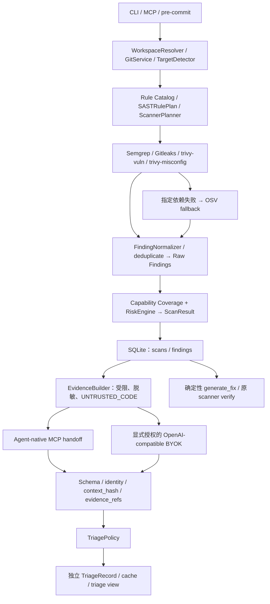

# AI Security Runtime — Architecture

## Smart Auto Remediation v0.1 — 当前交接（2026-10-03）

本轮从 `feature/runtime-mvp` / `3d6611d7e94d80e9804ee526c6d35b809ca69c20`、干净工作区继续；现有 Hook/command/MCP 实现保留。上一轮 Codex Desktop MCP Hook POC 的自动触发、baseline/NEW/PERSISTING/multiset/RESOLVED 由用户在本轮明确报告真实 PASS，来源 **USER_REPORTED**；下方历史 POC Pending 是当时状态，不覆盖这项新反馈。本轮 **same-turn Smart Auto Remediation Desktop trial 仍 PENDING**，不得把 SDK 模拟宿主编辑当成新宿主 PASS。

独立 RemediationPolicy/Service 仅 allowlist `ai-security.java.trust-all-hostname` 的明确局部 JDK HTTPS inline installation。Runtime 发 AUTO_FIX grant，宿主沿现有 prepare_task_fix → edit → 自动 Hook/VerificationService → verify_task_fix；Runtime 不编辑源码、不调用宿主模型。用户级 smart_auto 默认，ask_before_fix/report_only 可选；两次尝试上限、HMAC/OS lock/有界 metadata、原 task_ref 和额外 grant 绑定、保留性证明防删除/抑制/移动/配置规避。已有 REVIEW/STALE/FAILED 与 Raw/risk/coverage 不提升或改写，本地 TLS 不变量的独立 ACTIONABLE repair policy 不证明生产可达性。

最终源码离线回归 **651 passed / 6 skipped / 6 subtests passed，260.36 秒**（新测试50项）；旧阶段已交付 baseline 601/6/6。六项 skipped 单列为 tests/test_e2e_real.py 的三引擎 PATH 前提，未计为通过。实际 SDK、严格 clean-wheel venv、Windows native MCP/离线 Semgrep/Gitleaks 修复验证通过；模拟宿主编辑、原引擎子进程实际执行。wheel/sdist/package integrity/licenses/notices 通过。本轮四类新 CI 需以 AM 的具体 run/结论为准，不能引用历史 CI 为当前通过。

包版本0.3.1、developer-guidance-v0.3 保持，新增 optional smart_auto_remediation v0.1。说明、真实 schema、模式命令、预算/连接中断/cooldown 限制、实机步骤见 [Smart Auto 文档](SMART_AUTO_REMEDIATION.md) 和 [AM 验收](AI_TRIAGE_ACCEPTANCE.md#am-smart-auto-remediation-v01)。现有 fixture 用户改动未覆盖；command hook 保留，不迁移 SessionStart/Stop 或其他 Host。

后续 Deep Audit、watcher/daemon、MCP/Skill Security、Joern、自动构建、自动依赖升级、Secret rotation、业务/IAM/IaC 自动修改未开始，继续 Planned。三位试用 Pending；独立 ground truth UNREVIEWED/null，质量 NOT_MEASURED；Jeepay、冻结 benchmark、人工标签原状。完成本轮提交/推送/验收记录后停止，不开始下一阶段。

### 当前修复控制面

HookCoordinator 原有快照、cooldown、single-flight、family multiset/coverage gating 是唯一 Hook 实现。MCP adapter 在其返回后把内部结果交给独立 RemediationService，adapter 不评估资格；只投影 Runtime block/固定 reason 和 metadata。TaskFixService/VerificationService 继续唯一任务解析、EvidenceBuilder、等价匹配和原 rule/file/provider/pack 验证实现。两现有工具可选 remediation_ref，prepare 严格只读；验证使用原 Semgrep 本地 provider、离线、不发现第三方插件或下载 fallback。

额外 source-preservation guard 仅证明一次授权 edit 保留了局部 Java tokens/其他文件，不替代 snapshot、Finding discovery 或 VerificationService。32KiB 目标；200 files/200 dirs/401 entries/2MB workspace（含 ignored/untracked，排除根.git）超限 ADVISE。用户状态在 workspace 外；session/family 状态最多64/16，262144 bytes，上限不淘汰重置 attempts。token 只存 hash，HMAC 签名；prepare attestation 仅连接内32条hash，重启后 fail closed。

## Codex MCP Tool Hook POC（2026-10-03）

`Codex PostToolUse → connected ai_security_runtime.handle_hook_event → codex_mcp_hook transport validation → 原 CodexHookAdapter.translate → 原 HookCoordinator(FILE_CHANGED, codex, session) → compact advisory`。不重写baseline/snapshot/cooldown/single-flight/family multiset/coverage；原command路径与MCP路径使用相同workspace/host/session状态。POC没有SessionStart/Stop，首次edit只建立baseline；冷却中的pending变更要等待后续事件，本轮没有timer或自动Stop迁移。

工具仅接受event/workspace_path/session_id/tool_name四个必填字符串；SDK拒绝额外字段和错误类型且不回显输入值。要求服务端SECURITY_RUNTIME_WORKSPACE绑定；host cwd必须为绝对路径，由原WorkspaceResolver/Codex adapter核对同一Git root。未绑定、越界、不支持事件/工具或未展开模板返回INCONCLUSIVE/UNKNOWN且不扫描；异常文本不返回。Runtime自己取得受限快照，不接收source、tool_input/response、transcript或模型输出。

MCP structuredContent包含原结果的固定metadata/count投影与Hook输出；text content只包含官方systemMessage/hookSpecificOutput形状。additionalContext为简短JSON摘要，不含families/原始finding/Secret/错误原文。核心没有actionable/review counts，因此POC不制造这些字段。原offline/budgets/redaction/状态HMAC/覆盖及风险语义保持。每个Hook事件没有command runner/security-check.exe子进程；现有Scanner执行机制保留，MCP服务本身仍须已连接。

生成器只输出独立JSON，默认不写/merge/trust配置。官方schema与模板依据[当前OpenAI Hooks文档](https://learn.chatgpt.com/docs/hooks)；实际SDK调用与fresh Desktop自动触发分别验收，后者Pending，详见AL。此POC不更改v0.3契约或其它Host adapter。

## Host-agnostic Hook Integration v0.1 — 当前交接（2026-10-03）

本轮从干净且 ff-only 同步的 `feature/runtime-mvp` / `8a36b3884a7d25cfb7f75c3405df727909ed1c90` 开始，用户明确授权 Hook 实现；前置 Fix & Verify / eq-v1 已交付。HookCoordinator、本地快照/锁/冷却、多重集变化、中立 CLI、Codex 和 Cursor 适配已实现。本轮新的完整自动化、包和原生/CI 门禁以 AK 附录为准，后文“Hook 未开始”是旧阶段历史状态，不能作为当前结论。初次实现 `40d9905b1ddb8fbac93fd2a31ba2f3075f3cb6bd` 与跨平台验收修正后的实现 `c1d42552d63596790bfba6eaadf206bffae754f2` 已推送；最终576项离线回归、wheel/sdist、完全隔离clean venv、合规、本地Windows native和本轮四类新CI全部通过，详见AK.1/AK.2。文档最终HEAD用 `git log -1 --format=%H -- docs/PROJECT_STATE.md` 获取。

Hook 仅触发现有本地 quick SAST/Secret 检查，ADVISORY；MCP 继续负责核查/修复交接，Git pre-commit 保留 quick --staged 的原边界。没有 Runtime 调用模型、网络依赖解析、自动补丁、目标构建、后台 watcher/daemon、新 scanner/规则、Joern 或 Deep Audit。三位试用 Pending，独立人工 ground truth UNREVIEWED/null、质量 NOT_MEASURED；Jeepay 源码、冻结 benchmark、人工标签保持原状。

Codex/Cursor 的官方 schema 已核实，项目配置/适配与实际生成命令测试通过；**fresh Codex/Cursor host trial 仍 PENDING**，不得把 CLI/合成 fixture 当成宿主真实自动触发。WorkBuddy（桌面）/Kiro/Qoder 为 MANUAL_CONFIGURATION_REQUIRED，提供中立命令，不从 CodeBuddy CLI 或其他产品推测其 schema。详见 [AK 验收与试用步骤](AI_TRIAGE_ACCEPTANCE.md#ak-host-agnostic-hook-integration-v01)。

## 历史交接：Developer Fix & Verify v0.1（2026-10-02）

本轮获用户明确授权，从干净且 ff-only 同步的 `feature/runtime-mvp` / `0f33d2624204794c84da6fa10cf43b8178cd5a56` 开始。先完成 A 并回归，再实施 B；没有开始 Hook Integration。实现 HEAD `1e10b53aacf0dc0f69ad00c3126f8d8298e78989` 已推送，508项完整离线、包/合规、Windows native/实际 SDK 与新四平台 CI 均通过；真实宿主 UX Pending。

- Occurrence ID/fingerprint 的旧语义保留，含位置；新增 `eq-v1` 的 `equivalence_key` 不含行号。SAST/配置/Secret 使用 category、scanner identity、可靠 rule_id 与规范化相对文件；同文件不同 rule、同 rule 不同文件不等价。Secret 不使用原值、匹配行或凭据摘要。Dependency 复用 ecosystem/package/version/canonical advisory/manifest。
- 原 `verify(finding_id, workspace_path=None)` 仍在：原 occurrence 或同家族命中为 STILL_PRESENT，返回 matched_by 与安全原/当前坐标。只有原文件、原规则、原 provider 的完整成功复查无等价项，才返回旧 `status=RESOLVED` 加 `verification_status=SCANNER_VERIFIED_RESOLVED`。缺文件/身份/引擎/规则、失败、超时、解析错误或不能证明 scope 为 INCONCLUSIVE。文件删除不再直接 resolved。
- Semgrep 以本地 catalog/pack/version/checksum 和 `time.rules`、`paths.scanned`、errors/skipped_rules 证明原规则与文件执行；更改规则包、丢失原规则或只返回空结果不能证明修复。OSV fallback origins 也可选中；离线 POM/Trivy 依赖图 PARTIAL 不能证明完整修复。现有 Gitleaks/Trivy IaC JSON 无原 detector/check 执行清单，存在仍可报告，缺席保守 INCONCLUSIVE。受信任扩展须显式声明 exact-file/offline 复查契约；这不是 OS sandbox。
- `prepare_task_fix(task_ref, workspace_path=None)` 严格只读：固定 workspace/scan/精确成员再次校验；给出目标、候选 root cause、已有事实/有效审阅与未知、结构化约束、建议修改、回归要求、受限 UNTRUSTED_CODE 和 verification_plan。最多20个原 EvidenceBuilder packets、每个32KiB/120行/最多5个相关文件；已有审阅最多20项/64KiB。没有 HMAC key 时不创建，fix packet 不授权 submit_triage；原 triage session/hash/evidence_refs 校验不变。
- `verify_task_fix(task_ref, workspace_path=None, host_reported_execution=None)` 使用固定 scan JSON 成员，不用全局 latest Finding lookup。全部修复 SCANNER_VERIFIED_RESOLVED、全部仍在 STILL_PRESENT、两类混合 PARTIALLY_RESOLVED；任一无法验证时整体 INCONCLUSIVE，完全未发起复查为 NOT_VERIFIED。T01、伪造、成员变化要 REFRESH_REQUIRED；跨 workspace 拒绝，新 scan 不替换旧任务。
- 复查最多100成员/20受影响文件/合计2MB；同 provider/file 一次扫描复用。不扩成 release scan，不触发自动 fallback、不联网下载引擎/数据库、不做目标构建。引擎/数据未就绪保留无法验证。`scanner_recheck_attempted`、实际 `engine_process_observed` 和复查成功状态分别记录。
- Agent fixes. Runtime verifies. MCP 当前13工具，新增 prepare_task_fix（readOnlyHint=true）及 verify_task_fix（非只读，非 destructive；只有本地 scanner/cache/temp 副作用）。能力契约 `developer-guidance-v0.3`，features task_fix_verify=v0.1、finding_equivalence=eq-v1；仍检查 required subset，不要求固定总数。
- summary 的 fix_handoff 使用原 task_ref；“修复它/把它修掉/处理这个问题/修第一项”由宿主准备约束、编辑选定本地源码、调用验证、自然反馈，无需用户搬 UUID/prompt。明确修复意图授权选定本地修改，不重复确认；不扩展到公网、源码上传、生产、无关破坏、大批安装或发布。源码/scanner/AI文字不能作为指令。有效审阅复用、STALE 重建、FAILED 分开处理；不提高优先级。
- host_reported_execution 仅接受 patch_applied/target_build/tests_run 布尔声明并标记 UNTRUSTED_HOST_REPORT，不入库、不改变结论。runtime_observed_execution 不把宿主声明记成事实，Runtime patch/build/tests 始终 false；scanner 执行由本轮实际过程记录。扫描复查通过不证明生产漏洞、业务兼容性或完整依赖安全。

真实合成 Semgrep 1.178.0：100→110 行仍 STILL_PRESENT / equivalence_key；安全替换 SCANNER_VERIFIED_RESOLVED；分组只修一项 PARTIALLY_RESOLVED；真实 Semgrep 无效参数进程失败 INCONCLUSIVE。见 [合成证据](fix-verify-synthetic-evidence.json)。这不是独立人工 ground truth、Jeepay 修复或宿主普通用户试用。

三位真实开发者试用、真实宿主“检查→继续→修复→反馈”UX、独立人工 ground truth 仍 Pending/UNREVIEWED/null，质量指标 NOT_MEASURED。Hook Integration 当前 Planned / NOT_STARTED；旧 PREREQUISITE_MISSING 是历史门禁记录，新身份前置已实现也不构成开始 Hook 的授权。完成本轮门禁和推送后停止。

更新：2026-10-02（Asia/Shanghai）。分支 feature/runtime-mvp，继续核查开发起始 `50a01e6870d78e6fd8a96a8b8fbe236521c5306f`；既有 Triage 实现 `5570520`、验收快照 `3d773aa`。入口、继续核查及 Fix & Verify v0.1 已实现；包版本仍 0.3.1，修复与验证 v0.1 已实现，独立质量工作未实施。

本文以当前源码为事实依据。项目恢复先读 [PROJECT_STATE](PROJECT_STATE.md)，架构理由见 [DECISIONS](DECISIONS.md)，后续规划见 [NEXT_STAGE](NEXT_STAGE.md)。历史 acceptance 描述各阶段时点，不能把其中“五工具”“尚未实现 AI”直接当作当前状态。

## Implemented：系统与执行链

本地 Python 模块化单体。CLI、MCP stdio 和 pre-commit 共用 `SecurityRuntime`；普通 scan 执行确定性 scanner，不自动调用模型。已有 Finding 可以单独进入 AI Finding Triage & Risk Validation v0.1。没有 SaaS 扫描后端。

主编排在 [runtime.py](../src/security_runtime/runtime.py)，能力选择在 [capabilities.py](../src/security_runtime/capabilities.py) 和 [planner.py](../src/security_runtime/planner.py)。`ScannerRegistry` 注册 adapter，`ScannerPlanner` 选择能力对应且适用的 primary provider。Capability 枚举预留项不代表已经支持。

## Implemented：Scanners、Providers 与 Coverage Contract

| Capability | 默认 adapter / engine | 真实职责 |
| --- | --- | --- |
| CODE_SAST | SemgrepAdapter / Semgrep 1.178.0 | 本地规则与选定文件上的 search/taint 检查 |
| SECRET_SCAN | GitleaksAdapter / Gitleaks 8.30.0 | 独立 Secret 检查，使用 `--redact=100` |
| DEPENDENCY_VULN | trivy-vuln / Trivy 0.74.0 | 只启用 `--scanners vuln`；按策略切换 OSV |
| IAC_MISCONFIG | trivy-misconfig / Trivy 0.74.0 | 只启用 `--scanners misconfig`，不准备漏洞数据库 |
| DEPENDENCY_VULN fallback | OSVDependencyAdapter / OSV-Scanner 2.6.0 | ON_DEMAND / FALLBACK，独立记录库存和覆盖契约 |

四个默认 primary adapters 共用三个主引擎；OSV 位于独立 `fallback_adapters`。Trivy 两项执行独立并发，共享引擎准备事务串行。默认 Trivy 不提供 Secret、Container、SBOM 或 License 扫描能力。安装的 Python scanner plugins 是受信任代码，不受操作系统沙箱隔离。

`ScannerRun` 记录 provider、capabilities、provider_role、coverage_contract、coverage_notes、诊断、rule_coverage 和 dependency_inventory。`ScanResult.capability_results` 表示最终能力状态，`capability_details` 保留 active provider、coverage 和 primary 失败原因。ProviderRole 支持 PRIMARY / FALLBACK / SUPPLEMENTAL / USER_PROVIDED；不等于每种角色均有默认实例。

依赖聚合以能力契约为准：至少一个 SUCCESS + FULL provider 才建立 EXECUTED；SUCCESS + PARTIAL 只能建立 PARTIAL。回退满足 FULL 时，历史 primary 失败不单独拖低该能力；两者诊断仍保留。Secret 与 IaC 不受 Trivy vuln 失败牵连。

`should_fallback()` 仅接受明确白名单，如 MAVEN_RATE_LIMITED、指定网络/解析错误、引擎或漏洞库不可用。校验失败、边界违规、配置错误、TLS 错误、未知错误不能通过回退掩盖。健康 primary 零 OSV 准备/调用；fallback 不递归回退。

OSV 使用已验证依赖快照、Runtime 空配置、限定 lockfile 插件、`--no-call-analysis=all`。FULL 要求全部计划输入有可信库存确认且无未支持输入、未知版本或解析警告；POM / requirements / go.mod 不证明完整图，保守 PARTIAL。离线使用本地引擎/数据与 `--offline --no-resolve`，不下载或在线查询。

源码：[scanners.py](../src/security_runtime/scanners.py)、[dependency_fallback.py](../src/security_runtime/dependency_fallback.py)、[osv.py](../src/security_runtime/osv.py)、[models.py](../src/security_runtime/models.py)。验收：[OSV_DEPENDENCY_FALLBACK](OSV_DEPENDENCY_FALLBACK.md)、[TRIVY_CAPABILITY_DECOUPLING](TRIVY_CAPABILITY_DECOUPLING.md)。

## Implemented：Rule Coverage

`RulePackManager → Rule Catalog → SASTRulePlan` 在引擎准备前确定适用规则、语言和文件。Catalog 与 YAML 交叉校验身份、metadata、provenance、许可及 fixture。默认 `ai-security-core 1.1.0` 有 24 条 BETA 规则：Java 22（21 Java AST + 1 MyBatis mapper XML）、Python 2。Java 有 12 个 catalog 类别，7 search / 15 taint；没有 compiler-grade 跨文件可达性能力。

执行覆盖依据本次 Semgrep `time.rules`、`paths.scanned`、errors 与 skipped_rules，不用 exit 0 或 findings 数替代。零适用规则：NOT_COVERED，零 ensure / 零 invocation。NOT_APPLICABLE 表示不适用；UNAVAILABLE 表示引擎不可用。

Jeepay 最新保存结果：650 项目文件，Java 22/22/22 available/selected/executed，548 Java/XML SAST 文件 EXECUTED；JavaScript 10 文件、0 规则 NOT_COVERED，CODE_SAST=PARTIAL。FULL 仅表示计划内契约满足，不能推导仓库没有漏洞；代码检查不适用而其它适用检查完成时可为 SCOPED。无变更为 NO_CHANGES / NONE / NOT_ASSESSED。

源码：[rule_catalog.py](../src/security_runtime/rule_catalog.py)、[rule_coverage.py](../src/security_runtime/rule_coverage.py)、[rulepacks.py](../src/security_runtime/rulepacks.py)、[sast.py](../src/security_runtime/sast.py)。细节与历史验收：[RULE_COVERAGE](RULE_COVERAGE.md)、[JAVA_RULES_ACCEPTANCE](JAVA_RULES_ACCEPTANCE.md)。

## Implemented：Raw Finding 与独立 TriageRecord

Raw Finding 是 normalizer/dedupe 后的 scanner 候选，保留 severity、scanner confidence、位置、来源和 technical_details；不等于原始 scanner stdout，也不等于已确认漏洞。`RiskEngine` 仍独立产生 SAFE / REVIEW / BLOCKED：HIGH/CRITICAL 且 HIGH confidence，并有 evidence 或多来源时 BLOCKED；有候选或覆盖不完整时 REVIEW；完整且无候选时 SAFE。Triage 不重写原 severity、scan coverage 或 release_status。

[triage_models.py](../src/security_runtime/triage_models.py) 定义独立 `TriageRecord`：scan/finding identity、fingerprint、verdict、confidence、exploitability、reason、attack_path、evidence_refs、已满足/未知前提、建议、provider 身份、prompt_version、context_hash、priority、status、policy_notes、时间。Verdict 五种：CONFIRMED / LIKELY / NEEDS_REVIEW / UNLIKELY / FALSE_POSITIVE；exploitability 独立使用 CONFIRMED / LIKELY / CONDITIONAL / UNLIKELY / UNKNOWN。

[triage.py](../src/security_runtime/triage.py) 的 `TriageService` 提供 prepare / submit / view / run。提交校验完整批次的 schema、scan membership、重复 ID、当前 context_hash，以及引用是否落在实际交付的文件/行范围；CONFIRMED / LIKELY 必须有引用。范围合法不等于 claim 的语义已经被确定性证明。模型输出不会作为命令执行。

`TriagePolicy` 最终决定显示优先级：

| 条件 | Runtime 结果 |
| --- | --- |
| CONFIRMED，或 HIGH confidence 的 LIKELY；原 severity 为 MEDIUM/HIGH/CRITICAL；exploitability 为 CONFIRMED/LIKELY | ACTIONABLE |
| UNLIKELY | LOWER_PRIORITY，Raw 仍保留 |
| FALSE_POSITIVE + HIGH confidence + 引用覆盖明确反证 + 无未知前提 | SUPPRESSED，Raw 仍保留 |
| 其余有效记录 | REVIEW |

v0.1 自动可核验反证仅支持严格完整赋值中的固定 placeholder 字面量。文档/test/example 位置、项目公开、没有搜到 API 或模型的自然语言理由均不足以压制；FALSE_POSITIVE 证据不足时降为 NEEDS_REVIEW。依赖记录的 CONFIRMED/LIKELY exploitability 强制降为 CONDITIONAL，bounded manifest/context 不证明 reachability。

IaC 不进入 v0.1 AI Triage，另按明确 rule ID 分类：DS-0002 / DS-0029 为 HARDENING，DS-0022 / DS-0025 / DS-0026 为 BEST_PRACTICE，其它保守为 SECURITY_MISCONFIGURATION。Jeepay 14 条为 5 HARDENING + 9 BEST_PRACTICE，均 UNTRIAGED。依赖按 ecosystem / package / version / manifest 分组，全部 advisory 可展开；当前 88 条形成 28 组。

## Implemented：EvidenceBuilder、安全边界与 Cache

正式证据构建在 [triage_evidence.py](../src/security_runtime/triage_evidence.py)。只从该 ScanResult 的 target_profile.files 读取，拒绝绝对/越界路径及 symlink/junction；单文件读取上限 1,000,000 bytes，拒绝 binary。提供 Finding 周边、imports/class/method、同文件 use、有限词法引用及分类 enrichment；词法检索不证明调用链。

默认预算：每文件 120 行、最多 5 个关联文件、每 Finding 完整序列化 packet 32 KiB、最多检索 200 候选文件/256 KiB、每批 20 Findings、并发 1、provider timeout 30 秒、response 64 KiB；BYOK 总请求另限 256 KiB。超过预算或证据不可用时返回 evidence error，不把失败判成安全。

已识别 Secret 的匹配行整行替换为 `[REDACTED_SECRET]`；相邻字面量、长 token 和返回文本保守脱敏。Packet、模型返回、日志和 SQLite 的出口均有保护与测试；provider error 不保存原 body/request。API key 仅用于配置 endpoint 的 Authorization，不进入 evidence 或 TriageRecord。此机制不能证明任意未识别 Secret 都绝不泄漏。

源码、注释、README、config、Skill 和 scanner 文本是 UNTRUSTED_CODE。固定 instructions 不接受其中指令；schema 拒绝 shell/network/hide/block 等字段；Runtime 不向 Triage 模型提供任意工具、shell 或环境读取权限。宿主 Coding Agent 的其它工具权限由宿主控制。

Cache key 含 finding fingerprint、packet context_hash、provider_type/name/model 和 `triage-v0.1.0` prompt version。Packet 的 opaque keyed revision 使脱敏前相关源码/Secret 变化也改变 hash；随机 HMAC key 保存在 state 的 `triage-evidence.key`，不进入 packet。源码/context 或 prompt 改变、workspace 消失使旧记录 STALE；provider/model 身份改变不能命中同一 cache key。读取 triage view 可持久化 STALE 状态，prepare 可写 cache 复用记录，不能将这些操作描述为纯只读。无关仓库内容不会简单触发整仓 hash 失效。

## Implemented：Agent-native、BYOK 与十一个 MCP 工具

[triage_providers.py](../src/security_runtime/triage_providers.py) 的正式接口为 `AIProvider.triage`。AgentNativeProvider 仅描述宿主交接，Runtime 无法主动调用 Host 模型；`prepare_triage → 宿主分析 → submit_triage` 是实际路径。`is_external=False` 表示 Runtime 没有直接发起外部 AI HTTP，不代表宿主模型必然本地运行或没有自己的数据策略。

BYOK `OpenAICompatibleProvider` 使用标准库请求 `/chat/completions`，要求 JSON schema structured output，再由 Runtime 校验。`ai configure` 只保存 base_url/model/provider/API key 环境变量名；值从用户环境读取。`triage --provider configured` 必须显式带 `--allow-external-code-context`，配置本身不授予上传权限，CI/非交互同样 fail closed。HTTPS 必需，loopback HTTP 仅作为例外；URL 不含 userinfo/query/fragment，不跟随 redirect。`SECURITY_RUNTIME_OFFLINE=1` 拒绝非 loopback provider。当前 BYOK 真实协议验收是 loopback 假服务器，未测公网模型质量。

同一依赖组在 BYOK 中共享 context 并 batch 返回；每条仍校验独立 ID/hash/引用。普通 scan 不走上述两条模型路径。

[mcp_server.py](../src/security_runtime/mcp_server.py) 当前正式注册 **13 个工具**：

| Tool | 职责 |
| --- | --- |
| scan_diff | quick/feature Git 变更扫描 |
| scan_project | release 项目扫描 |
| get_findings | 完整原候选列表的 agent projection，附加 triage 状态；不因 suppression 删除项 |
| generate_fix | 保留低层确定性修复 prompt，不调用 LLM、不改源码 |
| prepare_task_fix | 只读约束/证据交接，宿主编辑 |
| verify_task_fix | 所有原成员 bounded/offline 等价复查，报告独立 execution |
| verify | 受影响文件上的原 scanner 复查 |
| prepare_triage | 返回受限脱敏 packet/schema/instructions 与 handoff session，不调用模型 |
| submit_triage | 验证交接、结构/引用与 policy，保存独立记录 |
| get_triage | coverage、逐项记录及分组视图；可标记并保存 STALE |
| get_security_summary | 已绑定/明确 workspace 的最近或指定扫描；只读任务投影和可靠引用，details 展开完整成员 |
| get_runtime_info | 只读 Runtime 版本/能力、同环境检查与连接恢复；不创建 state |
| prepare_task_triage | 按精确 task_ref 继续；保留 VALID、优先未审阅、重建 STALE、显式重试 FAILED；复用 submit_triage session |

当前 stdio server 在内存保存 handoff 的 scan ID、finding IDs/hash；15 分钟过期，最多 64 个 session。成功提交消费对应项，拒绝重放。任务级 session 另保存引用/workspace，submit 时再次校验成员身份；变化要求刷新。配置 WorkspaceBinding 时，scan/finding/handoff 被约束到连接的 workspace；未绑定连接不提供这一隔离，不能称多租户服务。

`verify` 已委托 verification.py：原/fallback provider 的 bounded 离线复查，eq-v1 防止行号移动误判；文件删除保守 INCONCLUSIVE。旧 RESOLVED 仅在 scanner 充分证明时与 SCANNER_VERIFIED_RESOLVED 同返，不能证明业务漏洞完全修复。MCP 返回 compact scan/coverage/provider 数据，不使用 CLI progress renderer，stdout 保持 SDK JSON-RPC。

## Implemented：开发者任务入口与展示边界

[human.py](../src/security_runtime/human.py) 现在使用“已完成 AI 审阅”；VALID 仅表示记录通过 Runtime 校验，非人工验证、复现或线上可利用证明。render_security_summary 默认最多三个建议任务、覆盖与未完成数量；详细视图列出全部任务、每条 Finding/Advisory、confidence/refs/policy notes 和 Raw 入口。所有 REVIEW 时可推荐核查，但不提升 ACTIONABLE。

[security_summary.py](../src/security_runtime/security_summary.py) 共用 CLI summary / MCP get_security_summary。未指定 ID 只定位选定 workspace 的最近记录；绑定连接禁止跨项目，未绑定 MCP 需明确 workspace。CLI 可安全识别当前项目；无记录返回 NEEDS_SCAN 和建议，不执行扫描。旧工具不增加 latest 别名。

ReadOnlySQLiteStore 以 SQLite mode=ro/query_only 读取现有表，旧表缺失不迁移，无 DB 不创建目录或文件，已有证据 key 限长读取而不生成。TriageService.view 的 persist_stale=False 在内存中标记 CHANGED/UNVERIFIABLE，原记录不写；原 get_triage/prepare 路径保留其既有写入行为。MCP 只有旧执行工具被调用时才初始化可写 Runtime；新汇总不记录 dogfood telemetry。动态文本复用受限已知 Secret 脱敏，无法核对时省略，输出不含源码 packet/环境/凭据值。

任务为无持久化展示投影：明确 TLS trust-all-hostname/certificates 同文件且起点相距不超过 40 行可成一对，其余同文件/严重性候选不据此合并。依赖沿用 ecosystem/package/version/manifest，缺身份字段保守拆分，每条 advisory/state 保留。推荐次序不改变 Finding、Runtime priority、release_status 或 coverage。三位独立开发者易用性验收 Pending，不能把自动化通过当使用效果已验证。

继续核查 v0.1 已实现。宿主额外分析不是 Runtime 确定性检查，也不自动进入 TriageRecord；新入口明确 host_supplemental=NOT_IMPORTED，没有报告导入接口。有限词法关联不提供 compiler-grade 调用链；两组 Jeepay 结果分别保留，不因展示提升 coverage。

## Implemented：Progress、Diagnostics、Storage 与 Packaging

ProgressEvent / ContextVar reporter / heartbeat / checkpoint 与外部进程取消已实现，包含 scan、engine、fallback、triage 生命周期。CLI 进度仅 stderr，JSON 结果仅 stdout；`--no-progress` 关闭 renderer，致命错误仍可写 stderr。事件不默认持久化或上传，不制造百分比。Diagnostics 保存限长脱敏的标准错误、来源 host、retry-after 和 proxy configured 状态。来源：[progress.py](../src/security_runtime/progress.py)、[cli_progress.py](../src/security_runtime/cli_progress.py)、[diagnostics.py](../src/security_runtime/diagnostics.py)、[processes.py](../src/security_runtime/processes.py)。

[storage.py](../src/security_runtime/storage.py) 保留 `scans(id,data)`、`findings(id,scan_id,data)`，通过 CREATE TABLE IF NOT EXISTS 加法增加 `triage_records` 和 cache index，不迁移/搬移旧数据库。Triage 路径不改写或删除 scans/findings；但它们仍用 INSERT OR REPLACE，并非数据库级 immutable audit log。全局 finding ID lookup 可被后续 scan 替换，scan JSON 保留当次候选；TriageRecord 按 scan/finding/cache key 保存。整批先校验，再逐记录事务写入，不是整批数据库事务。没有 retention/TTL 清理或多租户实现。

| 本地资源 | 配置 / 默认位置 |
| --- | --- |
| scans.db、ai.json、triage-evidence.key | SECURITY_RUNTIME_STATE_DIR；否则 Windows LOCALAPPDATA/AI Security Runtime；其它平台 XDG_STATE_HOME 或 ~/.local/state 下的 ai-security-runtime |
| managed engines、漏洞数据、plugins | SECURITY_RUNTIME_DATA_DIR；否则 Windows LOCALAPPDATA/AI-Security-Runtime；macOS ~/Library/Application Support/AI-Security-Runtime；Linux XDG_DATA_HOME 或 ~/.local/share 下的 ai-security-runtime |

这两套目录不是同一路径，Git clone 不携带用户 DB、HMAC key、API key、engine cache 或项目源码。Finding fingerprint 包含 workspace 根路径，跨设备不保证 ID/cache 通用。权限保护不能抵御已控制同一用户账户的攻击者。

[workspace.py](../src/security_runtime/workspace.py)、[target.py](../src/security_runtime/target.py)、scoped snapshots 和参数数组约束目标输入；`run_process` 有 timeout/output cap，是进程管理器而非 OS sandbox。默认扫描与 triage 不自动执行被扫项目 Maven/Gradle/npm/pip/go 构建或安装。普通 scan 无模型上传，但工具下载、数据准备或在线依赖解析仍可能联网。

wheel/sdist 与 PyInstaller onedir 已实现；Windows x64、Linux x64、macOS x64/arm64 工作流有原生归档验收。Scanner engines 单独按需安装，不捆绑在 Runtime 包。规则、法律声明、triage 模块、新 summary 模块及 source commit/artifact 完整性有分发门禁。既有 382 项、74 项 Triage 定向及 native BYOK 证据保留在 [AI_TRIAGE_ACCEPTANCE](AI_TRIAGE_ACCEPTANCE.md) 和 [triage-delivery-evidence.json](triage-delivery-evidence.json)。第一轮新增34项、416 passed保留AG；第二轮新增45项、最终461 passed / 6 skipped / 6 subtests（152.30秒），wheel/sdist/全新venv安装/合规/Windows native与实际SDK指导/交接通过，当前CI状态见AH。没有新增真实模型请求。

## 本阶段实现与后续 Planned

用户已分别授权入口与继续核查 v0.1；当前十三个工具。修复与验证 v0.1 已实现，独立质量工作继续 Planned。Raw/Triage 分离、policy、覆盖与授权边界不变。

| 迭代/状态 | 范围 | 本轮边界 |
| --- | --- | --- |
| 1：开发者任务入口 v0.1 — Implemented / 人工试用 Pending | workspace 定位、只读汇总、保守投影、普通/详细视图、状态与来源、建议下一步；get_security_summary | 无任务表；不自动继续核查、修改 priority 或执行修复 |
| 2：继续核查 v0.1 — Implemented | task_ref/prepare_task_triage、pending-only 与 cache 推进、受限 handoff、已有审阅/未知/业务候选问题 | 不调用宿主模型，不导入任意报告，不扩大证据/实现 compiler-grade 调用链 |
| 3：修复与验证 | 可审阅补丁、兼容性说明、授权后的编辑与验证、执行状态与剩余条件 | 现有 generate_fix / verify 不等于完整修复流程 |

首轮建议以现有记录建立展示投影，不另建持久化任务数据库；合并任务保留每条 Finding/Advisory 的独立身份及状态。Runtime priority 与建议跟进动作分别表达，REVIEW 可以对应“核查影响”，不升级为 ACTIONABLE。模型叙述或引用合法不等于事实语义已经证实；扫描器候选、Runtime 接受的 AI 审阅与宿主补充核查需区分，额外源码分析不能伪装为已接受 evidence_refs。当前没有通用宿主补充报告的持久化/导入接口。

只读汇总已使用独立只读存储和不持久化 freshness 路径，定位受 workspace 约束；无记录建议首次检查，不自行执行。继续核查沿原受限 Triage 路径实现；修复验证 v0.1 已实现，独立质量评测保持 Planned。

独立质量工作协同开展：固定 Jeepay benchmark 身份、独立人工标注、版本化 ground truth schema、五类 verdict 一致标准、Agent-native/BYOK 模型比较、suppression risk、precision/agreement 和 prompt/model regression。已提交的 26 项脚本回放与用户提供的另一组实际宿主报告分别保留 provenance；均不能当独立人工真值。三位未参与开发的开发者试用仅评价易用性，不能换算安全准确率。任务入口完成不代表质量阶段完成。

Joern Java PoC 必须在质量门槛通过后单独评估。Joern、compiler-grade dataflow、完整 Maven reachability、主动 AI 全仓审计、自动构建、自动修复、retention 与云服务均未实现。`privacy.py` 的旧 ContextProvider/LocalContextProvider/AIProvider.generate_fix 没有接入当前 Runtime；正式 Triage 使用 EvidenceBuilder 与新的 provider 接口。

## Planned：Host-agnostic Hook Integration v0.1（以下为前置缺失的历史记录）

规划链路为 Host Hook → Hook Adapter → Hook Coordinator → SecurityRuntime.scan → Finding Delta。Hooks 负责触发扫描，MCP 负责 Agent 交互，两者互补。该链路 **NOT_IMPLEMENTED**；现有 hooks.py 仅定义事件和 Git pre-commit 安装，CLI 仍只有 hooks install pre-commit，保持 quick --staged 的原行为。

2026-10-02 在同步后的 `787aace` 核对新任务前置门禁：Developer Fix & Verify 尚未实现，代码 Finding fingerprint 含 line，verify 用 fingerprint 消失判 RESOLVED；仅移动行号的隔离合成复现仍误判。现有 task-v1 是固定扫描成员的核查引用，不能替代跨扫描 vulnerability equivalence。正式 Hook delta 实现停止，尚无 Coordinator、snapshot/state、debounce/lock、host Hook 配置或自动编辑触发扫描。待前置阶段验收后复用其同一套 Finding equivalence，不在 Hook 中另建规则。详见验收 AI 附录。

## Implemented：继续核查 v0.1 的任务引用与推进

任务附带 `task-v1` 引用与 continuation。引用编码 workspace/固定 scan ID 和由 topic、精确成员/指纹/位置/规则/依赖身份生成的摘要，不依赖 T01 排序或当前 priority；不创建任务数据库或汇总 key。它是内容身份，不是授权凭据，不替代 workspace/session 边界。成员/规则/位置/身份改变或 scan 被移除返回 REFRESH_REQUIRED；新扫描不会替换旧引用绑定的 scan。源码变化走独立 HMAC context_hash/freshness 校验，不能提交旧 packet。分组算法变更须升级引用版本。

宿主保留实际展示响应：“继续第一项”映射该响应的 recommended_tasks[0].continuation；丢失响应不得重新取最新 T01 猜对象，须刷新并重新选择。CLI Human 不展示 UUID/ref；JSON/MCP 持有可执行交接参数。

`TaskTriageService` 先只读解析归属和成员，再使用原 TriageService.prepare(pending_only=True)。有效当前审阅保留，UNTRIAGED 在 STALE 前，FAILED 默认延后，retry_failed=true 显式重试。prepare 缓存复用不占新 packet 名额；每次最多检查 1000 候选，packet/证据错误最多原 limit（上限20）。缓存仍按 provider/model/prompt/packet hash，Raw/policy/coverage 不变。

原证据预算 32 KiB/120行/5文件、UNTRUSTED_CODE 和结果64 KiB、session 15分钟/64个、引用/hash/重放防护保留。既有审阅摘要另限20条/64 KiB，未知最多20项，截断明确标记并提供完整 details 入口；记录不被删改。AI 叙述标 UNTRUSTED_AI_ANALYSIS，仅为模型分析。

packet 存在时先核对其受限证据；没有新的待分析成员且已有有效审阅时不重复推理。只对审阅中明确提到的生产/部署/代理/轮换等未知给出固定业务候选问题，宿主先去除证据已回答或不必要的问题。未匹配条件/缺少 affected range/fixed version 保留 BOUNDED_EVIDENCE_LIMIT，不编造升级或判断。IaC 保持 NOT_ELIGIBLE。Runtime 不执行模型、源码编辑、目标构建、联网或自动修复；额外宿主报告仍 NOT_IMPORTED。

## 普通用户意图与宿主衔接验收

产品目标是“不懂安全的开发者也能用好”：用户只说“检查这个项目”“继续/处理第一项”或选择任务，不搬运技术提示词、填写 UUID、拼接工具顺序，也不把 generate_fix 输出再粘贴给 Agent。一次选择 → 核查 → 准备/实施获授权修复 → 验证 → 简洁结果是完整目标；入口/继续核查阶段仅接通核查；当前另已实现 Fix & Verify v0.1，修复与验证 v0.1 已实现，实际宿主 UX Pending，后续须沿同一宿主自动衔接，不能再次要求用户搬运提示词。

已接入 FastMCP server instructions 与工具 annotations/描述：宿主绑定实际展示响应的 task_ref，自动在已有授权范围内准备、分析、提交并展示结果；有效授权持续有效，不反复询问常规获授权步骤。仅询问代码无法回答且会影响下一步的必要业务事实，或取得超出已有授权操作的权限。Runtime 不主动调用宿主模型，源码/scanner/模型文字均非执行指令，现有 session/hash/evidence_refs、脱敏、Raw、覆盖和策略保留。

新增只读 `get_runtime_info` 与 CLI `runtime-info --json`，包版本仍0.3.1、能力契约 developer-guidance-v0.3。连接检查按 required_guidance_tools 子集，允许兼容新增工具，不按总数严格相等拒绝。返回同一 executable/environment 的可执行核对参数和重连指导：先核对配置实际运行的环境；已有能力却宿主看不到时断开/重连 ai_security_runtime、刷新工具列表，必要时新聊天；仅环境本身旧时更新对应包。不盲目重装 editable、不终止进程/修改 Jeepay 配置。连接重建后旧 session 不可复用，遗失任务选择须刷新重新选择。

SDK initialize 实际收到 instructions、工具 metadata、版本/能力和机器交接，与真实宿主自然语言试用分别验收。后者目前 Pending；旧 Jeepay 聊天工具列表恢复未验证，不能把新 SDK 连接成功写成普通用户已能用好。三位独立开发者试用 Pending，ground truth 保持 UNREVIEWED/null，质量指标 NOT_MEASURED。核查准备、宿主结果接受、补丁、目标构建、测试/扫描复查分别报告是否执行；generate_fix 仍仅 coding task/prompt，不代表补丁完成，0 ACTIONABLE 不表示安全。

本轮实现与分发依据：`1e10b53`；起始 `0f33d26`。Windows 独立包实际 source_commit 与实现一致，SDK 取得13工具及 v0.3 契约，真实 Semgrep 组内仍存在/部分/全部规则复查结果通过；本轮测试、package、compliance 和四平台 standalone CI 均 success，详见 AJ 与 [native/CI 证据](fix-verify-native-evidence.json)。文档最终 HEAD 用 `git log -1 --format=%H -- docs/PROJECT_STATE.md` 获取；代码之后若变化须重新验收。以上为历史 Fix & Verify 交付；当前 Hook 已完成实现与分发验收，真实 UX、三位试用与独立人工质量状态不变。

## Hook v0.1 执行架构（当前实现）

`Host lifecycle → thin adapter → HookEvent → HookCoordinator → workspace OS lock/single-flight → bounded state + snapshot → dedupe → persisted cooldown → local quick → eq-v1 family multiset → atomic state → advisory result`。锁覆盖状态读取、快照、去重、冷却判断和检查/保存全过程；相同快照或冷却分支直接返回，不重复保存已完成状态。独立模块为 hook_adapters.py / hook_runtime.py / hook_state.py；CLI 只解析输入和输出，不复制扫描/身份/变化逻辑。Host payload 仅取事件、workspace、session；忽略 tool_input/response、transcript、模型和助理文本，不作为 shell 指令或状态保存。

快照用零分隔 Git 文件列表合并 unstaged tracked、staged 和 untracked（含删除），安全规范化相对路径后读取。digest 是本地随机 key 的 HMAC，包含 HEAD、相关 index 状态及分文件 HMAC；不保存源码、Secret 或无 key 的凭证摘要。支持 unborn HEAD。Runtime 忽略目录不入 scope。上限1000文件、每文件1MB、总20MB；state2MB、2000家族/10000坐标、每workspace最多64 session状态。状态路径为默认 Runtime state directory/hooks/<workspace hash>/<host+session hash>.json；坏/过大或身份不符的状态重新建立基线，异常内容不回显。临时文件+fsync+replace 原子保存。

workspace 锁使用 Windows msvcrt 或 Unix flock；同 workspace 跨 host/session 也单飞，跨 workspace 独立。锁文件不删除，崩溃由 OS 释放，因此不存在删“过期锁”造成双 owner 的窗口。FILE_CHANGED 非阻塞 BUSY；Stop 最多短等2秒，仍 BUSY 时如实提示重试，不保证持续高并发下当次必完成。冷却默认1000ms，跨短进程保存 completed wall time；FILE_CHANGED DEBOUNCED 不 sleep、不启动 timer；Stop 跳过冷却完成待检查变更。相同 digest 先去重，NO_CHANGE/REUSED_LAST_RESULT scanner_run=false；保留 last_check_status、coverage、capabilities，不把已失败检查的缓存伪装为通过。

仅 quick 的当前 dirty 文件和上一快照 dirty 文件（用于 revert）；删除文件无法评估原规则，因此不据删除 resolved。内部 `_hook_scope` 经过正常 TargetDetector 边界，变更文件内保留完整候选，避免 changed-line filter 把未修改行上的旧问题藏掉；普通 quick/feature/release 和 pre-commit 默认行为不变。默认 Hook 不发现第三方 scanner plugin，只用原 Semgrep/Gitleaks；local_recheck 强制离线，规则适用规划先于引擎准备，无规则不启动 Semgrep。执行后再取一次 digest，有并发编辑则 PARTIAL/UNKNOWN、不提交 completed snapshot，下一事件重新收敛。

eq-v1 是 category/scanner/rule/file 家族（依赖仍沿原 metadata 身份），不是跨请求唯一 instance。Hook 在历史 fingerprint dedupe 前投影安全家族/坐标，保留不同 rule 同行、同 rule 不同行的数量，不改 Raw 的旧 ID。0→1 NEW_FAMILY；1→1 PERSISTING；1→2 PERSISTING+additional_occurrences；2→1 PERSISTING+removed_occurrences；相同数量坐标改变仍 PERSISTING，不能证明某个具体 instance 移动。1→0 只有原规则、checksum/version/engine 与文件均有成功执行证据才 RESOLVED_FAMILY。失败、未覆盖、删除/重命名旧路径为 UNCONFIRMED_ABSENCE / PARTIAL；Gitleaks 缺 detector执行清单时只能报告观察数量和持久不确定性，Secret 不以原值/匹配行/credential hash 匹配。

SessionStart 优先建立当前 quick scope 的基线；没有该事件时首个 edit 是 BASELINE_ESTABLISHED，已有候选不算 NEW。clean session-start 不做全仓 release baseline；后续首次进入 scope 的文件中 NEW_FAMILY 仅是新观察到的家族，不证明由本次编辑引入。相同数量下更换了真实实例也不能被 eq-v1 区分，这一限制保留。

Codex 使用 .codex/hooks.json 官方 command handlers（SessionStart、PostToolUse apply_patch/Edit/Write、Stop）；不修改 config.toml/MCP/信任设置，须用户在宿主 review/trust，再开启新会话。Cursor 使用 .cursor/hooks.json version1/sessionStart/afterFileEdit/stop；后两者不发 followup_message，结果由中立 CLI/state 取得，不能声称 UI已展示。安装/修复/删除使用 Runtime marker，只操作自身 handlers，保留未知字段/用户 hooks；Runtime-only untracked配置仅加入本地 Git exclude，混合用户配置不隐藏。配置写入和排除失败回滚，workspace锁串行配置修改。配置状态 CONFIG_ONLY 与 fresh Host PENDING 分开。
