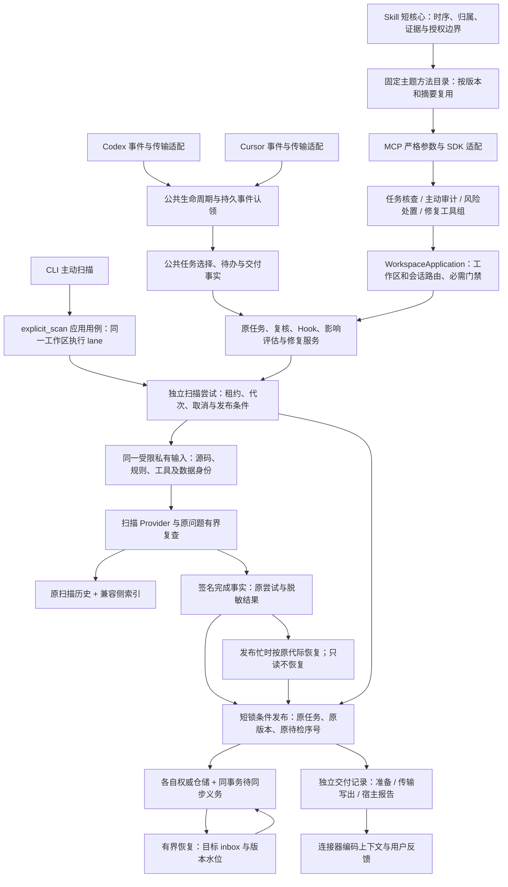
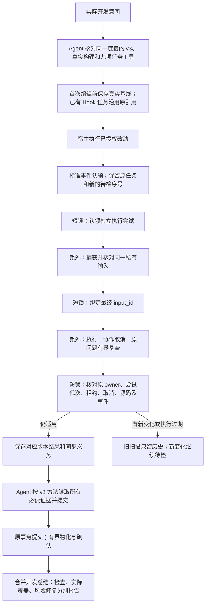

# 架构统一后续实施与验收记录

**历史工程记录**：下文为 2026-10-19、0.3.6 阶段的实施和验收，保留原始结论；其中“当前”指该阶段。当前产品已为 0.3.9 正式版，见[项目上下文](PROJECT_CONTEXT.md)、[当前进度](DEVELOPMENT_PROGRESS.md)及[语言覆盖](PRODUCT_COVERAGE.zh-CN.md)。

更新日期：2026-10-19。源码版本：0.3.6；分支：feature/runtime-mvp。本文记录当前边界和前一冻结阶段，实施目标见[总计划](ARCHITECTURE_UNIFICATION_PLAN.zh-CN.md)。后续修复的定向回归与前一冻结全库分别认定，不能用源码测试推定安装已生效。

用户已授权最新源码、文档清理和 GitHub 同步。Codex 正在由用户手工验收，完整结果尚未反馈；Cursor 仍待独立桌面验证。源码推送不自动更新已运行进程、外部 Skill 或公开 Release。

## 当前修复批次

本批修复 Windows 私有输入长路径、初始化残留占位、扫描完成但发布锁失败后的恢复，以及当前风险交付误走历史摘要的问题。短路径不回读实时工作区；签名完成事实不授予执行权限。Ctrl-C、失效代际和旧事件不能恢复为新成功，重试不重置预算。

当前交付继续使用 get_task_security_review，只有原 owner、终态 completion_revision 与当前源码匹配时生成完整风险正文和有效选择。默认历史查询不主动重放选择；两类风险共用当前处置，未知读取不变成新待处理项。只读依赖不初始化可写 Runtime。

ScanAttemptStore 新写 workspace-scan-attempt-v2，兼容已签名 v1 的读取和旧根清理；执行 receipt 仍 v1。ScanPublications 使用 scan-publication-v1 保存有界完成事实，认领新工作前在原权威锁下回收确定失效项。

另合入退役 Skill 升级事务、超长 Hook 控制上下文和包内规则/数据流身份校验。定向回归、当前同步验证及手测步骤统一见[验收记录](RUNTIME_CHAIN_REGRESSION_ACCEPTANCE.zh-CN.md)，不沿用下文旧候选的通过状态。

## 当前架构

Codex 与 Cursor 共用业务规则、状态和编排。保留的差异是宿主何时提供事件、是否有编辑前回调、怎样传输上下文和有限续办；host 仍用于隔离归属，不能用另一个宿主认领旧任务。Runtime 不在后台调用宿主模型。

| 边界 | 实际职责 | 耦合限制 |
| --- | --- | --- |
| host_lifecycle / task_orchestration | 公共能力、任务选择、待办与结果事实 | 不成为另一套任务或授权状态机 |
| workspace_services / WorkspaceApplication | 统一装配与连接归属、影响门禁 | 应用回调不捕获 MCP server、工具管理器或宿主输出 |
| mcp_contracts / mcp_tools | 原始参数校验、SDK 兼容、分组工具注册 | 业务仍委托原服务；工具规格声明不是权限 |
| TaskSecurityService / TaskReviewCoordinator | 编辑前基线、固定复核计划、证据和累计额度 | 不接受改后重建、跨会话认领或协议降级 |
| ScanRequest / CapturedScanInput | 源码类型、范围、固定字节与输入身份 | index 对照 index；缺失不能回读实时工作区 |
| ScanAttemptStore / ScanAttemptExecution | 执行认领、租约、取消、固定输入和条件发布 | 与任务 generation、Agent 复核租约分别管理；不授予编辑权限 |
| ScanPublications | 有界签名完成事实与发布恢复依据 | 原 lease、源码、事件与任务条件仍由原服务核对；不是另一套权威 |
| task_review_results / 只读扫描存储 | 当前交付与历史共用有界投影 | 当前交付有额外归属与版本校验；默认历史不写库、不重放选择 |
| 各权威仓储及恢复器 | 同库事务、幂等收件、水位、条件投影 | 恢复不扫描、不发消息、不改变人工选择或扩展修复授权 |
| 交付记录 | 结果版本及可证明的传输阶段 | 输出准备、stdout 写成功、宿主报告均不等于认证用户已读 |

## 开发与执行流程

普通聊天、只读、普通 Stop 不创建或恢复扫描；无改动不扫描。静态零告警仍需实际代码复核。扫描取消不清空基线、证据、累计额度或用户授权。固定副本只证明实际捕获的字节，不承诺冻结用户工作区，也不构成隔离同一用户恶意插件的沙箱。

## 持久化与升级

逐写路径的权威事务、目标、水位和故障恢复见[持久化事务清单](PERSISTENCE_TRANSACTION_RECOVERY.zh-CN.md)。开发任务投影、扫描器反馈、原风险复查、显式收尾、风险关闭与原生修复意图分别保存同步义务；目标状态与已应用事件同事务提交，源端最后确认。确认前崩溃只重放原义务，不重扫。

人工选择与技术评估保持独立。原问题复查的同步回执核对精确所选行的当前版本；来源已有部分 ACK 时，也不能跳过这一核对。历史 inbox 或整体已完成的旧 delivery 保留其原含义，不升级为新输入证明。仅相同来源确实已物化的完整版本水位可以续进；较新的人工选择、其他来源变化、未知旧水位均不能被旧事件覆盖。失败队列有界轮转，外会话及未知目标不得占住本会话的可恢复名额。已过期任务仅保留带签名的投影元数据，不延长源码、证据、授权或任务生命期。

历史扫描仍保留 scans(id,data) 两列；附加索引与脏行触发器兼容旧双值 INSERT/REPLACE。只读查询不建表、不回填；不完整或不可识别索引回到原查询语义，不以查无索引冒充无历史。

全局安装布局仍为 runtime-state-v1。包内 storage_contracts 声明各私有仓储实际契约；新版管理器激活及回退先核对槽身份和能力下限，不兼容时保留指针与历史。该下限不是发布者认证，也不能约束旧管理器自身；旧账本 writer 另由实际文件系统围栏阻止覆盖新格式。不得把扫描历史的旧 writer 兼容推广到新账本写入或二进制降级。

## Skill、MCP 与使用体验

显式收尾先在原事务保存结果和同步义务，确认同步前保持完成标志为假；源结果已保存但 `PENDING` 不表示扫描失败。目标提交后中断可沿原事实恢复，不重扫。原风险修复复查使用同一固定输入和独立 VERIFY 尝试，源码、规则或配置发生 ABA 变化时拒绝当前确认。

短核心保留不可跳过的时序和安全边界；完整方法有固定六个主题、版本、摘要和本地 reference。缺失才取同版方法，不能以拆分方法为由跳过必读代码。源 Skill、动态生成内容、安装结果及方法接口按字节校验。

新任务只执行开发核查 v3；缺少 v3、task-result-delivery-v1、真实构建身份或九项必需工具时停止对应核查并提示升级或重连，不静默降级。旧 v1/v2 任务保留原状态和只读历史，未完成旧任务不能续办。独立的 security-review-skill-v1、risk-decisions-v2 等契约保持原用途。具体升级步骤见[v3 升级说明](TASK_REVIEW_V3_ONLY.zh-CN.md)。

用户日常无需理解内部引用或方法切换，最终反馈仍合并到开发总结。暂缓、排除、缺证据、升级、运行失败或业务取舍需要如实说明，因此不能承诺所有情况下完全无感。没有稳定事件 ID 的宿主只做版本核对；没有消费回执时保留未知，不宣称全局永久精确一次或用户已经看见。

## 前一冻结阶段验收

2026-10-19 冻结全部 266 个测试文件，四片覆盖全部用例，不将重叠专项数量相加。原诊断失败回执继续保留；本轮正式冻结回执如下。

| 验证 | 实际结果 |
| --- | --- |
| 全量回归 | 5021 个唯一用例：4978 passed、17 skipped、26 xfail；零失败、零错误、零收集错误，四片均 exit 0 |
| 回执与身份 | 本地 `artifacts/architecture-final-20261019-runner/run-20261019-012537-03a78d9d/summary.json`；无重复用例、无运行中源码漂移 |
| 冻结摘要 | `3f32d8a416c755c50e342b4edaf2a86eb0a9417f4e5e45cf30ebbdf778775bc6`，范围 src、scripts、tests、pyproject.toml |
| 冻结后校验与格式整理 | scripts/build/verify_package.py 的规则包断言从过期 1.3.0 改为实际 1.3.2；另移除五个公共模块的多余 EOF 空行，逐文件确认仅尾部空行变化且 AST 相同。测试字节不变；最终 wheel 另作实际安装验证 |
| 最终源码摘要 | `b66396e971124bd037eb7e08f1c17e7586bbaf4c40b30fc6466c3b8ea8300280`；范围同上，文档另随 Git 保存 |
| wheel 隔离安装 | 正式 scripts/build/verify_package.py 离线验证通过：CLI、许可、56 项规则、7 个 Skill 文件与 6 个固定方法、v3 契约及隔离 Hook 安装/移除；未修改当前安装 |
| Windows 候选 | 干净提交的独立构建与隔离 self-test stdio MCP 契约自检通过；具体身份如下 |

固定输入与真实执行身份、短锁并发、跨进程崩溃恢复、账本旧 writer 围栏、历史只读、无工作区 admission 的指导读取、非法参数不回显、旧方法受管清理及用户修改保护均纳入此次全量。三个真实 MANAGED 性能用例也全部通过；跳过项及预期失败不计入通过数量。

17 项跳过中，9 项为 POSIX 包链接、1 项为非 Windows 路径、1 项为 Windows 不允许的换行文件名；另 6 项是旧 PATH 驱动的三引擎 E2E 前置不足（当前 PATH 缺少 Gitleaks/Trivy），不能宣称这 6 项已验收。MANAGED 性能用例使用独立已就绪工具目录，两者分别记录。26 项 strict xfail 精确对应既有 KNOWN_ANALYSIS_LIMITATION 语料，无新增或遗漏，代表现有分析边界。

本次交付身份如下；最终文档提交仅补回执，不改变上述 Runtime、测试或构建源码。

| 交付项 | 身份及范围 |
| --- | --- |
| 源码提交 | [1bcc2f79e239412cd3f6656eb1791690cede1d93](https://github.com/pikachu-cxy/Ai-security-check/commit/1bcc2f79e239412cd3f6656eb1791690cede1d93)，版本 0.3.6；候选元数据 source_dirty=false |
| GitHub 分支 | [feature/runtime-mvp](https://github.com/pikachu-cxy/Ai-security-check/tree/feature/runtime-mvp)，源码与本轮 README、计划、进度及交接文档同步交付 |
| wheel | 本地 `dist/architecture-final-wheel-20261019/ai_security_runtime-0.3.6-py3-none-any.whl`，SHA256 `2f58ef13e6ca8a81499d19db8b3200dc2ebc927e84a058113a75b6a56f495e57`，正式隔离验证通过 |
| Windows 独立候选 | 本地 `dist/architecture-final-native-20261019/security-check`；build_id `57fea182efb4ab09120c7b6d6b87af513180f061bde308dc3aca592a75498f87` |
| 实际候选 MCP | 52 个工具中含全部九项 v3 必需工具，六个主题字节与源码一致，11 项 storage_contracts 与包元数据一致；显式旧协议与非法指导参数均拒绝，参数不回显 |
| 本地回执 | `artifacts/architecture-final-native-build-20261019.json`、`artifacts/architecture-final-native-probe-20261019.json`、`artifacts/architecture-final-wheel-verification-20261019.log` |

构建只复用经完整包校验、且 launcher.c 与其源码提交无差异的原生 launcher；Runtime 和资源重新构建。以上本地包与回执留在忽略目录，GitHub 交付源码、测试与文档，不含用户扫描数据、原始聊天或构建产物。

候选自检使用全新临时状态及 self-test stdio 路径；未扫描、未新建开发任务，不证明普通生产 admission、实际安装、Hook 或桌面行为已经验收。当前安装、外部 Skill、运行中连接与公开 Release 尚未更新，macOS 和真实双宿主桌面未验收。

[本地性能数据](ARCHITECTURE_PERFORMANCE.zh-CN.md)单列样本、条件与成本，不把历史查询的合成提速换算为用户总等待。Windows 候选构建与包内 API 验收不代表 macOS 或真实桌面验收。

## 前一阶段原任务安全核查诊断

旧 Runtime 拒绝更新的原因已经确认：原账本 837 行加本任务 280 项观察会超过旧构建 1000 行总上限；原先通用错误隐藏了容量原因。另一次资源占用是工作区锁超时，二者不同。[诊断与处理](ARCHITECTURE_REVIEW_DIAGNOSIS.zh-CN.md)保留原任务、基线和证据，不清历史或改后补建。

2026-10-19 最后一次沿原任务调用 finish 仍为 `INCONCLUSIVE / TASK_REQUEST_REJECTED`；实际只读查询返回历史任务 `COMPLETE`，但 `host_review.coverage=PARTIAL`、复核进度 `PARTIAL`、`current_version=false`。历史 COMPLETE 不等于最新版本完整安全核查通过。当前旧构建尚未替换，本轮代码回归与候选验证分别记录；未清历史、重置额度、改后补基线或创建替代任务。

显式 closeout 自身执行租约保留 600 秒上限；超时结果保守拒绝发布，原任务可在有效条件下重新领取，不宣称支持任意长后台续跑。扫描尝试的协作续租与该收尾租约分别管理。扫描历史中的待发布标记只表示历史执行，当前检查应读取原任务或 Hook 权威状态，不能从“最新一条扫描”推导。
