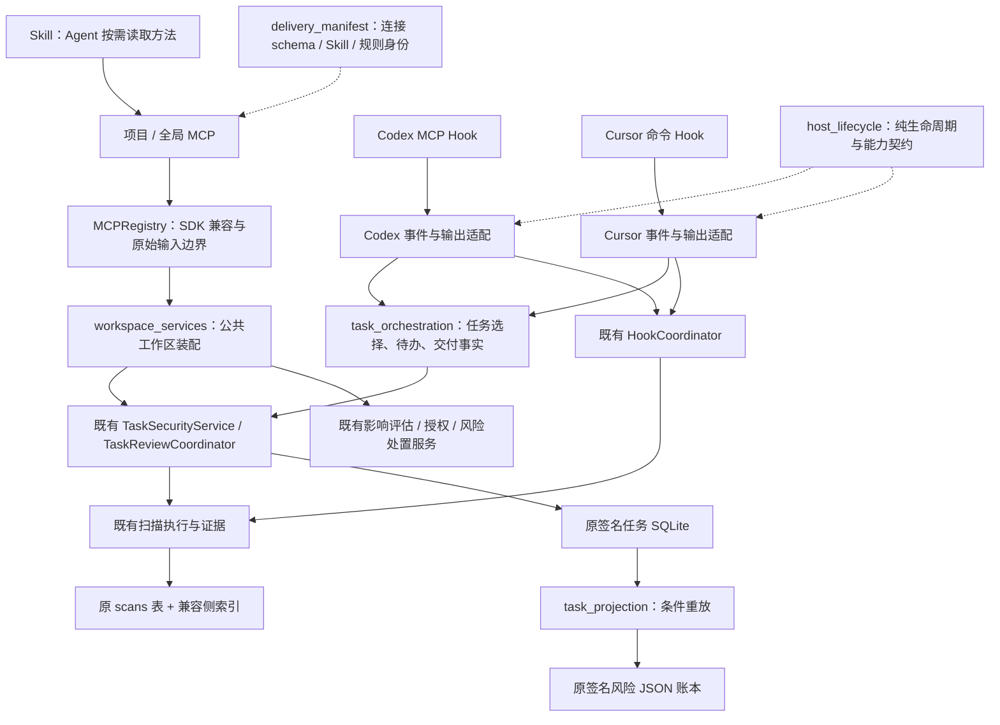
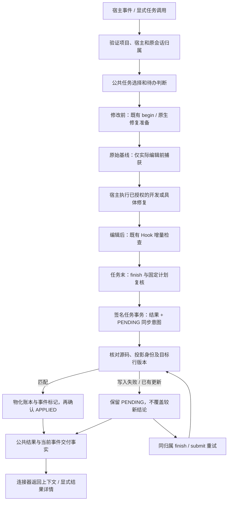

# 架构统一首批实现与验收记录

本文保留 2026-10-18 首批事实；2026-10-19 的接续实现与当前状态见[后续架构记录](ARCHITECTURE_UNIFICATION_COMPLETION.zh-CN.md)。原“原因未知”的核查拒绝现已确认是旧账本容量超限，见[诊断](ARCHITECTURE_REVIEW_DIAGNOSIS.zh-CN.md)。

更新日期：2026-10-18。源码版本：0.3.6。开发分支：feature/runtime-mvp。

本次按用户授权，先将本地最新源码、近期修复和开发规划提交并推送为 [a51a58d](https://github.com/pikachu-cxy/Ai-security-check/commit/a51a58d)，再开展架构升级。本文记录第一批公共架构实现与 v3 唯一协议收敛，后续阶段按[总计划](ARCHITECTURE_UNIFICATION_PLAN.zh-CN.md)继续；未完成的存储迁移、扫描输入和真实宿主验收不能从本批回归推定通过。

## 最近修复的冲突核对

| 最新修复 | 本批处理与防回归边界 |
| --- | --- |
| 原生修复意图 WAITING / READY / BOUND / CANCELLED | 复用原 TaskSecurityService 和意图守卫；公共选择器不创建任务或授予修复权限。WAITING 不捕获基线；READY 后保留关联的 repair_task_ref |
| 原始基线、会话归属和累计预算 | v3 沿原任务续接；根据后续明确决策停止 v1/v2 执行，仅保留历史；不自动转换、跨归属认领、重置额度或改后重建基线 |
| 修复影响未知分级 | BLOCKING_CONTEXT / SCOPE_LIMITATION、decision_basis 与已有门禁保留；本批统一产品装配 |
| 严格证据提交、可恢复错误 | 原始输入校验仍在 SDK 解析和工作区 admission 前；保留字符串 evidence_id 与有界 field_errors，不放宽嵌套结构 |
| 文件别名和扫描范围 | 不改变目标解析及输入范围，不因统一连接器扩大到全项目 |
| 用户处置、原风险复查 | 同步投影不改变 DEFER / EXCLUDE / RESTORE 或修复授权；原生风险沿 repair_task_ref 核查，原风险仍按原引用更新 |
| 原开发任务要求的测试与构建 | 保留 CHECK_OPERATION_BOUNDARIES；检查未完成不阻止已授权的产品开发测试 |

先前全局影响门禁的装配差异已经由近期源码修复，本批将它作为跨入口防回归项。另纠正一处指导文字：scanner 修复才使用 verify_task_fix；原生代码风险采用绑定的修复任务完成核查，不能混用证明。

冲突结论限定于本批差异和回归覆盖：未发现需要撤销近期修复才能实现公共架构的设计冲突。原始 A/B/C、A2/B2/C2 等桌面记录保留，不能被源码回归覆盖。

## v3 唯一协议收敛

用户后续明确停止旧 Runtime 兼容，覆盖原计划中保留 v1/v2 执行的策略。MCP、服务和计划默认统一为 3，旧协议请求在任何扫描、基线或结果重放前拒绝；历史任务保留原协议，不自动迁移。新版 Skill、动态生成指导和安装清单同时更新；旧受管方法按签名与原 hash 清理，用户修改原样保留。独立的风险处置、影响评估与修复授权契约保留。详细调用链、历史约束和升级路径见[v3 兼容说明](TASK_REVIEW_V3_ONLY.zh-CN.md)。

## 已落地的依赖结构

公共编排是已经被两连接器使用的共享决策函数，未建立第二套任务状态机，也未把模型推理搬进 Runtime。更广泛的事件持久认领和交付回执仍未完成。

| 模块 | 本批职责 | 依赖限制 |
| --- | --- | --- |
| host_lifecycle | 生命周期、Stop 意图、产品能力；投影既有公开结构 | 不导入 SDK、数据库、扫描器或连接器；host_events 不再反向依赖 hook_runtime |
| task_orchestration | 任务选择、归属、协议、待办、followup 指纹、当前事件交付事实 | 不保存任务、不扫描、不发消息、不授予权限；原任务服务保持权威 |
| workspace_services | 公共工作区和修复服务装配 | 保留自定义 factory 配置作用域；领域服务不反向依赖全局入口 |
| mcp_contracts | SDK 私有访问收敛、严格输入、schema 与派发兼容 | 不承载风险判断；私有 SDK API 仍存在于这一适配边界 |
| delivery_manifest | 连接 schema / effect、Skill 方法摘要、规则和状态协议身份 | 不扫描、不 admission 工作区、不修改安装；清单不是执行或数据保鲜证明 |
| task_projection | 随任务结果签名保存意图；有条件地补齐账本 | 不触发扫描、模型、消息、人工处置或修复，不建立通用事件总线 |
| scan_history_index | 侧索引、旧 writer 脏标记、有界追补与只读回退 | 保留原 scans(id,data)；只读不迁移或写库 |

## 实际流程与恢复边界

全量回归发现并修正一次实际连接器兼容回归：Cursor 上下文的任务参数 JSON 曾混入 task_delivery，严格 MCP 校验因此拒绝 finish。当前可复制的参数只保留原 task_ref / workspace_path / session_ref，交付事实放在明确标记为“非工具参数”的独立上下文段；原真实 MCP 验收和严格工具 schema 保留。

任务完成与账本同步分别表达。finish/submit 仍使用原工作区锁；任务事务提交前失败没有新意图，提交后物化失败保留签名 PENDING。已应用但确认失败时，同一事件重试不再写账本；目标行完整版本比较防止旧任务 A 覆盖较新任务 B，即使两者源码 hash 相同。

v3 的提交回执在源事务前预留同步状态预算，物化后只替换为实际 PENDING / APPLIED，不追加提交后的预算错误。当前事件交付事实独立包含 risk_ledger_sync；COMPLETE 的 task_pending=false 仅说明复核流程完成，不能表示所有同步义务已结束。

历史查询只展示同步状态，不执行恢复或迁移。重放只在原归属的有副作用入口、原工作区锁内发生，不重扫、不重建基线。仅当前任务结果到风险账本的窗口被覆盖；task_fix、反馈、人工处置等跨存储事务及未完成同步义务的长期保留仍属于后续 P3。旧程序不理解新增待同步事实，不能并发旧账本 writer 或把二进制降级当作安全回退。

历史查询保留原两列 scans 表和 INSERT OR REPLACE。侧索引以触发器记录旧 writer 的新增、替换和删除；有界追补未完成、缺少 schema / 触发器、路径过多或异常历史行时，采用原语义的流式回退，不截断结果。读取通过同一 SQLite 快照合并索引和脏行；只读旧库不变更 schema。合成 600 条无关历史记录的用例仅解码目标 1 条，证明访问方式改善，不能换算为生产延迟收益。

## 阶段状态

| 阶段 | 本批状态 | 余项及退出条件 |
| --- | --- | --- |
| P0 | 源码检查点、近期修复矩阵、专项基线已固定 | 双宿主真实耗时、冷暖样本和完整平台矩阵待测 |
| P1 | 公共生命周期 / 能力、工作区装配、SDK 适配边界已实现 | 大闭包业务协调与公开扫描接口继续拆分 |
| P2 | 两宿主复用任务选择、协议、待办、followup 和当前事件交付事实 | 持久事件认领、跨进程精确幂等、独立交付回执未实现，不能声称用户已读 |
| P3 | finish/submit 到风险账本的签名同步意图、条件重放和故障测试已实现 | 逐写路径事务清单、feedback / disposition / task_fix 恢复、清理保留及旧 writer 切换未完成 |
| P4 | 未改变现有扫描输入或锁边界 | 先固定所有 Provider 的同一输入视图，再实施尝试身份、短锁和取消；不得直接锁外扫描 |
| P5 | 兼容侧索引、有界追补、旧写入与只读专项已实现 | 原生候选升级 / 中断 / 降级及真实大历史性能待验 |
| P6 | 共享严格输入契约与连接交付清单已实现 | 完整工具模块化、交付兼容协商及内容成本测量继续推进 |
| P7 | 源码回归按下文真实回执记录 | 未打包、未安装或重启当前连接；双宿主桌面和系统矩阵待验 |

依照总计划，本批不同时引入公共编排切换、全面存储迁移和锁拆分。下一批先补齐 P3 的其余权威写路径与版本门槛，再进入 P4；不能通过把扫描调用移到锁外替代。

## 测试与交付记录

近期修复基线：artifacts/architecture-baseline-20261018-r3.xml，152 passed，69.35 秒。前两次沙箱执行因 Windows 临时目录访问拒绝未完成，失败回执保留；使用仓库外独立临时目录、经授权的测试进程重跑，未放宽断言。

当前相关回归按 classname + name 去重，采用下表所选回执的最后结果：**1719 项通过，0 项剩余失败/错误/跳过**。这是分批验证与复测的汇总，不是单次全库重新运行，也不累加重叠的专项数字。

| 本地回执（artifacts/） | 实际结果 | 范围与解释 |
| --- | --- | --- |
| v3-final-suite-1-20261018.xml | 883 passed / 1 failed，1475.67 秒 | Codex / Cursor、全局 MCP、安装、公共架构；宿主首次声明的断言一次返回 REJECTED |
| v3-final-suite-2-20261018.xml | 826 passed / 1 failed，989.71 秒 | Skill、任务、证据、风险、恢复；第二个会话任务返回中一次没有 task_ref |
| v3-final-diagnostics-20261018.xml | 31 passed，142.23 秒 | 冻结源码后对上述两文件合并复测；增加实际返回诊断，不降低原归属与重放断言 |
| v3-guidance-final-20261018.xml | 93 passed，57.50 秒 | 最终 Skill 源/动态生成/安装一致性、MCP 和连接器契约 |
| v3-history-admission-final-20261018.xml | 169 passed，257.40 秒 | 最终历史容量、签名、协议、归属、编排和任务服务 |
| v3-history-driver-final-20261018.xml | 8 passed，54.66 秒 | 总 64 条硬上限、旧历史与新 32 条额度、真实验收客户端 |

两个扩大回归失败在独立冻结复测中均未重现。原失败回执保留，原始拒绝原因没有被完整捕获，不能推定为环境问题、源码变动或已经证明修复的产品缺陷。后续失败会输出实际响应与已有健康诊断，不重试绕过断言。

此前架构首批全库四分片回执保留（architecture-full-20261018-s1/s2/s3/s4-r2.xml）。其中发现的 Cursor 参数 JSON 混入元数据属于实际回归，已修并经真实 MCP 测试；依赖三选项、就绪语句、规则数量和 SDK 标语的陈旧断言按现行契约校正。系统 PATH 的 Node 18 不满足测试门槛，使用已存在的 Node 24，仅修改测试子进程环境，相关 12 项通过（architecture-node24-20261018-r3.xml）。这组旧全库结果不能作为新 v3-only 源码的全库通过证明。

Skill 格式校验通过；独立只读行为验证覆盖缺少 v3 能力、旧任务续办、独立 v1/v2 契约、静态零告警未读窗口和普通只读五个场景。它不计入 1719 项，也不代表真实宿主桌面行为已验收。五份验收 driver 与一个共享客户端完成 v3 调用迁移并通过编译；共享客户端通过真实服务 API 测试。未执行外部项目、安装或桌面 driver。

### 安全核查的当前限制

沿用首次修改前建立的原任务和真实基线，没有新建任务或补基线。较早修订的正式材料已读取 324 帧，33 个单元均因旧前像缺少脱敏定位依据和语义不可见范围记为 PARTIAL；另有四份测试样例材料不可用。旧静态结果保留 280 项观察（270 测试、9 样例、1 内部验收脚本），未批量改变其处置。

当前最终源码的任务更新请求两次被拒绝，准备入口另曾返回资源占用；具体拒绝原因未能确认。尝试记录中止原因后，查询仍为旧修订、current_version=false，没有确认保存新的复核结果或新的中止原因。故**当前版本安全核查未完成**，不能把旧 COMPLETE、旧静态结果、代码回归或部分覆盖说成本轮通过。未补建前像、重置额度、改写风险或伪造证据。

源码提交和 GitHub 同步不等于安装更新、自动发布或真实宿主已验收。日常开发仍依赖宿主 Agent 的准备、证据分析和最终呈现；没有可靠回执时，只能证明上下文已经返回，不能证明用户已看到或完全无感。
