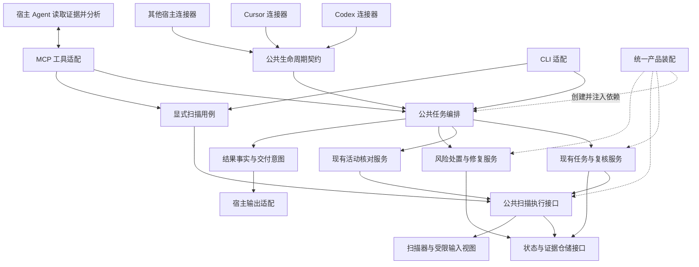
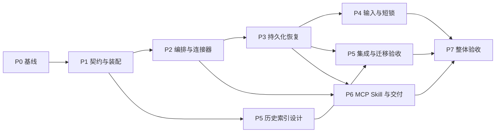

# 架构统一与优化开发计划

状态：首批公共架构与 v3 唯一协议已实现；1719 项去重相关回归通过。当前版本安全核查更新未完成，完整后续阶段与实机验收仍待执行。日期：2026 年 10 月 18 日。

目标是形成一套任务编排和安全核心，由 Codex、Cursor 等连接器适配事件、传输和呈现，并同时改善并发、持久化、查询、版本交付及日常等待。本计划已获用户后续开发授权，按阶段分批交付；实际完成范围见[首批实现与验收记录](ARCHITECTURE_UNIFICATION_IMPLEMENTATION.zh-CN.md)。

新增已授权决策：开发任务核查仅执行 v3，取消旧 Runtime/未完成旧协议任务的执行兼容，保留只读历史；不影响其他独立版本契约。详见[v3 收敛与升级说明](TASK_REVIEW_V3_ONLY.zh-CN.md)。

## 一 目标与范围

本计划的交付目标是：

1. 相同的标准任务与代码变化，经不同连接器进入同一套核心流程；宿主差异限制在输入、能力、调度和输出适配。
2. 任务基线、检查证据、风险处置、修复影响、授权与原问题复查继续各自负责，不产生第二套任务状态机或授权来源。
3. 检查结果可以在中断、重复事件、并发编辑及重连后准确恢复；旧结果不能覆盖新代码和新决定。
4. 用真实数据减少锁等待、重复读取、历史查询成本和提示负担；必要检查范围与必读证据不缩水。
5. Runtime、Skill、MCP 工具、规则与宿主接入能力有可核对的兼容关系，源码更新与安装生效分别表达。

本轮规划覆盖公共编排、连接器迁移、状态恢复、扫描输入与锁、历史索引、MCP 与 Skill 契约、版本交付和体验验收。产品继续在本机运行，语义分析由宿主 Agent 完成。

独立常驻服务、云端控制台、微服务拆分、通用事件总线、完整程序调用图和企业功能验证不作为本次实现前提。Cursor 驻留通道、自动更新和漏洞数据持续保鲜分别进入后续评估，不与核心统一捆绑。

## 二 当前实现基线

| 项目 | 当前事实 | 对计划的约束 |
| --- | --- | --- |
| 源码与连接 | 源码与本轮连接均为 0.3.6；本批新增架构源码尚未打包安装 | 实施前固定源码、安装包、Skill 与连接身份，不把源码能力直接视为已生效 |
| 公共安全核心 | 已有共享任务、复核、扫描、证据、风险处置、授权和复查服务 | 复用现有服务，不重写一套同类核心 |
| 公共事件 | 已有 host-event-v1，但主要表达会话开始、工作区活动和会话结束 | 新阶段采用显式兼容适配，不改变旧任务引用的含义 |
| Codex 产品接入 | SessionStart、PostToolUse、Stop 使用 MCP Hook；当前产品配置未提供编辑前 Hook | 基线来自编辑前显式任务准备；不能由此断言所有 Codex 版本都不支持前置能力 |
| Cursor 自动接入 | 命令 Hook 提供编辑前准备、编辑后检查、上下文交付和有限停止续办 | 保留实际时序；命令进程与 MCP 进程不能依赖共享内存传递状态 |
| 已有性能机制 | 增量范围、缓存、扫描器并行、任务预算去重及续接已经存在 | 优化协调和关键路径，不以减少必要检查来获得收益 |
| 状态存储 | 任务、扫描与处置使用 SQLite，部分风险账本使用签名 JSON | 单文件原子写入不等于跨存储原子提交，需要明确恢复规则 |
| 修复影响装配 | 最新源码已统一注入影响门禁，覆盖全局工作区工厂 | 之前的装配差异已修正，转为跨入口防回归项 |
| 历史查询 | latest_scan 仍按历史行倒序读取并解码筛选工作区 | 在保留旧版写入兼容的条件下建立索引 |

实施依据：

- [公共事件与能力](../src/security_runtime/host_events.py)
- [公共事件派发](../src/security_runtime/host_event_runtime.py)
- [工作区服务工厂](../src/security_runtime/workspace_services.py)
- [Codex 接入](../src/security_runtime/codex_integration.py)
- [Cursor 自动接入](../src/security_runtime/cursor_automatic.py)与[任务桥接](../src/security_runtime/cursor_tasks.py)
- [任务检查](../src/security_runtime/task_security.py)与[任务持久化](../src/security_runtime/task_security_state.py)
- [扫描与历史存储](../src/security_runtime/storage.py)
- [Skill 生成](../src/security_runtime/review_skill.py)与[MCP 工具装配](../src/security_runtime/mcp_server.py)

## 三 目标架构与依赖方向

连接器负责将原始宿主事件转换为标准信号；公共编排器决定下一步调用哪个既有服务。公共编排器不执行模型推理、不拼宿主字段，也不取代任务、复核和授权服务的状态所有权。

| 边界 | 负责内容 | 耦合约束 |
| --- | --- | --- |
| 生命周期契约 | 阶段、操作、已核对的归属、事件关联、能力与来源 | 不依赖 MCP SDK、扫描器、数据库或具体编辑器模块 |
| 宿主连接器 | 原始字段校验、宿主绑定、事件映射、传输、输出编码、安装配置适配 | 原始 payload 在此终止；不实现扫描策略、风险判断和授权规则 |
| 公共任务编排 | 任务准备、活动协调、收尾、去重、恢复及交付意图 | 依赖领域服务的公开接口，不按编辑器名称复制业务流程 |
| 任务与复核服务 | 原始基线、源码版本、复核计划、证据、预算和结果 | 保持现有权威状态，不依赖连接器输出格式 |
| 扫描执行 | 固定输入、选择引擎、执行、取消及扫描证明 | 通过公开请求传递范围与版本，逐步替代调用者依赖私有 Hook 参数 |
| 风险与修复服务 | 技术评估、人工处置、影响分析、授权及原问题复查 | 四类事实分别保存；影响分析和交付消息均不是修复授权 |
| 仓储与恢复 | 原子状态提交、同步意图、幂等物化、索引 | 不触发扫描、模型调用、用户提示或修复 |
| 回复与交付 | 从已保存事实生成回复计划，记录可证明的交付阶段 | 不改变风险、授权、技术结论；未获消费回执时不声称用户已看见 |
| 产品装配 | 创建服务、选择明确的产品能力配置、注入必需依赖 | 所有入口复用；领域模块不反向导入装配层 |
| MCP 注册与发布契约 | 工具规格、处理器绑定、可见性和兼容清单 | 注册表不成为业务逻辑中心，SDK 私有对象访问收敛到适配边界 |

目标调用与状态权威进一步固定如下，避免公共编排器增加另一套业务状态：

| 对象或动作 | 唯一权威与调用规则 |
| --- | --- |
| 编辑后增量核对 | 既有 HookCoordinator 发起对应检查；编排器不再为同一事件直接发起第二次扫描 |
| 开发任务基线与任务末检查 | TaskSecurityService 管理任务并发起必要检查，任务状态继续保存在原任务仓储 |
| 显式项目审计 | 独立应用用例调用同一公共扫描接口，不伪装为开发任务，也不新建改前基线 |
| 模型复核与累计额度 | 现有任务复核服务及仓储持有，编排器只导航，不复制计划与预算 |
| 扫描执行尝试 | 扫描执行仓储持有尝试、租约和代次；任务仅引用，不把任务 generation 当扫描尝试身份 |
| 事件去重 | 持久事件记录持有执行认领；任务关联写入与原任务事务协调，原 Hook pending 仍保存未完成活动 |
| 风险及人工处置 | 对应风险、反馈和处置仓储分别保有权威，其他账本仅投影，不能反向推翻人工决定 |
| 结果交付 | 独立交付记录保存结果版本及实际回执，不重建任务完成状态或风险结论 |

编辑后检查与任务末检查是不同检查阶段，是否复用结果由范围、输入版本与证明契约决定；不能仅因为“同一任务”就跳过必要的最终核对。

优先扩展现有 workspace_services、host_events、reply_plan 等模块；仅在出现明确独立职责时新增小模块。不为目录整齐批量搬文件，不为每个函数新增接口。

依赖方向固定为：入口适配 → 应用编排 → 领域服务 → 仓储及执行端口。基础设施实现这些端口，产品装配负责连接。领域模块之间通过公开契约协作；host 标识仍用于归属隔离和审计，但不决定另一套安全规则。

## 四 统一生命周期与宿主能力

统一“业务含义”，保留“事件怎样发生”的差异。拟增加的生命周期信号包括会话打开、修改前准备、修改后活动、显式任务收尾和会话停止，确切名称在 P1 固定。

能力由一份契约维护，区分已实现、当前连接可用和真实宿主已验收三种事实。至少覆盖同步编辑前回调、编辑后通知、调用关联标识、上下文回传、有限续办和消费回执。现有 HostCapabilities 与 HostConnector 的重叠字段投影自同一来源，避免增加第三份布尔配置。

标准输入包含项目身份、会话归属、可用的调用标识、事件阶段、操作分类及来源。原始宿主文本、模型输出和客户端自报状态均不能直接变成授权或“文件已改变”的证明；文件变化仍以实际输入核对为准。

| 情况 | 公共行为 | 保留的连接器职责 |
| --- | --- | --- |
| 支持同步编辑前事件 | 调用相同任务准备服务，保存原始基线 | 确定同步时机并返回宿主要求的响应 |
| 没有已验证的前置事件 | Agent 编辑前调用同一公开任务准备接口 | 声明能力限制，交付现有工作流指令 |
| 编辑后通知重复或来源分散 | 对应同一变更版本和任务；检查与上下文交付分开 | 映射事件，避免把 Cursor 的两个回调都当成扫描触发 |
| 准备最终回复 | 显式调用公共收尾流程，完成所需复核 | 可由 Agent 的正常工具调用发起，不假设存在原生回复前 Hook |
| 会话停止 | 按现有意图与能力进行有限补偿 | Codex 已批准修复续接与 Cursor 报告补交保持不同意图 |

SessionStart 不统一成“一律扫描”：Codex 现有启动准备与 Cursor 自动模式的编辑前准备保留各自时序。Stop 也不等于任务收尾，不创建第二条自动全库扫描路线。

有稳定调用标识时，以宿主、项目、会话、调用和阶段形成持久幂等键。无稳定标识时保留内容核对与配置版本校验，不能用随机事件 ID 或短时间窗口宣称精确去重。不同来源报告同一次编辑时，应合并相同版本的检查工作，但继续保留必要的归属和交付信息。

## 五 必须保持的正确性条件

1. 编辑前基线只能来自实际编辑前捕获；保留已有未提交改动，禁止改后补建或用 Git HEAD 替代任务基线。
2. 同一宿主、原归属仍可验证的升级、重连和旧新连接器实现切换，不得重置 task_ref、owner、原复核协议、累计预算或已读取证据。切换 Codex 与 Cursor 不自动允许跨宿主认领；连接范围已失效或原绑定缺失时保留历史并说明无法续接，不重发 owner 或补建基线。
3. 同一事件只允许一个权威执行路径。影子比较只计算纯事件映射或结果投影，不双跑扫描、双建任务、双写账本或双发消息。
4. 检查证明绑定具体输入、规则、工具与数据版本。检查期间的新修改保持待检，旧结果不能关闭新版本的检查缺口。
5. 模型分析、扫描器证明、人工处置、提醒状态和修复结果分别表达。Runtime 校验结构与版本，不认证模型推理正确。
6. 修复仍依赖用户明确选择的具体范围。已有同范围授权不重复索取；消息、自动续跑、复核完成和影响评估不创建或扩大授权。
7. 暂缓、排除与恢复决定持久保留；旧物化事件不得覆盖较新的人工决定。
8. 普通聊天、只读和无变化路径保持低打扰；历史成功、缺数据、部分覆盖和未知均不能转换为当前通过。
9. 产品开发中的仓库回归用于验证本产品；个人版 Runtime 不因此新增对用户项目的自动构建、测试或功能验证。
10. 原始源码、密钥、会话凭据不进入公开文档和普通诊断；新增扫描输入副本使用受限私有存储及最短必要保留。

## 六 分阶段实施计划

P0 至 P7 分批交付。首批已固定 a51a58d 源码检查点并实现公共契约与装配、两宿主共享决策、任务结果条件投影、兼容历史索引和连接交付清单；详见[逐阶段状态及余项](ARCHITECTURE_UNIFICATION_IMPLEMENTATION.zh-CN.md#阶段状态)。这不代表 P0 至 P7 全部退出条件已经满足，尤其 P3 完整跨存储恢复、P4 输入与短锁、P7 真实宿主验收仍未完成。

| 阶段 | 主要交付 | 前置依赖 | 退出条件 |
| --- | --- | --- | --- |
| P0 固定基线与验收目标 | 接入模式矩阵、现有语义对照、源码及安装身份、真实耗时基线、依赖边界清单 | 计划确认 | 可以准确复现现有行为，区分支持能力与待验范围 |
| P1 公共契约与统一装配 | 生命周期与能力契约、既有公开服务边界、统一产品装配 | P0 | 项目 MCP、全局 MCP 与命令连接器使用同类服务配置，门禁与权限边界一致 |
| P2 公共任务编排与交付 | 通用任务桥接、事件去重、交付意图、逐宿主迁移 | P1 | 两宿主标准流程产生一致核心状态，保留各自时序；一个事件只执行一次 |
| P3 可恢复持久化 | 任务事务内同步意图、幂等账本物化和恢复对账 | P2 | 在写入边界中断后能补齐，旧事件不覆盖新决定 |
| P4 固定扫描输入与缩短锁 | 版本化扫描请求、统一输入视图、短锁执行、取消与过期执行隔离 | P3 | 并发编辑及过期执行不能提交错误的当前结果，锁等待有实测改善 |
| P5 兼容历史索引 | 附加索引、可重入迁移、旧写入追补和只读兼容 | P1 可独立设计，集成在 P3 后 | 最新记录查询不漏数据，旧版写入可用，只读不改库 |
| P6 MCP Skill 与交付契约 | 分模块工具注册、短核心指令、按需方法、兼容清单与文档生成 | P2 P3，整体验收覆盖 P4 P5 | 工具、方法、Runtime 与规则身份可核对，旧任务和证据仍可继续 |
| P7 性能与真实宿主验收 | 同候选打包、安装升级恢复、双宿主真实流程、最终数据对比 | P1 至 P6 | 完成已声明入口与平台矩阵，待验项单列，按实测结果确定发布范围 |

### P0 固定基线与验收目标

记录 Codex 产品 MCP Hook、旧命令模式、Cursor legacy 与 Cursor automatic 的事件、输出、同步性、默认行为、超时、恢复和实际验收状态。固定源码修订、工作树差异摘要、候选构建与连接身份。

将耗时拆成启动、基线捕获、只读、未变化、扫描、锁等待、持久化、证据交付、Agent 复核和最终回复；区分冷暖状态、组件是否就绪、项目规模和并发场景。记录 p50、p95、样本数及同条件总任务时间；低样本不宣称稳定分位数。

首批测量后固定各场景性能门槛，后续不得靠减少必查范围达标。普通场景不得出现超过既定容差的退化，优化目标场景必须出现可重复改善。指标缺失时保持未验收，不先承诺毫秒数。

### P1 公共契约与统一装配

沿用既有服务，实现一个明确的工作区装配入口；MCP、Hook 和 CLI 选择相同的产品能力配置。必需的影响门禁、归属校验和权限策略不由某个入口是否恰好使用默认 factory 决定。

领域服务仅接收公开任务、复核、执行和仓储契约。复用现有方法足够时不新增封装；扫描范围等私有 Hook 参数在适配边界转换为公开请求。

将当前 MCP 闭包中的跨服务协调与影响门禁实现移到公共应用服务，通过装配注入；领域回调不捕获 MCP server、工具管理器或宿主输出对象。影响分析仍提供前置判断，授权仍由原修复服务管理。

先加入契约和兼容适配，不改变用户流程。验证已修正的影响门禁在项目 MCP、Codex 全局和 Cursor 全局中一致生效；只读影响询问、拒绝修复和人工暂缓不被错误阻塞，合法的已有授权不重复确认。

### P2 公共任务编排与逐宿主迁移

从 CursorTaskBridge 抽取与宿主无关的任务准备、上下文事实、待完成判断及交付去重；已有 TaskSecurityService、TaskReviewCoordinator 仍保有原状态。

迁移分三批：先抽取纯逻辑并保持旧入口委派；再切换 Cursor automatic；最后接入 Codex 显式 begin/finish 与编辑后 Hook。旧模式通过兼容适配进入同一服务，不长期维护第二套业务实现。

核心决定“有什么待完成、应交付什么”，连接器决定如何编码上下文和有限续办。Agent 读取与提交复核仍通过公共 MCP 完成，不让 Runtime 在后台自行调用宿主模型。

交付状态分开保存检查执行、结果持久化、上下文已返回和宿主报告提交。只有宿主提供可核对消费回执，才能进一步记录消费事实；没有回执时保持未知，不把返回成功等同于用户已看到；Agent 自报“已展示”仍标为宿主报告，不升级为可认证的用户已读事实。反馈按任务、结果版本和类别去重，完成后的新结果取代旧检查缺口。

### P3 可恢复持久化

每条实际写路径先固定权威源事务，再在该事务内记录待同步意图，即 outbox。任务状态与任务 outbox 同库提交；反馈和人工处置以各自仓储为权威，不能由一个任务 outbox 假定管理所有数据。风险账本作为可恢复投影，使用明确事件键和原风险身份幂等物化，不把多个数据库和 JSON 文件误当成一个事务。

P3 先列逐路径事务清单，覆盖 task_security 的 finish/submit、task_fix 的登记及原扫描复查，以及 task_risk_feedback 的反馈保存、实质变化确认和人工处置。每项明确权威仓储、同步目标、条件更新版本和重投效果；不能只覆盖任务结束入口。同步意图引用受版本约束的事实，不复制整套源码或产生新的风险判定。

物化器将已应用事件标识与账本变化一起原子保存，然后确认 outbox。若在落账后、确认前中断，重复投递无副作用。带更新语义的事件增加行版本或 revision 条件，旧评估不能恢复已暂缓提醒或覆盖新决定。

保持任务核查状态与投影同步状态独立。读取缺口不变成零风险。恢复采取有界的本地对账，不触发扫描、模型、消息或授权；历史清理必须保留尚未完成的同步义务。

新旧写路径必须有明确版本门槛：旧账本写入会重建整个 JSON，可能丢失新增的已应用事件标识。启用新物化保证前须完成本产品旧账本写进程的受控退出或兼容升级；否则保持旧模式并延迟启用，不能只靠对账宣称已有新保证。幂等标识必须与投影状态一起受签名和原子提交保护。

新路径对遗留记录执行有界对账，但不能恢复已经丢失的事件水位或推断用户决定。兼容旧扫描数据库写入不等于允许旧账本写进程并发写新格式；版本清单与降级流程必须分别检查这两类兼容性。

### P4 固定扫描输入与缩短锁

本阶段分两批，先固定输入，再移动耗时扫描。禁止直接将现有 engine.scan 移到锁外就宣称并发问题已经解决。

第一批建立公开的版本化扫描请求，显式携带逻辑工作区身份、source_kind、输入 manifest 和实际执行目录。source_kind 至少区分工作区与 Git index；用户结果的路径始终映射回原项目。使所有 Provider 读取同一份受限私有输入视图，绑定必要源码、关联上下文、清单、规则、工具与数据身份。复用现有快照设施，但不能各 Provider 随时复制不同版本，也不能缺文件时静默回读实时工作区。

同步核对路径归一化、finding scope 捕获、freshness、缓存键和证据定位的读取来源；扫描在快照上执行时，这些环节也必须使用同一输入视图。缺失上下文、复制失败、路径越界和容量不足保持明确缺口。扫描输入副本与脱敏改前证据不是同一种材料，不能相互替代。

第二批采用短锁领取、锁外执行、条件提交。执行记录包含独立尝试标识、递增的执行代次、租约归属、输入身份及取消代次；不能仅以任务 generation 代替执行身份。

提交前校验执行归属、代次、输入身份和当前适用性。证据读取使用私有视图，当前适用性核对原始来源：工作区检查核对对应文件与清单，staged 检查核对 Git index 条目及 OID，不能把 index 结果与工作树字节比较。扫描期间出现新编辑时，旧结果可保留为对应版本历史，最新变化继续待检；清除 pending 时校验原事件序号，不能误清后到事件。扫描租约与 Agent 复核活动租约分别管理。

复用已有进程树取消机制，为原生分析补协作检查点，避免普通异常处理吞掉取消。租约过期后旧执行者恢复也不能提交；取消不清基线、不清风险、不重置累计复核额度。无法协作取消的插件单列执行边界，不承诺线程即时退出。

输入视图只能证明实际捕获的字节版本，不承诺冻结用户工作区。快照成本和锁等待一起测量；容量不足时使用明确的保守兼容路径或报告缺口，不静默降低输入要求。

### P5 兼容历史索引

旧版 scans 表使用双值 INSERT 写入。直接增加列会破坏旧写入，因此优先建立附加 scan_index 表，保留原表结构和原始 JSON。

索引保存规范工作区身份、scan_id 及与旧查询一致的历史顺序信息。历史记录没有可靠扫描时间时，不用回填时间伪造 created_at。

迁移分批、可重入；新写入与对应索引在同事务提交。优先在原扫描表上增加只记录记录身份及变更顺序的轻量脏行触发器，使旧版双值 INSERT 或替换也能留下追补信号，不在触发器中解析业务 JSON。具体触发器兼容性在该阶段验证，验证前不启用索引作为唯一查询来源。

处理索引已有命中但旧进程又写入新扫描、以及同 scan_id 被替换导致排序改变的情况。查询必须合并当前读取快照中未索引的增量后再选最新；有界追补未完成时回退兼容查询。仅靠索引未命中或一次回填完成标记不够，索引未命中也不能被当成没有记录。

只读查询不建表、不回填、不写迁移标记。索引不完整时兼容读取并保留正确排序。本阶段先不自动删除历史；清理策略需另外证明不会破坏活跃任务、复核、证明及处置引用。

### P6 MCP Skill 与版本交付

按任务核查、显式审计、风险处置和修复拆分处理器注册。统一工具规格包含输入、输出、效果与能力要求；业务规则仍留在原服务，不塞入注册表。

工作区与会话校验采用独立适配，SDK 私有对象访问集中在单一边界。保持现有工具名、参数兼容和必需能力子集；不以固定工具总数判定连接是否正确，也不为减少数量隐藏正常流程必需工具。

Skill 保留短核心流程与不可绕过边界；详细分析方法按版本和摘要读取一次。扩展已有方法去重机制，不压缩必读代码为不可读内容，不取消静态零发现后的复核要求。

发布兼容清单绑定 Runtime 构建、状态格式、支持协议、MCP schema、Skill 核心与方法摘要、规则包和连接器模式。漏洞数据新鲜度与构建身份分开，不因软件版本一致而认定数据仍新鲜。

安装、启动和诊断读取同一清单，说明兼容、需要重连或需要升级的具体原因；当前开发任务只执行 v3，旧协议保留只读历史，未完成旧任务不续接、不自动迁移。升级保护用户改动和其他产品配置，生成文档与清单核对，避免再次出现不同资料各自声明“当前版本”。

### P7 真实宿主与性能验收

同一候选分别记录源码回归、原生包、模拟事件、真实宿主和操作系统结果。Codex 与 Cursor 的相同标准任务应产生一致核心事实，但允许实际事件数量、传输格式和触发时机不同。

先完成已承诺的本地单根路径，再扩展其他宿主。远程、多根及未具备真实证据的平台保持独立状态，不继承别的入口通过结论。

首轮完成后比较 p50、p95、总任务时间、锁等待、扫描次数、重复证据字节、MCP 调用次数及重复提醒次数。只有命令启动或重复快照被证实为主要瓶颈时，再立项 Cursor 驻留通道或进一步快照复用；不提前增加后台服务的维护成本。

## 七 关键验收场景

| 场景 | 必须成立的事实 |
| --- | --- |
| 普通聊天与只读 | 不创建开发核查任务，不刷通用安全提示 |
| 首次编辑前已有未提交改动 | 原基线准确包含这些改动，不替换为 HEAD |
| 前置能力缺失或准备失败 | 保留明确缺口，不改后补建，不把继续编辑当检查成功 |
| Cursor 多回调与 Codex 单次编辑后回调 | 同版本检查工作不重复，交付义务不丢 |
| 同一事件两进程同时到达 | 一个权威执行；重复请求复用或等待，不双发结果 |
| 扫描 A 时编辑为 B | A 只证明 A；B 保持待检，不报告 B 已检查 |
| index 为 A 而工作树为 B | staged 结果只证明 A；扫描中 index 改为 C 后不得报告当前通过 |
| 扫描中修改后又还原 | 结果绑定实际输入；pending 仅在对应序号已处理后清除 |
| 旧执行租约过期后返回 | 旧代次提交被拒，不能覆盖新执行 |
| 提交任务后、物化账本前中断 | 恢复补齐风险登记，不新建任务 |
| 物化后、确认同步前中断 | 重投无重复效果，较新处置不倒退 |
| 外部引擎与原生分析取消 | 有界退出或明确限制，保留原基线与已有结果 |
| 多聊天并发与断线重连 | 不串项目、不串 owner、不借用最近任务，不重置额度 |
| 查询旧库、迁移中断及旧版继续写入 | 旧写入可用，最新记录不遗漏，迁移可恢复 |
| 已有索引命中后旧 writer 新增或替换 scan_id | 识别未处理增量及排序变化，仍返回真正最新记录 |
| 旧账本写进程与新投影切换 | 未完成受控切换时不启用新保证，不允许旧 writer 丢失新幂等信息 |
| 只读打开旧库 | 数据库和 schema 不变 |
| 暂缓 排除 恢复 | 用户决定保留，相关新证据按原规则复核后再决定提醒 |
| 已批准修复及修复影响 | 同范围不重复索取批准；跨入口门禁一致，代码版本改变使旧依据失效 |
| 普通停止与有限续办 | 执行对应意图，停止有界，不变成新扫描或新授权 |
| 最终结果呈现 | 风险及必要缺口进入实际回复；无消费回执不虚构已读 |
| 新旧路线切换 | 原引用、协议、处置和证据继续有效，不重建基线或回滚用户代码 |

测试优先覆盖状态不变量、真实并发与中断边界。连接器字段映射使用固定宿主样例；规则、方法和 schema 用契约验收。保留必要人工桌面观察，不能仅靠模拟事件或工具调用返回成功认定用户已看到。

## 八 迁移与回退

新入口先通过兼容包装调用现有公开服务；每个宿主和连接模式独立切换。配置开关由产品装配管理，不允许原始宿主 payload 或普通 MCP 参数改变安全策略。

影子对比仅用于纯映射与回复投影。同一真实事件只走一条有副作用的路径；不能为了对比同时运行两次扫描。

路由回退与程序降级分开。前者在兼容服务与存储上切回旧入口；后者必须先确认旧二进制能读取当前状态。数据库变更优先附加，保存旧格式，禁止一次性破坏性改表。账本格式与物化进度另设降级门槛：先确认同步义务已处理及旧程序不会丢失新标识，否则不执行二进制降级；路由回退可以继续使用新兼容服务。

活跃任务仅在原宿主和原归属仍可验证时保留原始引用、owner、协议与累计额度。新连接或另一个宿主不能凭旧引用自动认领；绑定缺失时保持历史，不另发归属。升级不延长已过期证据和授权；连接内修复凭据失效时沿用现有恢复规则，不因回退复活权限。

回退不撤销用户源码、不删除风险决定、不清空同步事件。清理兼容代码以相应入口验收通过和活跃旧任务退出为前提。

## 九 实施依赖与并行安排

P1 固定接口后，历史索引设计、工具规格整理及宿主样例准备可以并行。公共编排切换、持久化改变和锁拆分分批合入，不在一次大改中同时改变三者。

不固定日历承诺；P0 后按实际改动量拆成可独立评审的小批次。某阶段出现兼容或证据问题时，保持该阶段未完成，保留既有可用路径，不用重新建任务或扩大功能范围绕过。

## 十 优化项覆盖与后续边界

| 前述优化方向 | 本计划安排 |
| --- | --- |
| Codex Cursor 统一业务流程 | P1 P2 |
| 版本与能力身份不一致 | P0 P6 P7 |
| 项目锁持有期间扫描 | P4，输入与恢复条件具备后实施 |
| 跨 SQLite 与 JSON 的中断窗口 | P3 |
| Agent 调度依赖 | P2，将确定性任务动作下沉，保留宿主能力边界与模型分析职责 |
| 提示和结果交付一致性 | P2 P6 P7 |
| 历史查询退化 | P5 |
| MCP 大闭包与 SDK 私有接口耦合 | P1 P6，收敛到适配边界 |
| Skill 与工具上下文成本 | P6，按需读取并保留必读证据 |
| 首次进入项目与日常等待 | P0 P4 P7 |
| Cursor 每事件命令启动成本 | P0 P7 测量，驻留通道按收益单列后续开发 |
| 自动更新与漏洞数据持续保鲜 | 后续独立计划，本次清单能反映版本与数据新鲜度 |
| 新宿主扩大支持 | 核心统一验收后接入，不同时复制新业务状态机 |

## 十一 交付物与评审重点

计划确认后的交付物包括公共生命周期与服务边界说明、分批实现、契约及故障回归、兼容迁移说明、同候选性能结果、宿主验收矩阵、版本兼容清单，以及与实际行为同步的架构和安装文档。

本次评审主要确认：

- 采用一套核心与公共任务编排，多连接器按能力适配，保留真实宿主时序。
- 优先保持正确性和恢复，再进行锁拆分与体验优化。
- 依照 P0 至 P7 分批推进，历史索引等独立工作有限并行。
- 以原任务、原证据、原处置和准确授权的兼容为迁移底线。
- 以实际等待、完成可靠性和低打扰体验评价结果，不以模块数或工具数评价优化完成。
