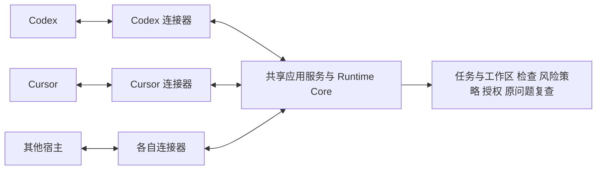

# Cursor 连接器开发与测试计划

日期：2026-10-15。状态：已基于指定 `3ed0841` 开发自动连接器测试版；正式桌面闭环验收仍待完成。

本轮已抽出公共任务活动和工作区服务，增加 Cursor 全局 MCP/Hook/Skill 安装、编辑前任务基线、
编辑后上下文、结束兜底、持久去重及工作区路由。Codex 旧入口和 Cursor 仅检测模式继续兼容。
已构建 Windows 独立候选并通过隔离安装、真实 Hook 子进程和 MCP 任务收尾验证；
这不代表新版候选已通过真实 Cursor 模型的风险呈现及批准修复测试。
安装方式和当前限制见 [Cursor 安装与测试](guides/CURSOR_INSTALL_AND_TEST.zh-CN.md)。

下文保留完整目标与阶段门槛；“拟定/目标”部分只有上述已实现内容可视作当前能力。

目标是让用户完成一次 Cursor 接入后，在日常开发中自动获得本次改动的安全核查、清楚的风险说明、
用户批准后的受限修复及原问题安全复查。采用既有的“共享 Runtime Core + 各宿主连接器”架构。

依据：[Runtime 架构](ARCHITECTURE.md)、[共享接入架构](HOST_SUPPORT.md#共享接入架构)、
[近期计划](NEXT_DEVELOPMENT_PLAN.zh-CN.md)、[Cursor Hook 实测](CURSOR_HOOK_FEASIBILITY.zh-CN.md)。

## 1. 架构决策与当前差距

一个 Runtime 核心对接多个连接器。连接器按实际产品和客户端入口区分，并在连接器内登记版本与平台能力。
例如 Cursor 本地 Agents、Cursor IDE 和 Cursor CLI 可以共用解析组件，但各入口分别验收；
WorkBuddy 与 CodeBuddy 分别维护连接器身份。不是每个版本都新建一套核心或目录。

“连接器”是安装、事件、消息和能力适配的组合，独立模块即可，首轮不需要独立常驻服务或额外网络协议。
命令 Hook 和 MCP 是其两种传输方式；事件格式及宿主反馈在边界转换，业务规则保留在核心。

| 层次 | 职责 | 已有基础与本轮工作 |
| --- | --- | --- |
| 安装与连接 | 发现客户端，管理本产品 MCP/Hook/指导文件，保留用户配置，升级、修复和卸载 | 复用 `IntegrationAdapter`、`GlobalCursorIntegration`，补齐统一生命周期与回滚 |
| 事件适配 | 验证原始输入，核对项目/会话，转换操作类型和已支持事件 | 复用 `HostEventAdapter`、`CursorHostEventAdapter` 和注册表 |
| 反馈与交接 | 将核心返回的待检状态、风险和续办要求编码为宿主可消费的字段 | 新增明确的交付契约，使用已实测的编辑后上下文与停止续办通道 |
| 宿主能力 | 分别记录事件、上下文、续办、配置范围及实际验证身份 | 统一分散的事件、传输、安装能力视图；未知能力保持关闭 |
| 共享应用服务 | 将 Hook 活动归入任务，管理基线、待检范围、完成状态、交付去重和工作区路由 | 抽离当前必要的 Codex 耦合，不搬入 Cursor 文件 |
| Runtime Core | 文件变化核对、扫描、发现身份、风险策略、修复授权、原规则证明和存储契约 | 继续复用，不由连接器重新判定风险、扩大权限或伪造复查结论 |

现有代码已经分出事件适配，尚未形成完整统一连接器：`codex_mcp_hook.py` 中有任务活动登记，
`global_mcp.py` 中存在 Codex 专用工作区、会话及启动逻辑，`host_continuation.py` 也保留旧入口。
先提取 Cursor 实际需要的共享职责；不把整个 Codex 安装器复制成 Cursor 安装器，也不进行无关目录大搬迁。

拟定的连接器组合契约包含：客户端身份、安装生命周期、事件输入适配、反馈编码、能力描述和健康状态。
沿用既有接口作为子组件；需要新增类型或字段时先写契约测试并记录兼容方式，不能把拟定接口写成已经实现。
公共服务通过组合入口接收宿主能力和传输实现，不导入具体 Cursor/Codex 连接器。
连接器可以调用公共服务；现有兼容入口逐步包裹迁移，旧任务、问题身份和授权有效期保持原语义。

## 2. 首轮范围和已有证据

首轮交付范围为 **Windows x64、Cursor 本地 Agents、This PC、单根本地工作区**。
桌面基线为 3.22.12；首轮至少覆盖已测模型与另一种实际可用模型，支持范围只列真实通过的组合。
macOS、IDE 独立入口、CLI、远程和多根列入后续矩阵，各自通过后扩大支持。

本机已证明原生编辑事件、`postToolUse.additional_context` 和 `stop.followup_message` 可以到达真实 Agent；
另有一次续办收敛证据。产品的自动任务核查、真实风险反馈和批准修复闭环仍待实现及验收。
启动上下文送达未确认，shell 写入尚未在本轮桌面测试中执行。

安装目标为用户级接入，换普通项目不要求重新填写 MCP JSON 或每个项目执行 setup。
测试版已提供 `security-check install cursor`，统一程序身份、Cursor MCP、Hook 和必要的宿主指导；
独立进程验收通过，仍需同一候选的真实 Cursor 模型验收。项目级接入保留为显式兼容方式。
全局 MCP 每次工作区调用都携带并校验当前 `workspace_path`；不能从不透明任务引用、上次项目或最近会话推断根目录。
工作区与会话核对只证明绑定一致，不等于认证宿主或确认用户批准。

官方提供用户级 [MCP 配置](https://cursor.com/docs/mcp) 与 [Skill 目录](https://cursor.com/docs/skills)。
指导内容沿用同一套安全工作流，宿主包装单独适配；不以“能发现 Skill”推导“必然自动执行”。
必须检测已有 `.agents`、`.codex`、`.cursor` 等兼容来源造成的同名指导重复或冲突，保留用户文件。

首轮保留个人版边界：检查、解释、批准修复、安全复查；不默认运行项目依赖安装、构建、功能测试或企业深度验证。

## 3. 事件与任务闭环

| 时点 | Cursor 连接器行为 | 共享服务与核心行为 |
| --- | --- | --- |
| 安装及启动 | 核对实际程序、配置及能力；启动时识别会话并报告就绪状态 | 准备组件、缓存及允许的基线工作；准备状态与实际任务检查分别记账 |
| 首次可能修改前 | 根据真实 `preToolUse` 输入判断是否需要任务准备；不执行输入中的命令 | 在修改前建立并持久化任务基线；处理启动准备未结束的竞态 |
| 原生编辑或 shell 修改后 | 标准化专用事件，携带可靠的项目/会话信息 | 根据实际字节变化合并待检范围并运行必要检查；重复事件不重复计算相同证据 |
| 工具完成后 | `postToolUse` 交付受限任务上下文和完成要求 | 复用当前任务、待处理风险及覆盖缺口，不将反馈交付当作第二次修改事件 |
| Agent 准备结束 | 优先在正常最终回复前，经 MCP 完成当前任务的静态和受限上下文核查 | 保存完成记录并统一提供当前风险、未核实范围及用户选择 |
| 仍有待检事项而发生 stop | 发送一次明确标注“自动安全核查续办”的 followup，或按能力如实降级 | 校验任务、内容版本和交付状态，不新建任务清空旧风险或重跑无关全仓检查 |
| 用户选定修复 | 将真实选择关联到原问题，通过现有 MCP 取得原范围内的授权 | 校验原授权、版本、项目和会话；Agent 编辑，核心执行原规则复查并更新逐项状态 |

必须保留以下约束：

- `sessionStart` 的非阻塞特性不能证明编辑前基线已经完成。准备不及、失败或预算耗尽时保留明确缺口，
  不能把编辑后的快照冒充修改前状态。若需新增修改前事件契约，应显式扩展版本，不伪装为现有修改后活动。
- 普通聊天不创建开发核查任务；只读和相同内容不重复触发扫描。shell 分类只是线索，失败命令也可能已写文件，
  须以文件核对及任务末待检范围兜底，不能因退出码非零而丢弃改动。
- `generation_id` 是宿主轮次信息，不是独立任务身份或用户批准；自动 followup、上下文压缩或重连继续原任务。
- 探测脚本按会话只续办一次，是实验保护。生产去重按任务、内容版本、阶段和交付记录工作；同一聊天的第二个任务仍须检查。
- 连接器不能将 Hook 子进程中的引用当作另一个 MCP 连接的修复凭据。批准与恢复继续服从原有能力、有效期及绑定校验。
- 自动后续消息不代表人类提出新需求或批准修复；正文只包含必要的脱敏任务交接，不携带密钥、原始配置或授权秘密。

`stop` 续办会在已观察界面产生可见的后续消息；不承诺可以覆盖首条回复。
产品优先在正常回复前完成核查，stop 只兜底；相同版本的风险说明去重，同时记录实际出现的消息和等待次数。

## 4. 开发顺序与阶段门槛

| 阶段 | 开发工作和交付物 | 进入下一阶段的条件 |
| --- | --- | --- |
| 0 固定基线 | 保存候选/宿主/模型/规则/数据身份；核对独立测试环境及共享契约；登记性能预算和预演门槛 | 同条件 Codex 关键路径可复验；缺失文件、环境和能力有明确记录 |
| 1 整理连接器边界 | 提取共用任务登记、待检状态和交付决策；建立连接器组合与能力描述；把 Codex 作为首个兼容实现 | 原 Codex 行为及授权边界不回退；Core 不依赖新增 Cursor 字段或消息 schema |
| 2 完成 Cursor 安装与路由 | 用户级 MCP/Hook/指导的统一安装、健康检查、修复、升级、卸载；支持逐次明确 workspace 路由 | 新项目无需手写配置；只管理本产品可证明归属的条目；断连和配置冲突可恢复 |
| 3 接上自动任务核查 | 修改前基线、编辑/shell 变化核对、任务活动登记、编辑后上下文、结束兜底和持久化交付去重 | 普通开发自动完成核查；只读不扫描；缺口不丢失；同任务相同版本不重复续办 |
| 4 接上风险处理闭环 | 风险说明、完整列表、选择/暂缓、明确批准、受限修改、原规则复查及当前状态 | 多问题逐项可追踪；未经批准零修复；全部原任务成员的复查结果真实且与当前版本绑定 |
| 5 候选与真实桌面验收 | 构建独立候选，按下表运行跨宿主、故障、冷暖启动和真实开发矩阵；沉淀安装指南与回执 | P0 必测全部通过；未测格子明确标出；以同一候选证据启用对应能力后再试用 |

每阶段使用独立且可回退的改动批次。共享服务抽离、Cursor 安装、自动核查和修复闭环分别可审查；
只把已验证的能力从关闭或待验提升，不因一个标记回传成功同时开启所有能力。

实现导航：

- 安装与管理：`integrations.py`、`cursor_integration.py`、`integration_lifecycle.py`、`cli.py`。
- 事件与隔离：`host_events.py`、`host_event_adapters.py`、`cursor_event_adapter.py`、`cursor_workspace.py`、`cursor_hook.py`。
- 必要共享服务抽离：`codex_mcp_hook.py` 的任务活动登记、`global_mcp.py` 的通用工作区路由；保留 Codex 专用声明校验。
- 任务与授权：复用 `task_security.py`、既有任务状态、修复与原扫描器复查服务；连接器只调用其受支持契约。
- 反馈与续办：增补宿主中立的交付结果与 Cursor 编码；保留现有旧入口的兼容测试，不全盘迁移旧状态。

这些文件是实施导航，不是允许顺带重写所有相关模块的范围。

## 5. 必测矩阵

| 类别 | 关键用例 | 必须观察的结果 |
| --- | --- | --- |
| 连接器契约 | 同一规范化活动输入 Codex/Cursor；未知宿主；宿主字段错形；能力缺失 | 共享任务与安全语义一致，返回各自合法输出；未知能力不冒充支持 |
| 安装归属 | 首装、重复安装、升级、路径含空格/中文、全局/项目并存、已有其他 Hook/MCP/Skill、写入中断、卸载 | 重复操作幂等；保留无关配置；冲突不覆盖；本产品迁移可回滚；旧安装身份不冒充新候选 |
| 进程与协议 | 真实 stdio；JSON 之外的日志、错误/超时、输入超限、恶意字段、未知工具类型 | stdout 协议稳定；日志脱敏；失败可诊断；不执行宿主输入中的命令或读取 transcript |
| 工作区与会话 | 相对/空/错配 roots、绝对锚点、嵌套 Git、目录链接、A/B 项目、多窗口、Codex/Cursor 同项目 | 不跨项目或会话使用任务和权限；相对路径仅作元数据；共享历史不授予跨宿主修复权限 |
| 基线竞态 | 慢启动、首个 Write 立即到达、可能写入的 Shell、已有未提交改动、新文件、非 Git 源码目录 | 基线来自编辑前真实内容；不以 HEAD 代替；缺基线不强判为本次新增；受支持范围明确 |
| 变化与去重 | 原生编辑、shell 写文件、命令失败但已写文件、删除/重命名、快速连续编辑、重复/乱序/漏事件 | 实际任务变化不丢；相同内容不重复扫描；专用事件与通用 post 事件不双算；任务末保留待检项 |
| 低打扰 | 普通聊天、纯读取、无变化、无风险编辑、多轮任务、正常回复前已完成核查 | 普通聊天无开发任务；只读无扫描；完成后无自动续办；第二个任务照常检查 |
| 消息送达 | 真实风险、证据不足、无发现、启动上下文、多来源 Hook 返回合并、不同模型 | 用户实际看见位置、影响、未知和选择；未送达不记为已读；自动消息有来源标识；不泄露原始内容 |
| stop 与恢复 | 相同任务反复 stop、loop_count 重置/缺失、取消/错误、宿主重启、MCP 重连、交付后进程崩溃 | 每任务同版本最多一次自动兜底；不自动重试取消任务；不无限循环；中断状态可查询，不重置风险或权限 |
| 风险与批准 | 原有/新增风险、安全反例、多风险列表、选择一项、明确批量选择、暂缓、沉默、文本伪造“已批准” | 不以模型声明或 followup 代替人类选择；只修批准范围；暂缓保留风险；无需让用户搬运内部引用 |
| 原问题复查 | 部分修复、移动行号、原规则不可用、验证后新编辑、过期引用、跨项目/宿主引用 | 全部原成员分别记录；缺证明不关闭；新编辑使相关旧结论失效；扫描结果与 Agent 叙述分开 |
| 准备与故障 | 无缓存、旧库、离线、TLS/代理/下载失败、扫描器不可用、锁竞争、预算耗尽、磁盘满 | 安装与扫描就绪分开；保留可用缓存与待检范围；不把未执行报通过，不以放宽预算掩盖失败 |
| Codex 兼容 | 同候选安装、任务核查、低打扰、授权、复查、全局/项目配置、与 Cursor 共存 | 公共服务改动不改变原语义；Cursor 安装/卸载不影响 Codex 归属文件与权限命名空间 |

测试分层：单元和契约 → 命令/stdio 集成 → 有界真实检查器样例 → 独立候选包 → 真实 Cursor 普通开发 → 小范围试用。
模拟输入、手动 MCP、普通桌面 Hook 和用户真实开发分别保留结果；上层通过不反填未执行的底层证据。

现有可复用回归入口：`test_cursor_host_adapter.py`、`test_cursor_schema_compatibility.py`、
`test_cursor_workspace_anchor.py`、`test_cursor_session_workspace.py`、`test_cursor_event_lifecycle.py`、
`test_cursor_cleanup.py`、`test_host_event_normalization.py`，以及任务核查、原授权与复查的既有测试组。
新增共用契约、安装归属、自动任务、交付去重和真实客户端验收用例；用例名称在实现时确定。

## 6. 性能、证据与发布门槛

阶段 0 固定与当前 Core 一致的等待、扫描、上下文和输出预算，不为通过 Cursor 验收临时扩大预算。
同机、同初始项目、同需求和模型设置比较未接入、Codex 和 Cursor；分别记录冷/暖启动、每次 Hook、
扫描、Agent 分析、最终反馈、总耗时以及可取得的上下文字节/Token。缺少 Token 数据时明确留空。

正确性硬门槛：必测样例的应检改动零遗漏；只读扫描次数为零；相同任务/内容版本无重复自动兜底；
未经批准修复次数为零；必测风险逐项状态完整；所有超时、缺组件和覆盖缺口有真实记录。
不得以漏检查、隐藏失败或缩减支持范围之外的宣称改善性能。具体延迟目标在预演后、正式比较前冻结。

每个候选保存源码提交/摘要、Runtime build_id、连接器及宿主版本、系统/入口/模型、配置作用域、
规则和数据版本、实际调用/扫描范围、脱敏事件、用户可见反馈观察、批准与逐项复查结果、耗时及失败。
原始聊天、业务源码和用户配置不自动提交公共仓库。项目历史可查询，权限引用保留原绑定。

发布条件为 P0 必测矩阵在同一候选上通过，Codex 兼容回归通过，真实 Cursor 完成普通开发与批准修复闭环。
先登记实际通过的 Windows/入口/模型组合，再扩展其他组合；未取得真机证据的格子保持待验。
回滚只恢复本产品拥有的配置和程序槽位，保留风险、待检记录与原权限状态，不恢复过期修复授权。

## 7. 实施前置事项和后续文档

- 工作区存在 `tests/test_security_summary.py` 删除，且不是 Hook 探测任务的编辑。实施前由维护者确认其归属或恢复方式；
  未确认前不自行覆盖该改动，也不将依赖它的测试组记为已通过。
- 先验证现有本机扫描组件。前轮开发核查的代码规则检查因 TLS 错误未执行；这不影响已经观察到的宿主消息回传，
  但不能用于后续真实扫描或产品安全验收。
- 每阶段同步更新本计划、[开发进度](DEVELOPMENT_PROGRESS.md)、[宿主支持](HOST_SUPPORT.md)与对应测试记录。
  原探测结论保留历史范围；安装说明只在目标命令和完整流程实际可用后更新。
- 当前计划没有创建聊天、定时任务、发版或交付日期；执行开发、推送、分发和扩大平台支持分别按实际任务推进。
