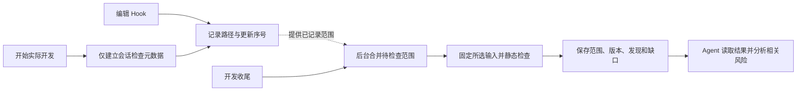

# 轻量 AI 编辑检查

默认开发检查以“尽量不影响开发节奏，发现本次 AI 编辑涉及的风险”为目标。它不再承担证明整个工作区所有前后变化均已审计的任务。

## 默认流程

普通聊天、只读操作、启动及普通 Stop 不触发扫描。编辑 Hook 只记录元数据，不扫描、不唤醒后台进程，不做全项目文件盘点、源码复制或全项目哈希。开发收尾才调度一次合并检查；结果读取只返回已保存状态，不隐藏地再检查一次。收尾后新增编辑保持待检查，写完再次收尾，不自动追扫下一版。

轻量工具与旧严格审计分开：`begin_development_check` 只建立元数据；`record_development_changes` 只补充明确编辑路径；`finish_development_check` 请求后台处理；`get_development_check` 读取保存结果。默认指导为 `development-check`，旧 `task-review` 方法只服务显式严格任务、历史延续与原生修复。

每次编辑立刻重扫整个任务累计范围会重复检查早期文件。默认在收尾合并一次，避免随着编辑次数增加而反复扫描；需要继续编辑时显式再次收尾，保证检查成本可理解。

## 为什么还保留所选输入的固定版本

扫描正在读取文件时，Agent 可能继续编辑。如果一个扫描器读取旧内容，另一个读取新内容，不能把两者合成同一版本结果。因此后台检查仍固定本次所选输入。这一步只针对实际检查范围，不是开发前的全项目基线，也不用于比较整个工作区前后变化。

仅有文件路径和行号不能证明所有安全风险已覆盖。行号会随编辑移动，Shell 可能无法给出可靠路径，删除文件也可能改变业务防护。因此记录将已观测范围、未知范围与扫描版本分别保留。无法确定范围时保留缺口，有可靠会话编辑记录时补录路径，不自动扩大到全项目。

## 成本与覆盖边界

| 环节 | 默认工作 | 不作出的证明 |
| --- | --- | --- |
| 开始开发 | 保存会话归属、检查引用等元数据 | 已取得全项目修改前状态 |
| 编辑 Hook | 只记录有界路径、事件去重与更新序号，不启动扫描 | 调用一定写入成功、行号仍然准确 |
| 开发收尾 | 调度后台合并范围，固定所选输入，调用可用静态组件 | 所有外部编辑或整个项目都已覆盖 |
| 结果读取 | 返回保存版本、发现、范围和缺口 | 已重新核验当前磁盘内容 |
| Agent 收尾 | 分析发现和安全相关改动，按需补读上下文 | 所有改前/改后窗口已完整审计 |

没有改前内容时不能可靠区分问题是本次引入还是已经存在；报告应描述实际发现。依赖输入、扫描组件或数据不可用时按实际范围说明限制。零发现不是安全证明。

已有严格任务、风险处置、授权与原生修复记录保持原样。不能用新的轻量检查关闭旧风险，不能把旧任务转换成轻量记录后宣称完整审计通过。全项目扫描和完整差异审计仍是显式选择。

以上是源码契约；安装包及运行中的 MCP 必须以实际构建能力为准。功能验证不等于 Codex 桌面整段对话耗时已完成验收，不能从单元测试推导固定加速比例。
