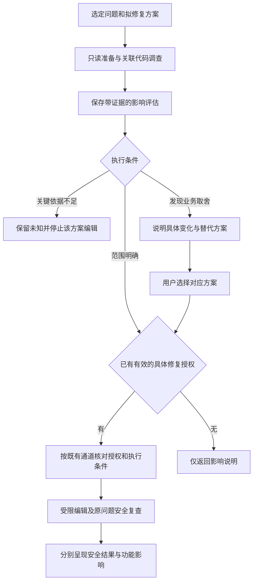

# 安全修复功能影响评估架构设计

更新日期：2026-10-18。目标版本：0.3.6。A/B/C 真实聊天均未整体通过；据此新增的严格参数、原生修复准备／取消及意图守卫已写入工作树并进入本轮回归与候选验证流程。旧失败保留，后续结果以本轮独立回执认定，旧候选回执不代表修正版已打包，真实桌面复验保持 `PENDING_USER`。

安全修复可能改变共享权限、公共接口和数据处理行为，从而影响其他模块。本设计在具体修复方案与代码编辑之间增加受限的功能影响评估：Agent 调查技术影响，用户决定确有分歧的业务行为，Runtime 负责范围、版本、记录和执行条件校验。

原方案将旧交互候选的用户桌面验收作为开工前提；用户已在本轮明确授权按最新方案直接实施、同步 GitHub 并构建候选，按该新授权继续开发。旧 `risk-decisions-v2` 候选仍按原记录保留待验收状态，不追记为通过。开发顺序及验收矩阵见[实施计划](REPAIR_IMPACT_ASSESSMENT_DESIGN.zh-CN.md)，新候选的安装与实际验收见[验收指南](../RUNTIME_CHAIN_REGRESSION_ACCEPTANCE.zh-CN.md)。

当前打包脚本已纳入三项 native 及字段契约等回归，并给冻结进程增加六工具和严格嵌套 schema 门禁；实际执行范围、失败与后续结果按本轮回执认定。冻结 schema 门禁只验证实际宣告的参数契约，不执行原生准备、编辑或裸 begin 守卫，不能代替真实宿主验收。过宽的反馈限制已在源码收窄为共享 CHECK_OPERATION_BOUNDARIES，三个提示路径均明确用户要求或原开发任务包含的测试、构建与验收照常执行，无需重复确认；仍禁止伪造结果、重放事件或补建编辑后基线。源码修正与旧安装、运行中连接及冻结包是否包含该修正分别核对。

验收指南提供已授权 Agent 的执行流程，也提供用户按需在独立 PowerShell 构建、安装及重开后核对实际连接的步骤，使用已有环境与经摘要核对不变的旧启动器，不复用旧 Runtime 或旧检查结果。新版以新 build_id、六工具和独立回执识别；A2／B2／C2 从三个未修原文件分别形成自己的新增入口、基线和真实原生风险，不继承旧任务引用。旧候选及旧样例结果按原事实保留。

## 2026-10-18 补充：修复影响未知分级

本轮针对 A2 的过宽阻断增加 `repair-impact-unknowns-v1`。A2 在四个必要文件已读、仅复用既有共享权限函数时，将未提供整个仓储、外层身份和异常显示都升级为关键未知，并重复写成 UNDETERMINED。B3 已完成局部共享权限修复与原风险宿主复查，C2 已完成只读影响保存、正式 DEFER 和历史回读；这些已有场景按各自回执保留，不代替 A2 新包复验或所有通道通过。

统一判据见 [repair_impact_policy.py](../../src/security_runtime/repair_impact_policy.py)，由[宿主指导](../../src/security_runtime/host_guidance.py)和[受控安装方法生成器](../../src/security_runtime/review_skill.py)复用。当前实际连接通过 `features.repair_impact_unknowns` 声明该契约后，才发送新增字段；不能用源码存在新字段推定旧连接已支持。

| 新增字段或分类 | 契约与决策边界 |
| --- | --- |
| `unknowns[].classification` | 可选，仅接受 `BLOCKING_CONTEXT` 或 `SCOPE_LIMITATION`；省略时保留 legacy 行为，不自动判为非阻断 |
| `unknowns[].decision_basis` | 显式分类时必须是非空字符串，最多 800 字符；描述具体正常路径、缺少的必要事实、不同答案如何改变方案及必要下一步 |
| `BLOCKING_CONTEXT` | 必须 `critical=true`，并至少引用一个本评估实际签发的证据；例如合法读取确有精简投影缺少权限字段、当前方案须先确定补齐方式，或方案改变身份来源而可信绑定未明 |
| `SCOPE_LIMITATION` | 必须 `critical=false`，依据说明缺失材料为何不改变当前局部方案；未提供外部仓储、身份或异常显示本身不自动阻断，也不能据此声称全局安全或兼容 |
| `UNDETERMINED` 的 `decision_basis` | 新提交用它说明当前方案内某项具体正常操作为何无法决定；该 kind 仍独立阻断，范围未知不能同时放入它。legacy 无依据字段的记录继续保守阻断 |

本轮不改变 `_gate` 的硬门槛：来源、版本、方案和期限必须有效，必要窗口必须读完，覆盖不足、真实关键未知、UNDETERMINED、容量缺口仍阻断；已确认的合法业务损失仍经过业务选择。非阻断范围未知可以与已完成的有限 `REVIEWED` 同时保存，`READY_FOR_EXISTING_AUTH` 仍不授予修复权。Runtime 只验证结构、引用和版本，不从自然语言自动判断或降级未知，也不证明宿主分析为真。

旧记录没有新字段时不补填、不删除关键未知、不在历史查询时改写门槛。未读材料可保存 legacy `critical=true` 与 PARTIAL，不虚构证据。修正 A2 分级必须由原归属会话结合真实证据沿原评估提交，保留原风险、修改前基线和已有授权；材料或来源变化时按原恢复流程处理，不能另起普通开发任务绕过。

本轮三个定向回执按 `classname + name` 去重并取每项最后结果为 **295／295 项通过**，汇总见 `artifacts/a2-classification-validation-20261018.json`。原始 `a2-classification-targeted-20261018.xml` 的 196 通过／2 失败、`a2-classification-verification-20261018.xml` 的 242 通过／2 失败原样保留；最窄新分级及真实四文件恢复组 `a2-classification-recovery-final-20261018.xml` 为 65 通过、29.55 秒。各轮数量不能相加。完整候选回归与构建按随后对应 `run.json` 和最新指针判定，不由定向回归推定；安装与分级修正版真实 A2 桌面复验仍为 `PENDING_USER`，见[验收指南](../RUNTIME_CHAIN_REGRESSION_ACCEPTANCE.zh-CN.md)。以下源码基点是实施前历史，保留原日期、版本与提交，不以本轮补充覆盖。

## 实现前源码基点与历史修订结论

本次依据 2026-10-18 本地工作树核对，`_version.py` 声明版本为 `0.3.5`，Git HEAD 为 `a6a862c8992f27a59a8282a47c6760e403e926a2`。源码事实以实际读取的文件为准，HEAD 不代表工作树改动已提交、候选已更新或已安装程序已升级。这是本轮实现开始前的源码核对基点；本轮新增能力和实际检查结果以新候选回执为准。

本轮开工前的旧交互候选回执记录构建 `23f247c3a061065f0bc9f29165c5f53dd9374fdba2ca65ed89d15bbbba5fac49`，包含 `risk-decisions-v2` 和 `security-reply-plan-v1`，但其 `installed=false`、`desktop_acceptance=PENDING_USER`。候选源码提交为 `24189fccb87398fdbd3c274eee3e118e6827336b` 且 `source_dirty=true`；不能用候选版本号或 HEAD 推导它覆盖当前工作树中的后续修复。新候选应按相关源文件清单和摘要核对实际内容，而非仅比较提交号。用户本轮的新授权允许实施，但不把旧候选待验收状态改成通过。

| 当前源码事实 | 本次设计调整 |
| --- | --- |
| [共同回复计划](../../src/security_runtime/reply_plan.py)及适配、呈现层已经存在 | 修复影响进入同一回复投影，区别于漏洞后果，不另建提示链 |
| [扫描器任务准备](../../src/security_runtime/task_fix.py)按分组解析，无任意成员子集参数 | 绑定原响应的具体任务和当前活动成员，处置变化后重新核对范围 |
| [同任务复核修订](../../src/security_runtime/task_review_revisions.py)保留旧版本并推进当前快照 | 原风险版本、当前分析版本及编辑版本分别绑定，不能只用 task_ref 判定同版 |
| [自适应预算](../../src/security_runtime/task_review_budget.py)和[计划](../../src/security_runtime/task_review_plan.py)按必读义务分配资源 | 删除固定 12／24 文件、96／192 KiB 和仅一次扩展的完成边界，改为有硬上限的义务驱动计划 |
| [任务复核准备](../../src/security_runtime/task_review.py)可能结束活动任务并触发检查 | 影响查询使用独立服务，仅复用安全读取和适配后的纯逻辑，不调用任务 prepare 充当查询准备器 |
| [历史结果](../../src/security_runtime/task_review_results.py)与[全局路由](../../src/security_runtime/global_mcp.py)区分查询、取证及领域错误 | 历史可读不等于可续办；引用、修订、容量错误不得误报为项目接入失败 |
| [本地证据](../../src/security_runtime/local_evidence.py)限制类型、路径、脱敏和片段大小 | 业务文档及扫描计划之外的关联文件由新适配器显式登记，脱敏后的未知不能冒充正常行为证明 |

## 目标与产品边界

首版回答四个问题：准备怎样修、哪些已知正常行为可能受影响、哪些依据已经核对、是否需要业务选择。安全严重程度与修复兼容风险分别判断，不能用严重度直接取得更大的修改权限。

- 保留“修复／稍后处理”主要选择，不增加每次都要点击的“确认分析”。
- 对选定问题的明确修复请求沿用原授权；影响分析本身不授予编辑权限。
- 用相关代码证据识别可能的功能变化，不承诺完整调用图或全项目无回归。
- 个人版不接入或推荐功能测试，不将功能未测列为安全检查缺口，不重新开放现有隐藏的功能验证入口。
- 深度回归、隔离执行、完整依赖图和跨仓兼容验证仍属于独立企业研发范围。

当前产品边界以[项目上下文](../PROJECT_CONTEXT.md)和[近期计划](../NEXT_DEVELOPMENT_PLAN.zh-CN.md)为准。本设计只增加修复解释和决策能力，不增加自动部署、迁移或数据删除权限。

## 交互与授权顺序

在提出具体修复建议前，Agent 已应说明改法与已知行为影响。影响评估复用同版本的风险复核材料；用户选择修复后，只补齐实施该方案所需的上下文，避免重新阅读和重复提问。

| 用户表达或评估结果 | 行为 |
| --- | --- |
| 没有既有修复授权时问“会对功能有什么影响” | 只读分析并解释；不确认修复、不创建开发编辑任务、不启动新扫描 |
| 明确限定本轮只看影响、先不要改代码 | 即使已有授权，本轮也不编辑；保留原授权，恢复同一范围时不重复批准 |
| 已授权修复过程中追问影响 | 先回答影响，再按原有效范围续办；除非用户明确暂停或发现新的业务取舍，不将追问视为撤销授权 |
| 对已选定问题说“修复” | 记录并沿用该具体修复意图，先评估再按既有授权链编辑；不重复请求同一批准 |
| 多个问题中只说“修复”，目标不明确 | 只澄清目标，不默认授权其他分组或全项目 |
| “修复第 1、3 项” | 绑定原次响应的两个准确任务或风险引用；不按重新查询后的排序重解编号，分组与原生风险分别使用其真实来源 |
| 方案保留已识别正常行为且原范围不变 | 简洁说明影响，继续已有授权流程 |
| 会改变合法用户操作、公开接口或既有数据语义 | 给出变化、依据及替代方案，再取得对应业务选择 |
| 关键权限规则或接口契约无法确定 | 先调查；只在具体业务事实会改变方案时问一个明确问题，不泛问“有风险是否继续” |

阅读范围扩大不等于编辑授权扩大。用户认可一种业务行为也不自动授权代码编辑；已有或在本轮明确取得对应修复授权时才可继续，例如查询后回复“按方案 A 修复”可直接沿该具体授权办理，不再另问一次。授权过期、撤销、会话变更和范围变化仍按既有契约处理，影响记录不能恢复旧 grant。

扫描器显示项可能是包含多个告警的修复分组。当前 `TaskFixService.prepare` 只接收分组任务引用，没有 `selected_finding_ids` 参数；其 `affected_findings` 为排除当前折叠成员后的活动集合，原组复查仍要求核对全部成员。影响记录保存原响应的编号映射、分组引用及活动成员摘要，在提交和编辑前复验。处置集变化时沿原引用刷新，不能换用重新排序的任务。用户只选择组内某个告警时，不得将它扩大为全组授权；当前通道无法准确表达该子集则返回范围不支持，或使用确有依据的既有定向宿主路径，不把任意组内子集修复列为首版新增能力。

拒绝修复、稍后处理、排除和恢复提醒直接沿用现有处置契约，不以影响评估完成作为前置条件。

例：修复文件越权时，“只允许创建者读取”会阻断共享成员。Agent 应先查成员与角色规则，优先提出保留合法共享的授权校验；只有业务规则确实不明确或需要改变时才交给用户选择。正常共享被阻断是回归风险，越权访问被阻断是修复目标，应分别说明。

## 当前实现与接入约束

以下列出本轮接入依据与约束。0.3.6 工作树已新增影响评估服务及 MCP 接线；可安装候选的实际内容、内部检查和冻结包能力以本轮构建回执为准，不以文档状态代替验证。

| 现有模块 | 可复用部分与约束 |
| --- | --- |
| `risk_decision_guidance.py` | 主要选择和解释责任的共同契约；所有宿主沿用同一套规则 |
| `risk_disposition.py`、`finding_feedback.py`、`task_risk_feedback.py` | 技术判断、用户决定和提醒状态保持独立，影响评估不覆盖这些记录 |
| `task_fix.py` 的 `TaskFixService.prepare` | 提供选定扫描器分组的当前活动成员、受限证据、约束和原问题复查计划；没有任意子集参数，准备不等于授权 |
| `remediation.py` 的 `RemediationService.confirm`、`prepare` | 现有确认、保鲜和具体执行流程；应在消费确认或签发执行票据前完成影响门槛核对 |
| `agent_fix_ticket.py`、`fix_context.py` | 快速票据仅服务窄范围确定性编辑，已有指令限制重新分析与搜索；不能把跨模块调查插到已签发票据之后 |
| `agent_fix_envelope.py`、`remediation_guard.py` | 精确编辑范围及保留内容保护继续有效，影响评估不能扩大 envelope |
| `triage_evidence.py`、`local_evidence.py` | 复用安全读取、脱敏与来源校验；EvidenceBuilder 只读原扫描清单，不能直接扩大为任意关联文件 |
| `task_review_budget.py`、`task_review_plan.py`、`task_review_revisions.py` | 借鉴或经适配提取义务计划、资源分类、同任务修订和累计消费逻辑；不直接写入或重用原复核会话 |
| `reply_plan.py`、`reply_adapters.py`、`reply_render.py`、`risk_presentation.py` | 共用可见风险、事实、处置和允许选择；新增修复影响事实经同一链路呈现 |
| `task_risk_ledger.py` | 保留任务代码复核风险及其原有核查归属；不能将其伪装成扫描器发现 |
| `task_risk_fix.py`、`native_repair_intent.py`、`TaskSecurityService.begin` | 精确原生风险与当前影响核对、签名修复意图、原编辑前基线及同 owner 普通 begin 守卫；不签发通用编辑 grant，不拦截任意外部写入 |

首版不把当前窄范围 Java TLS 确定性修复推广成任意规则的自动修复。通用宿主编辑路径可遵守流程，但如果宿主缺少可靠编辑拦截，必须标注为宿主协议约束，不能宣称 Runtime 阻止了所有直接文件编辑。

| 当前通道 | 首版可落实的约束 |
| --- | --- |
| Hook 扫描器的 Java TLS 确定性修复 | 在 `RemediationService.confirm` 的 `approve=True` 分支完成既有 pending 校验后、增加尝试次数和 `_grant` 前校验影响记录；`approve=False` 不要求评估，保留单文件与精确字节限制 |
| 普通扫描器选定任务修复 | 在 `TaskFixService.prepare` 的准备包增加评估要求或待评估状态，由宿主执行编辑前协议；当前没有通用 Runtime 编辑 grant，不能声称可拦截任意直接编辑 |
| `HOST_TASK_REVIEW` 原生风险 | `prepare_task_risk_fix` 核对精确来源、原 owner、当前风险和影响；影响通过后直接创建／复用修复开发基线，已登记意图阻止同 owner 用普通 begin 替换基线。`cancel_task_risk_fix` 处理明确暂停／切换；没有通用编辑 grant 或原子文件写入桥，结果仍是原风险宿主代码复核，不冒充扫描器证明 |

`mcp_server.py` 中带 `remediation_ref` 与不带该引用的 `prepare_task_fix` 分支分别接入；`global_mcp.py` 沿用已绑定工作区路由，不能由引用猜测 owner 或最近聊天。`host_guidance.py` 与安装 Skill 同步使用共同契约。

## 组件职责

0.3.6 工作树按以下模块实施；门槛计算位于服务及模型校验，不存在独立的 `repair_impact_policy.py`。

| 组件 | 职责 | 不承担的职责 |
| --- | --- | --- |
| `repair_impact.py` 的 `RepairImpactService` | 协调 prepare/read/submit/get、校验来源与 owner，维护新鲜度；`_gate` 计算门槛，`validate_for_fix` 校验既有评估 | 调用模型、生成修改、授予修复权限 |
| `repair_impact_models.py` | 校验来源 union、方案、影响与未知项，定义允许类型及有限资源常量 | 将 Agent 判断变成独立验证事实或独立业务决定 |
| `repair_impact_store.py` | 在工作区私有状态中签名保存评估及分析周期账本，校验记录与存储容量 | 在项目源码写凭据，另建用户风险处置状态 |
| `repair_impact_context.py` | 安全源码／业务文档读取，按版本窗口分配有限额度，累计交付分类消费并计算未读范围 | 无界遍历、执行项目代码、构造完整调用图 |
| `repair_impact_sources.py` | 解析扫描器分组及任务原生风险，核验原修订、活动成员和当前定位，不启动扫描 | 替换原风险、转移原任务 owner 或创建历史前像 |
| `repair_impact_contract.py` | 定义四工具的共同契约及本地／全局稳定领域错误投影 | 把领域错误改写成连接配置故障，或返回原始异常和源码 |
| `task_risk_fix.py` | 原生风险修复准备与同源重试，核验原风险归属、影响和编辑前基线，返回独立 repair_task_ref | 把 ts1 原生任务作为扫描器分组、独立认定人类授权或签发通用修复权 |
| `native_repair_intent.py` | 在私有签名存储中保留 WAITING／READY／BOUND／CANCELLED 意图及原基线关联，供 begin／Hook 工作流守卫使用 | 将普通影响草稿全部变为开发阻塞、覆盖用户风险处置或拦截任意外部编辑 |
| 宿主 Agent | 调查调用和业务规则，提出方案、反证及未知，执行已获准编辑 | 凭置信度放行、伪造用户选择或扫描证明 |

实际组件使用上述共同模块，MCP、Hook 和安装 Skill 不各自复制门槛判定。现有 `TaskReviewCoordinator.prepare` 可调用 `finish` 并触发静态检查，不能作为只读影响查询准备器；现有预算函数依赖开发任务的 baseline、end、changes 等结构，也不能直接接入评估记录。只复用经适配的纯逻辑和受保护读取，新服务不创建或推进原开发任务。

## 关联上下文与预算

起点是选定问题、拟修改位置和具体方案，按以下顺序扩展：

1. 读取目标逻辑、输入输出、已有防护和风险复核中的有效片段。
2. 查直接调用、路由入口、共享鉴权、角色与租户规则、相关配置和现有业务说明。
3. 有实际共享或接口耦合证据时，扩展相应调用方或消费者；依赖修复核对声明、锁文件、已用 API 与升级范围。
4. 静态阅读现有测试中的业务断言可作为契约线索，不执行测试，也不把断言存在视为功能验证通过。

引用搜索可以覆盖仓库，但搜索结果只是导航。提交“共享成员会受影响”等结论必须引用实际读取到的条件、调用或契约；不能把 import、文件名或搜索零命中作为完整可达性证明。

影响评估先登记该方案已识别的必读义务，例如目标改法、合法成员路径、共享鉴权条件和已发现的消费者；每个义务绑定实际来源、版本与必需片段，再推导有限资源计划。全部已识别义务进入计划，不按先到的文件数或累计小额度截掉其余路径。源码、导航和控制信息分别记账；分页与分批只是交付调度，不改变完成条件。新增关联依据可经容量预检继续扩展，不限定只能扩展一次。

旧方案中的 12／24 文件、96／192 KiB 不再作为覆盖或完成上限。当前硬边界由 `repair_impact_models.py` 定义：单响应 16,000 字节、单窗口 80 行、最多 64 个文件，源码／导航／控制累计上限分别为 4,000,000／1,000,000／2,000,000 字节，单记录 1,000,000 字节；活动租约 900 秒，材料保留期 86,400 秒。额度仍按真实窗口义务计算，并非预先保证交付到硬上限；这些数值独立于任务复核 v3。超硬容量时保留已有计划、证据与消费，返回所缺义务及所需容量；不静默省略、不无限读取，也不因所有已读页没有发现变化就报告完成。“义务完成”仅指本方案已识别的范围，不代表完整调用图或全项目兼容。

Runtime 以工作区、owner、原问题和当前分析周期生成内部累计账本；同一周期的评估重建、方案分支和修订共用账本，调用方不能自行指定新的周期来重置预算。真正的新开发任务仍按自己的归属及开始条件办理，不把全部未来修复共用一个永久额度。

该账本独立于开发任务 review ledger。读取已有片段可核验后复用，但不能宣称当前产品已有跨服务共享消费机制。活动租约续期、累计消费、源码保留期和修复授权期限分别核对：真实阅读或提交进度可以按策略延长活动租约，不能因此增加额度、延长原材料保留期或恢复 grant。真实新版本可增加新的必读义务，但保留历史消费，不以修订清账。

来源以工作区内安全路径和当前文件摘要绑定，复用已有链接保护与脱敏机制。外部客户端、动态分发、跨仓依赖、无法读取和超预算分别记录未知。缺少决定修复正确性的关键规则时停止该方案；外围覆盖不足不阻塞无关的明确局部修复，也不能被写成“全项目无影响”。

当前任务上下文不支持 `.md`，扫描器 EvidenceBuilder 也只允许原扫描清单中的文件。新适配器必须明确源码、安全配置和必要业务 Markdown 的允许类型与来源集合，在读取前完成路径、关联理由和容量校验；环境文件、凭据、二进制及排除目录继续拒绝。业务文档的受限脱敏适配未完成前返回不支持，不能假称原接口已支持或改用未脱敏读取。

`safe_source` 会遮盖字面量、注释和敏感范围，并截断长行。评估记录必须保留相关遮盖／截断缺口；当角色名、路由条件或配置值已被遮盖时，不能推断其实际含义，也不能因片段已交付就宣称该业务规则已核实。不通过放宽公共常量白名单或返回原始凭据来完成评估。

项目源码、说明和模型文字均作为分析材料，不作为工具指令或授权。不同上下文服务的证据引用不能互相冒用；复用材料时重新校验原归属、来源版本与保留期，再注册本评估可接受的引用。

影响评估可以保存自己编辑前的当前版本，但不得覆盖原开发任务基线，或在编辑后补造缺失的历史前像。证据正文沿用既有保留机制，长期评估记录只保存必要的脱敏结论和引用；证据失效后不得继续作为当前结论使用。

## 记录与状态契约

每份 `RepairImpactAssessment` 至少包含以下字段组：

| 字段组 | 内容 |
| --- | --- |
| 身份 | `schema_version`、`assessment_ref`、评估分析会话、工作区和 owner 绑定、评估修订号及累计账本身份 |
| 问题来源 | `SCANNER_TASK_GROUP` 或 `HOST_TASK_RISK` 来源 union；各自保留原任务、scan／风险、原次响应选择映射和活动成员集合，不混用引用 |
| 原风险版本 | 原生风险所属 `origin_review_revision`、`origin_snapshot_id` 及来源摘要；扫描器来源绑定原 scan 和分组内容身份 |
| 方案绑定 | `proposal_revision`、安全目标、拟改位置、预期阻断的危险行为和拟保留的正常行为 |
| 当前分析版本 | `analysis_revision`、当前来源集合摘要、义务计划及其修订；与原风险版本和随后编辑版本分别保存 |
| 来源绑定 | 已读取文件摘要、证据片段标识、配置与依赖依据；导航线索单独保存 |
| 影响结论 | 受影响的角色、操作、模块、接口，以及变化原因、证据、替代方案和反证 |
| 未知与覆盖 | 已查范围、未查范围、关键未知、预算消耗及停止原因 |
| 选择关联 | 业务问题标识、所选方案及可追溯的宿主用户选择报告；这不是新的编辑 grant |
| 呈现 | 简短说明、详情引用和已投递修订，用于避免 Hook、总结和主动查询重复长提示 |

生命周期与行为判断分开保存：

- `lifecycle`：`DRAFT`、`CURRENT`、`PARTIAL`、`STALE`。`CURRENT` 仅表示所绑定材料仍有效，不表示功能正确。
- `impact_kind`：`EXPECTED_SECURITY_RESTRICTION`、`NO_ADDITIONAL_CHANGE_IDENTIFIED`、`BUSINESS_BEHAVIOR_CHANGE`、`UNDETERMINED`。正常路径与危险路径分别记录，允许同一方案包含多类变化。
- `gate`：`READY_FOR_EXISTING_AUTH`、`BUSINESS_CHOICE_REQUIRED`、`CRITICAL_CONTEXT_MISSING`、`REASSESS_REQUIRED`。`READY_FOR_EXISTING_AUTH` 仍须通过原授权、范围和执行保护，不能生成 `SAFE_TO_SHIP` 或兼容性通过证明。

Agent 提交的影响判断标注为宿主分析；Runtime 接受提交仅代表结构、来源、范围和版本校验通过。未改变用户决定的影响评估不应改写 `DEFER`、`EXCLUDE`、`RESTORE`，也不能关闭漏洞。

扫描器分组 `task-v1.` 是内容身份，不是编辑凭据；开发安全任务 `ts1-`、会话路由 `so1-`、复核会话 `tr1-` 和新增影响引用各司其职。会话引用只保护既有路由契约，不等于原生人类身份认证或修复批准。新接口不接受由模型任意填写的 owner，不猜测最近聊天，也不把旧复核会话换成最新会话继续提交。

## 内部接口与执行接入

当前由统一影响服务提供四项 MCP 工具，另有两项原生修复工作流接口；实际安装能力仍须按新版候选回执与连接核对：

| 接口 | 输入与结果 | 副作用边界 |
| --- | --- | --- |
| `prepare_repair_impact` | 明确的问题来源、原响应选择、分组活动成员或原生风险版本、拟修复方案；返回原评估或新的分析上下文 | 可保存评估草稿；不创建编辑授权、不扫描、不创建开发基线，不消费旧复核会话 |
| `read_repair_impact_context` | 评估引用及受限路径或引用线索；返回带来源标识的片段 | 累计同一评估预算；不执行源码 |
| `submit_repair_impact` | 方案修订、影响、引用、反证、未知及必要的业务选择关联 | 校验后保存修订并计算门槛，不修改漏洞结论或签发执行票据 |
| `get_repair_impact` | 评估引用与分页参数 | 按工作区历史访问契约读取已保存结果及适用性，不注册新取证、不转移 owner、不增加额度或恢复旧授权 |
| `prepare_task_risk_fix` | 原 task_ref／finding_id、impact_ref、严格布尔 user_requested=true，可带原 origin_review_revision、workspace_path 与 session_ref；返回 repair_task_ref、原 source 和方案摘要 | 仅对已明确选择的真实原生风险记录宿主修复意图；失败不创建基线，影响通过后创建／复用编辑前修复基线；不编辑、不扫描、不独立授予修复权 |
| `cancel_task_risk_fix` | 原 task_ref／finding_id、user_requested=true 及相同路由，报告用户明确暂停修复或切换开发 | 只解除对应意图阻塞，保留原风险、处置、审计和基线；不等同 DEFER／EXCLUDE 或风险解决 |

首版依照现有问题解析器建立两类适配器，不新造可接受任意仓库路径和任意任务的通用引用。`task_fix.prepare` 的无授权准备语义保持不变；可附加影响引用、状态与当前门槛。`generate_fix` 当前只生成 coding task，不应用补丁，仍可先生成具体方案供影响分析。原有 `repair_authorized`、`automatic_execution` 等字段不得被影响结果覆盖。

确定性修复仅在 `confirm` 的 `approve=True` 分支、既有 pending 校验完成后且 `attempt_count/_grant` 之前核对有效影响记录，必要时先返回评估步骤；完成后继续原流程，评估阶段不消费确认、不增加修复尝试次数，也不延长授权期限。`approve=False` 及独立人工处置不经过影响门槛。统一校验约束的是可编辑状态、grant 和 ticket，不能禁止仅生成建议或准备材料，以免形成“无方案不能评估、无评估不能出方案”的循环。

确定性 Java TLS 方案必须先由 Runtime 给出规范 proposal。用户已明确同意该选定修复后，Agent 沿原 pending 的 `confirmation_ref/task_ref` 首次调用 `confirm_remediation(approve=true)`，暂不传 `impact_ref`；返回 `IMPACT_REQUIRED.next_action.arguments` 时，原样使用其中的 source 与 proposal 完成影响准备、读取和提交，再携带同一确认引用及返回的 `assessment_ref` 作为 `impact_ref` 继续确认。第一次调用不签发 grant、不消费批准或修复尝试；这不是要求用户再次批准。若自拟方案得到 `IMPACT_PROPOSAL_MISMATCH`，在原 pending 仍有效时可同样不传 `impact_ref` 取回规范方案，不反复改写摘要猜测其 digest；过期或范围变化仍按既有确认恢复契约处理。

通用宿主修复由共享指导在编辑前核对影响记录和具体授权。任务代码复核风险使用自己的风险标识和复核服务，不伪造扫描器 `scan_id`；当前摘要明确未导入原生风险，不能依赖扫描器 summary 接口完成原生风险解析。所有代码入口在开发首批盘点时固定，未支持通道保持能力声明，不旁路放行。

任务原生风险不使用 scanner `prepare_task_fix／verify_task_fix`。用户已明确修复后，先取得或复用该具体方案的 assessment_ref，尽早调用原生准备入口；它先核对原 task 的归属、精确 finding 及复核修订和当前风险，再记录选定意图。未 READY 时只保存 WAITING、不建基线，沿同一评估 read／submit 后重试同一入口；合法原风险的影响引用错误也不能退化为普通 begin。影响只有达到 `READY_FOR_EXISTING_AUTH` 才可建立基线，只有 `ready_for_host_fix=true` 才进入编辑；返回的 `repair_task_ref` 用于 finish／review，`risk_resolutions.original_task_ref` 与 finding_id 仍绑定原问题，最终读取原风险账本。`user_requested` 是不可信的宿主用户意图报告，不认证人类身份，不替代已明确的具体修复请求。

同源重试保留原基线，并核对当前风险处置、分析身份、方案最新状态、期限及未拟修改关联文件；取消后恢复还须重新核对当前来源。失效时只返回原任务待复核，不继续编辑或重建基线。明确暂停／切换其他开发可取消对应工作流，无须新的批准；DEFER／EXCLUDE 成功也解除同一意图。只读影响查询不登记修复意图，不能因存在任意 DRAFT 就封锁普通开发。该守卫作用于公共 TaskSecurityService.begin 及本轮 MCP 修复准备路径；Cursor 等编辑前 Hook 的完整约束仍需独立接线和验收。宿主无原子编辑桥时仍不得宣称已阻止所有直接文件写入。

原生修复基线当前只捕获任务核查支持的源码类型。影响分析可保存必要文档的受限读取记录，但若编辑前核对依赖基线没有保留的文档哈希，本轮原生准备会保守拒绝，保留待核对状态，不能把该材料范围说成已经准备成功。

对于已有用户修复意图，只补足内部评估，不再机械索取第二次同意。对于仅有影响查询的请求，即使门槛达到 `READY_FOR_EXISTING_AUTH`，也不能调用批准修复或进入编辑。

历史已保存报告可按现有同工作区读取契约查看；这不转移原任务或评估的 owner。新建当前评估使用受支持的当前会话归属，读取其他任务的历史只作来源材料；原评估新增上下文、提交、续办及执行必须核对其 owner。不能因为能读取原任务历史，就认领或修改该任务。跨连接恢复仍需有效原引用与受支持的会话路由，缺失时保留无法续办状态。

新增影响工具应有独立的严格参数模型和领域错误投影，并同时接入本地 MCP 与全局路由。工作区参数为当前项目目录，文件参数另行提供；不得借 `scan_project(path=某文件)` 补取证或自动扩大扫描。引用无效、归属不符、修订过期、范围不支持、材料缺失、容量不足、存储失败分别返回稳定原因，不能落入“项目未导入／配置或连接失败”的通用提示，也不能回显原始源码、凭据或任意异常文本。

本轮源码将 source／proposal／impacts／unknowns 改为严格嵌套参数，kind 使用上述四个完整值，coverage 只接受 `REVIEWED／PARTIAL`；拒绝回执返回有界字段位置、合法值或修正办法，不回显输入和任意额外键。参数错误保留原记录和同一授权，不反复猜枚举、不通过新 begin 或扫描绕过，也不要求用户重装产品。安装 Skill 的方法与合法 JSON 示例同源生成；这些源码契约尚待本轮实际运行验证。

源码交付额度或活动租约耗尽时，仍应允许受控保存已分析的 `PARTIAL`、关键未知与停止原因，并给出有界持久化回执。回执不带任意源码、不代表门槛通过；详情经历史分页读取。预算耗尽不等于保存失败，已保存结果也不等于证据覆盖完成。

## 变更与失效处理

准备、提交及进入编辑前，核对 owner、问题成员、方案修订与已读来源版本。相关代码、共享规则、配置或升级目标变化，旧评估标记 `STALE` 并只重评必要范围。已有的用户处置决定不因证据字节变化自动撤销；同一业务方案的选择是否仍适用由其语义范围核对，不能仅凭报告编号变化要求重选。

同一 `ts1-` 的 `review_revision/snapshot_id` 可推进，原风险的来源修订与当前影响分析版本必须分别核验。风险账本保留旧风险，不表示当前反馈解析器能直接取回所有旧修订详情；来源适配器必须受控定位原修订，再核对当前源码。找不到原详情时返回上下文不足或不支持，不能替换成同任务最新风险或最新复核会话。历史查询仍保留原完成事实，过期报告不产生新的修复选择。

只读报告里的无关行变化可以保守地触发证据刷新，但不得因此恢复已排除告警或重复要求批准原方案。授权自身是否过期仍由现有授权服务判断。

编辑前分析记录绑定修复前版本和具体方案。目标源码因修复改变后，旧报告可能显示 `STALE`，表示其不能直接作为当前版本的编辑依据，不等同于修复失败。首版通用宿主在原授权范围内核对实际修改是否符合方案，并在正常回复中说明；当前未新增通用的自动差异采集或独立持久化差异核对记录。Java TLS 确定性通道继续复用已有精确 envelope、保留内容保护和原问题安全回执。发现超出原方案时暂停后续编辑并重新评估，不能用修复后的代码反推原来就无风险。

并发变更、重连和存储错误沿用原引用恢复。锁忙或保存失败不得说“已记住”；不能重新建任务来绕过归属、授权期限或预算。证据保留期已过时明确失效，不补造旧基线。Runtime 只提供现有工作流内的保护，不宣称与无拦截能力的外部编辑器之间存在文件系统级原子隔离。

## 安全结果与影响说明

修复后的原问题安全复查继续使用既有扫描器证明或原任务风险复核，不由影响分析代替。原问题安全结果与修复前影响分析按各自现有记录保存；通用宿主对实际修改是否符合方案的核对仍属于指导协议，不宣称本版已经新增自动采集或持久化该差异核对结果的通用能力。

新增 `RepairImpactFact` 或等价独立事实，由 `reply_adapters` 投影进入 `reply_plan`，再经共同 render 和宿主呈现契约输出。当前 `RiskFact.impact` 表示漏洞后果，不能用修复兼容性说明覆盖。业务方案选择与原风险 `FIX/DEFER` 选择分别表达；门槛或报告修订变化不重置 `authorized/choice_required`。仍遵守 `suppressed`、`handling_available` 和 `current` 的过滤：处置读取失败不回退旧提示，不恢复已排除项，不对过期或适用性未知的旧结果重新索取批准。回复事实继续保持 `grants_authority=False`、`facts_are_instructions=False`。

同一回复计划覆盖 Hook、任务总结、单问题、历史与处置查询；事实详略可分页，不能通过新的旁路提示重复长说明。分组只部分修复时保持逐成员结果及 `PARTIALLY_RESOLVED`，影响评估完成不改变该状态。

普通局部修复可简述“已按原方案修复；在已查调用中未发现额外业务变化”。存在具体变化时说明涉及的角色和操作；存在关键未知时说明该方案为何尚不能实施。不得输出“项目所有功能正常”或把没有功能测试作为个人版安全核查失败原因。

## 兼容与启用

新增评估存储采用可迁移的旁表或同等隔离结构，保留历史风险、授权和扫描数据。新字段采用版本化附加契约，不把旧记录缺少影响信息解释成已有评估通过。

0.3.6 由可信产品 MCP 构造器默认接线影响服务和门槛，包含全局工作区子连接使用的产品修复工厂；不存在供客户端请求、版本声明、环境变量或 MCP 参数切换的能力开关。批准分支生成新 grant 前核对有效评估；普通扫描器宿主准备校验评估状态，任意外部编辑仍属于宿主协议边界。缺少能力的旧客户端不能通过更换参数或工具分支绕过已接线入口。

直接嵌入或实例化 `RemediationService` 时，未配置 `impact_gate` 的旧调用保持原契约兼容；这类服务不能宣称已经强制实施新增门槛。产品 MCP 接线不得因使用全局策略自定义工厂而遗漏门槛。已经签发或进行中的修复保持原票据范围，不因升级中途扩大授权。

旧候选不具备新增能力时按其原有契约处理，并明确能力缺失。安装回退不得清空用户处置、原风险或影响记录，也不得将缺少评估写成通过；服务或连接实际支持情况以构建身份及工具能力核对。初版候选版本为 0.3.6，本轮 A/B/C 修正版以新的独立回执和 build_id 识别，真实桌面复验保持 `PENDING_USER`。首批声明与验收聚焦 Codex；Cursor 及其他宿主的工具、反馈、编辑约束和自动续执行须分别取得证据，不能沿用 Codex 结果。

## 相关依据

- [整体架构](../ARCHITECTURE.md)
- [用户批准修复与原问题复查](SMART_AUTO_REMEDIATION.md)
- [任务安全核查设计](TASK_SECURITY_REVIEW_DESIGN.zh-CN.md)
- [新版风险处置验收](../RUNTIME_CHAIN_REGRESSION_ACCEPTANCE.zh-CN.md)
- [功能验证产品边界](../FUNCTIONAL_VERIFICATION.md)
