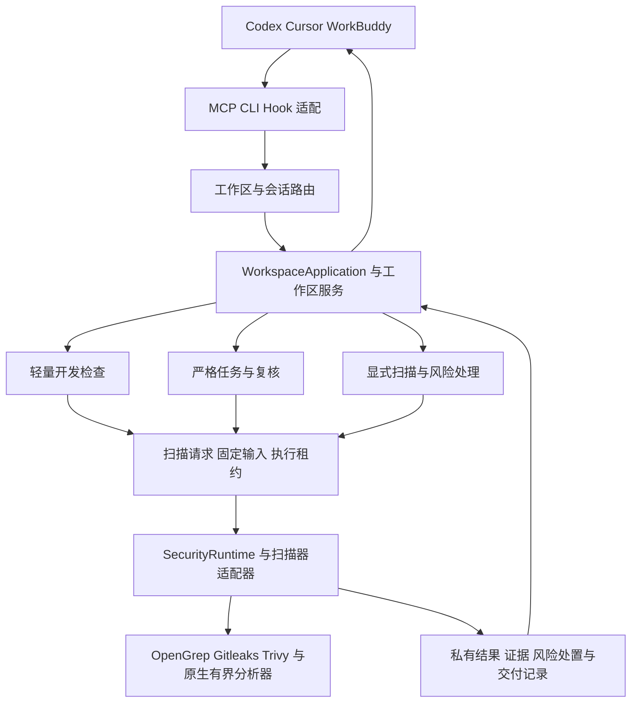

# 当前开发架构

AI Security Runtime 为 AI 编程宿主提供本地安全检查、证据读取、风险处置与修复复查。宿主 Agent 负责模型分析和用户沟通，Runtime 负责输入边界、扫描器执行、状态与证据持久化。默认开发过程只记录编辑路径，在收尾时合并检查。

上述为默认宿主协作链路。另有 `triage_providers.py:OpenAICompatibleProvider` 的 BYOK 模型通道，需要明确允许外发代码上下文；它不是 Runtime 调用宿主模型，也不由普通开发检查自动启用。

## 分层与主链路

| 层 | 代码入口 | 职责与边界 |
| --- | --- | --- |
| 产品命令 | `src/security_runtime/cli.py:main` | 参数与结果呈现，调用领域服务；不另写一套扫描语义 |
| MCP 协议 | `mcp_server.py:create_server`、`mcp_contracts.py:MCPRegistry`、`mcp_tools/` | SDK、原始输入校验与工具声明；不以协议校验代替业务授权 |
| 全局路由 | `global_mcp.py:GlobalWorkspaces`、`global_workspace.py`、`workspace_binding_status.py` | 明确工作区、验证配置、会话归属及连接绑定；不从最后一个项目猜目标 |
| 应用装配 | `workspace_application.py:WorkspaceApplication`、`workspace_services.py` | 组合运行时、Hook、任务及修复影响门槛；领域服务不依赖 SDK 对象 |
| 普通开发 | `development_check.py`、`development_file_watch.py`、`development_check_worker.py` | 路径观测、版本序号、收尾、后台执行及保存结果 |
| 复核与交付 | `development_risks.py`、`development_delivery.py`、`development_stop.py` | 候选复核、业务审计、原版本交付及有界续接；读取不证明用户看到 |
| 严格任务 | `tasks/`、`task_review/` | 明确请求下的任务、固定证据、复核窗口与覆盖；不替代轻量默认流程 |
| 执行核心 | `runtime.py:SecurityRuntime`、`scanners.py:ScannerRegistry` | 选择适用适配器、聚合结果与覆盖信息；不调用宿主模型 |
| 执行一致性 | `scan_request.py:ScanRequest`、`scan_attempt.py:ScanAttemptExecution` | 绑定输入来源、租约、取消和发布条件；重试不能发布过期结果 |
| 存储 | `storage.py`、`tasks/`、`risk_disposition.py` | 各领域保存自身事实与版本；不把数据库写成功当作风险已消除 |
| 安装交付 | `personal_install.py`、`delivery.py`、`distribution/build/launcher.c` | 包完整性、活动构建、宿主配置与实际启动器验证 |
| 指导 | `guidance/`、`skills/`、`review_skill.py` | 版本化方法及 Skill 生命周期；安装指导不升级运行中的进程 |

表中未带目录的模块均相对 `src/security_runtime/`。精确声明位置见 [符号索引](SYMBOLS.json)。

## 普通开发时序

1. 宿主验证当前工作区与会话；读取状态不开始扫描。
2. 实际开发开始时沿已有检查引用记元数据；原生 Hook 和文件通知只记录路径。
3. 收尾停止本轮观测、合并已记录路径并提交固定版本后台检查。
4. 查询或等待沿原引用读取状态。新编辑产生新输入版本，旧结果不能代表新版本。
5. 根据 `analysis_requirements` 分别进行扫描候选复核和业务逻辑审计；证据读取与判断保存分开。
6. 用户处置、授权修复、原问题复查各自保存；零告警不关闭旧问题。

## 安装与运行是两条链路

源码经 `scripts/build/build_standalone.py` 生成原生目录包。安装器验证清单和文件内容，把包放入版本槽位，再激活受校验的指针与固定启动器。宿主配置指向启动器，启动器验证实际活动包后运行 Runtime。

`version` 标识产品版本，`build_id` 标识构建。相同版本可对应不同源码内容。宿主驻留 MCP 进程不会因磁盘指针更新自动替换；需要重连并读取当前连接身份。组件缓存和漏洞数据准备是另一项就绪状态。

## 目录职责

`src/` 是产品实现，`tests/` 是回归与语料，`scripts/build/` 和 `scripts/release/` 负责构建及发布，`scripts/performance/` 负责测量，`website/` 是用户文档站与下载脚本。`dist/`、`build/` 和系统临时目录不是源码事实入口。第三方 `rules/` 通过规则目录与许可边界管理，不逐条复制进本知识库。

开发复核由宿主交付本轮开发摘要和已保存的安全报告。路径来源、重复告警关联、纯删除输入分别在事件收集、风险事务和扫描执行层处理；各工作目录使用自己的检查记录。大仓库与多 worktree 的验收范围见[开发场景验收](DEVELOPMENT_ACCEPTANCE.md)。
